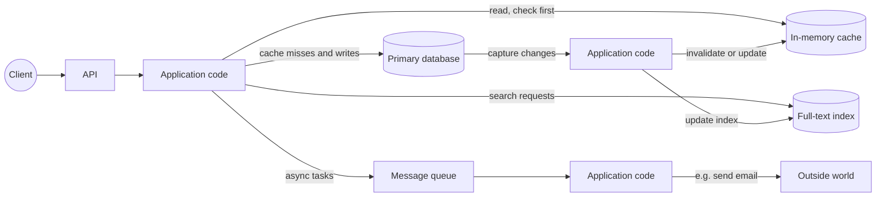
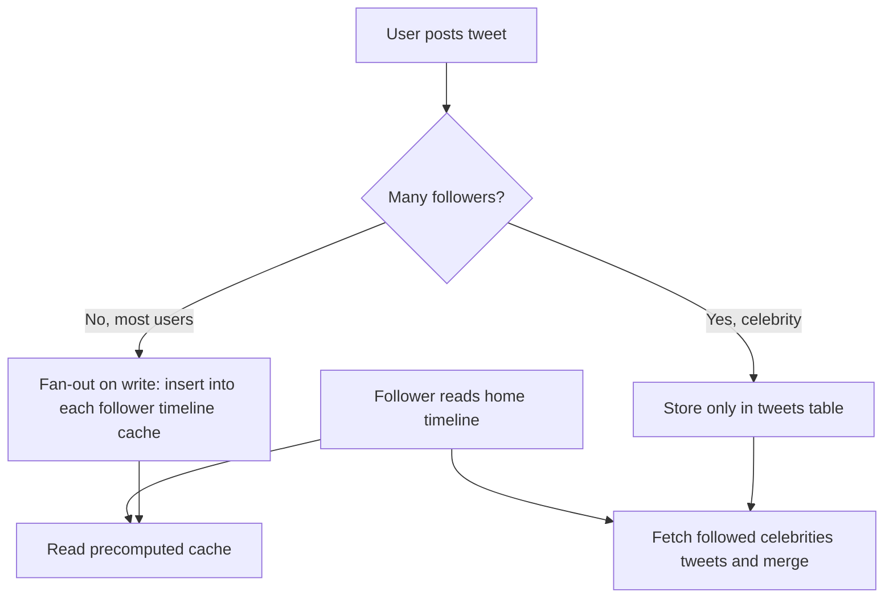

---
tags:
  - ddia/chapter-01
  - system-design/fundamentals
date: 2026-11-21
---

# Chapter 1: Reliable, Scalable, and Maintainable Applications

Reader: a backend engineer who knows databases basics and wants a fast refresher.

**Summary.** Modern applications are *data-intensive* (limited by data volume, complexity and rate of change, not CPU). They are built by stitching together standard data systems (databases, caches, search indexes, queues, batch jobs). Whoever combines them becomes a data-system designer. The chapter fixes the vocabulary for the whole book around three concerns: **reliability** (keep working correctly despite faults), **scalability** (cope with growth in load) and **maintainability** (stay workable for many people over time).

## 1. Thinking about data systems

- Data-intensive vs compute-intensive: the hard part is data, not raw CPU.
- Typical building blocks: databases, caches, search indexes, stream processing (async messaging), batch processing.
- Category boundaries blur: Redis is a datastore also used as a queue; Kafka is a queue with database-like durability.
- One tool rarely meets all needs, so application code stitches tools together and must keep caches and indexes in sync with the primary database.
- The composite service hides this behind an API and may promise guarantees (for example "cache is correctly invalidated on writes"). Open design questions: correctness under internal failure, performance when parts are degraded, scaling, and API shape.
- Other forces: team skills, legacy systems, delivery time, risk tolerance, regulation.

Notice that the application code, not any single tool, owns consistency between the cache, the index and the database (Figure 1-1).

## 2. Reliability

**Definition.** Continue to work *correctly* (right function, adequate performance, tolerates user mistakes, prevents unauthorized access) even when things go wrong.

| Term | Meaning |
|---|---|
| Fault | One component deviates from its spec |
| Failure | The system as a whole stops providing the service |
| Fault-tolerant / resilient | Copes with *certain types* of faults (never all of them) |

Goal: stop faults from becoming failures. You cannot reduce fault probability to zero.

- **Chaos engineering**: deliberately inducing faults (Netflix Chaos Monkey, killing random processes) exercises the error-handling code, since many critical bugs come from poor error handling.
- Prevention beats cure only where no cure exists, e.g. security breaches. The book mostly covers curable faults.

### Hardware faults

- Disks: MTTF about 10 to 50 years, so a 10,000-disk cluster loses about one disk per day.
- Classic answer: hardware redundancy (RAID, dual power supplies, hot-swap CPUs, backup generators). Good for years of uptime on one machine but not complete.
- Trend: more machines raise the fault rate, and clouds (e.g. AWS) prioritize elasticity over single-machine reliability, so VMs can vanish without warning. Hence **software fault tolerance** that survives whole-machine loss.
- Bonus: **rolling upgrades**, patching one node at a time with no system downtime.

### Software errors

Systematic, so **correlated across nodes** and more damaging than independent hardware faults. Examples:

- A bug crashing every server on a particular bad input (leap second, 30 June 2012, Linux kernel bug hung many apps).
- A runaway process eating shared CPU, memory, disk or bandwidth.
- A dependency that slows, stalls or returns corrupt data.
- Cascading failures.

Bugs lie dormant until an environment assumption stops holding. No quick fix; helpers: think through assumptions, thorough testing, process isolation, let processes crash and restart, production monitoring, and runtime self-checks (e.g. messages in equals messages out, alert on mismatch).

### Human errors

An operator-configuration study found config errors were the leading cause of outages, while hardware faults were only 10-25%. Mitigations, combined:

1. Well-designed abstractions, APIs and admin UIs (but not so restrictive that people work around them).
2. Sandbox environments with real data, decoupled from production.
3. Testing at all levels (unit to integration to manual), automation for corner cases.
4. Fast recovery: quick config rollback, gradual code rollout, tools to recompute data.
5. Monitoring/telemetry (performance metrics, error rates).
6. Good management and training.

**How important?** Even "boring" apps matter: lost revenue, legal risk, a parent's lost family photos. Sacrificing reliability (prototypes, razor-thin margins) is acceptable only consciously.

## 3. Scalability

Scalability is the ability to cope with increased load. It is not a one-dimensional label: "X is scalable" is meaningless; ask "if load grows in this way, what are our options?"

### Describing load

Use **load parameters**: requests per second, read/write ratio, concurrent users, cache hit rate, and so on. Pick the one your bottleneck depends on (average case or extremes).

**Twitter example (Nov 2012 data).**

| Operation | Rate |
|---|---|
| Post tweet | 4.6k req/s average, over 12k/s peak |
| Home timeline read | 300k req/s |

The challenge is **fan-out** (requests triggered per incoming request): each user follows many and is followed by many.

| Approach | Write | Read | Verdict |
|---|---|---|---|
| 1. Global tweet table, join at read time (`follows` JOIN `tweets`) | cheap insert | expensive query: look up followees, merge by time | First version; could not keep up with timeline reads |
| 2. Per-user home-timeline cache ("mailbox"), fan-out on write | one tweet written to each follower's cache | cheap, precomputed | Better, since reads are about 2 orders of magnitude more frequent than writes |

Cost of approach 2: average about 75 followers, so 4.6k tweets/s become **345k cache writes/s**. Some users have over 30 million followers, so one tweet can mean 30M+ writes; Twitter aims to deliver within 5 seconds. The **distribution of followers per user** is therefore the key load parameter.

Final twist: a **hybrid**. Most users fan out on write; celebrities are excepted and their tweets are fetched at read time and merged in (like approach 1).

### Describing performance

Two questions: (a) raise a load parameter, resources fixed, what happens to performance? (b) how many more resources to keep performance constant?

- Batch systems (Hadoop): **throughput** (records per second, or job time). Real runtime exceeds size/throughput due to skew and waiting for the slowest task.
- Online systems: **response time**.

| Term | Meaning |
|---|---|
| Response time | What the client sees: service time + network delays + queueing delays |
| Latency | Time a request waits to be handled (is "latent") |
| Service time | Actual processing time |

Response time is a **distribution**, not a number: outliers come from context switches, packet loss and TCP retransmit, GC pauses, page faults, even rack vibration.

**Mean vs percentiles.** The mean hides how many users suffered. Sort the times:

| Metric | Meaning |
|---|---|
| p50 (median) | Half faster, half slower; "typical" wait for one request |
| p95, p99, p999 | Threshold below which 95%, 99%, 99.9% of requests fall |
| Tail latency | High percentiles; they drive user experience |

- If p50 is 200 ms, a user making many requests in a session is much more than 50% likely to hit at least one slower one.
- Amazon sets internal targets at p99.9 (the slowest customers are often the most valuable, with the most data). A 100 ms slowdown cuts sales by 1%; another report: 1 s slowdown cuts a satisfaction metric by 16%. p99.99 was judged too costly for the benefit.
- **SLO/SLA**: contracts on performance and availability, e.g. median under 200 ms and p99 under 1 s, up 99.9% of the time, with refunds if violated.
- **Head-of-line blocking**: a few slow requests hold up fast ones queued behind them. Measure response time **on the client side**. Load-test clients must send requests independently of responses, otherwise queues are artificially short.
- **Tail latency amplification**: one end-user request fanning out to several backends waits for the slowest call, so slow user requests are a larger share than slow backend calls (Figure 1-5 example: backends at 76 to 143 ms plus one at 487 ms makes the whole request slow).
- Computing percentiles: rolling window (e.g. last 10 minutes), naive sorting each minute, or approximate algorithms (forward decay, t-digest, HdrHistogram). **Never average percentiles**; merge histograms instead.

### Approaches for coping with load

- Each 10x of load probably needs an architecture rethink.
- **Scaling up** (vertical, bigger machine) vs **scaling out** (horizontal, shared-nothing). A single machine is simpler but high-end ones get expensive; a pragmatic mix is usual.
- **Elastic** (auto-add resources) suits unpredictable load; manual scaling is simpler with fewer surprises.
- Stateless services distribute easily; stateful data systems get much more complex. Old wisdom: keep the database on one node until cost or availability forces distribution. Better tooling may change this.
- No "magic scaling sauce": design depends on read volume, write volume, data size, complexity, response-time needs and access patterns. Example: 100,000 req/s of 1 kB differs greatly from 3 req/min of 2 GB, though throughput is equal.
- Scaling assumes which operations are common vs rare; wrong guesses are wasted effort. For early startups, product iteration beats hypothetical scale.

## 4. Maintainability

Most cost of software is ongoing maintenance (bugs, operations, failures, new platforms, new use cases, tech debt, features). Design to avoid becoming a painful legacy system.

| Principle | Goal |
|---|---|
| Operability | Make it easy for operations to keep it running |
| Simplicity | Make it easy for new engineers to understand (not UI simplicity) |
| Evolvability | Make change easy (aka extensibility, modifiability, plasticity) |

### Operability

"Good operations can often work around bad software, but good software cannot run reliably with bad operations." Ops duties include monitoring and restoring service, root-causing, patching, capacity planning, deployment and config tooling, migrations, security, predictable processes and preserving knowledge.

A data system helps by: exposing runtime visibility and monitoring; supporting automation and standard tools; not depending on single machines; clear documentation and an "if I do X, Y happens" model; good defaults with override freedom; self-healing plus manual control; predictable behaviour.

### Simplicity

- Complexity symptoms: state-space explosion, tight coupling, tangled dependencies, inconsistent naming, performance hacks, special cases. Result: "big ball of mud", overruns, more bugs.
- Simpler does not mean fewer features; remove **accidental complexity** (arises from implementation, not the problem; Moseley and Marks).
- Best tool: **abstraction**. High-level languages hide machine code; SQL hides on-disk structures, concurrency and crash inconsistencies. Good abstractions are hard to find, especially for distributed systems.

### Evolvability

Requirements keep changing (new facts, use cases, priorities, platforms, regulation, growth).

- Agile, TDD and refactoring work at code-file scale.
- This book looks for agility at the whole-data-system scale, e.g. "refactoring" Twitter from approach 1 to approach 2. 
- Evolvability is tied to simplicity and good abstractions.

## 5. Summary

- **Functional requirements**: what it does. **Nonfunctional**: security, reliability, compliance, scalability, compatibility, maintainability.
- Reliability: hardware faults are random and uncorrelated; software bugs systematic; humans err.
- Scalability: quantify load and performance (load parameters, percentiles).
- Maintainability: operability, simplicity, evolvability.
- No easy fix, but recurring patterns follow in later chapters.

## Quick recall

- Data-intensive: bottleneck is data volume, complexity, change rate.
- Fault is a component deviating; failure is the system stopping. Tolerate faults to prevent failures.
- Hardware faults are independent; software faults are correlated and dangerous; human config errors cause most outages.
- Describe load with load parameters; for Twitter it is the follower distribution (fan-out).
- Twitter: join on read, then fan-out on write (345k writes/s), then hybrid for celebrities.
- Use percentiles (p50, p95, p99, p999), not the mean; tail latency matters and amplifies across fan-out calls.
- Measure on the client; never average percentiles.
- Scale up vs out vs elastic; no one-size-fits-all architecture.
- Maintainability = operability + simplicity + evolvability; abstraction removes accidental complexity.
