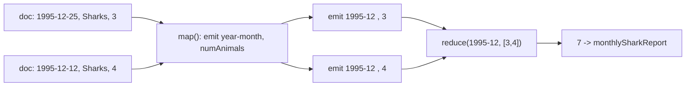
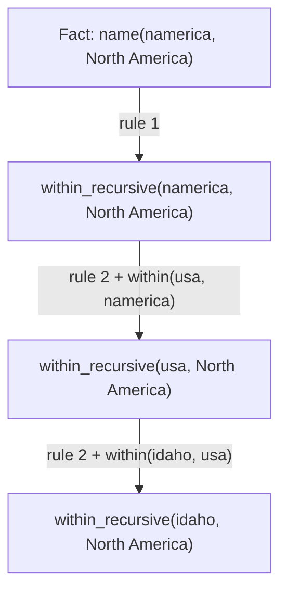

---
tags:
  - ddia/chapter-02
  - databases/data-models
date: 2026-11-21
---

# Chapter 2: Data Models and Query Languages

Reader: a backend engineer who has used SQL and knows JSON, wanting a quick comparison of relational, document and graph models.

**Summary.** The data model shapes both the software and how you think about the problem. This chapter compares the **relational**, **document** and **graph** models and the query languages that go with them (SQL, MapReduce, MongoDB aggregation pipeline, Cypher, SPARQL, Datalog). Documents suit self-contained, tree-shaped data with few cross-references; graphs suit data where anything may relate to anything; relational sits in the middle, with strong joins. Declarative query languages beat imperative access because the optimizer owns the "how".

## 1. Why data models matter

Applications are layers of models, each hiding the layer below:

1. Real world to application objects and APIs.
2. Objects to a general-purpose model (JSON/XML, relational tables, graph). **This chapter.**
3. Database engineers map that model to bytes in memory, disk, network (Chapter 3).
4. Hardware maps bytes to electrical signals and so on.

Every data model embodies assumptions: some operations are easy or fast, others awkward or unsupported. Choose one that fits the application.

## 2. Relational vs document model

### Background

- Relational model (Codd, 1970): data in *relations* (tables) of unordered *tuples* (rows). Originated in business data processing (transactions, batch jobs such as invoicing and payroll) and dominated for 25-30 years, beating the network and hierarchical models, object databases and XML databases.
- It generalized far beyond its origins: most of the web still runs on it.

### The birth of NoSQL

"NoSQL" began as a 2009 meetup hashtag, later read as "Not Only SQL". Drivers:

- Scalability beyond what relational easily achieves (huge data, very high write throughput).
- Preference for free, open source software.
- Specialized query operations the relational model supports poorly.
- Frustration with rigid schemas; wish for a more dynamic model.

The likely future is **polyglot persistence**: relational alongside several nonrelational stores.

### The object-relational mismatch

Application code is object-oriented; tables/rows/columns need an awkward translation layer (**impedance mismatch**). ORMs (ActiveRecord, Hibernate) cut boilerplate but do not hide the difference.

Example: a LinkedIn-style résumé (Figure 2-1, Example 2-1). `first_name` appears once per user (a column), but positions, education and contact info are one-to-many. Options:

| Option | Notes |
|---|---|
| Normalized: separate tables with `user_id` foreign keys | Traditional (pre SQL:1999) |
| Structured types, XML or JSON column inside the row | Supported to varying degrees by Oracle, DB2, SQL Server, PostgreSQL, MySQL; can query and index inside |
| JSON/XML in a text column | App interprets; DB cannot query inside |

A JSON document has better **locality**: one query fetches the whole profile, versus several queries or a messy multi-way join. The one-to-many relationships form a **tree** that JSON makes explicit (Figure 2-2).

### Many-to-one and many-to-many

Why store `region_id` / `industry_id` instead of strings?

- Consistent spelling, no ambiguity, easy updates (name stored once), localization, better search (Seattle is in Washington).
- IDs have no human meaning so never need to change; duplicating human-meaningful text means write overhead and inconsistency risk. Removing that duplication is **normalization** (rule of thumb: duplicated values that could live in one place means not normalized).

Problem: many-to-one needs joins, which document databases handle weakly (at the time: RethinkDB supports joins, MongoDB not, CouchDB only in predeclared views). Joins then move into application code (several queries). Data also becomes more interconnected as features are added:

- Organizations and schools become entities with their own pages.
- Recommendations reference the author's profile (so photo updates propagate).

These need many-to-many references (Figure 2-4).

### Are document databases repeating history?

IBM **IMS** (1968, Apollo stock-keeping) used the **hierarchical model**: a tree of nested records, like JSON. Good for one-to-many, poor for many-to-many, no joins, so developers denormalized or resolved references by hand. Two answers competed through the 1970s:

| Aspect | Network model (CODASYL) | Relational model |
|---|---|---|
| Structure | Records can have multiple parents; links are pointer-like | Plain tables of rows |
| Access | Follow an **access path** from a root record, moving a cursor | Query any row by condition or key |
| Choosing the path | Programmer, by hand, by imperative code | **Query optimizer**, automatically |
| Schema change | Painful, rewrite query code | Add an index, queries unchanged |

The key relational insight: build the optimizer once and every application benefits. Today, document databases revert to the hierarchical idea for nested one-to-many data, but for many-to-one and many-to-many they work like relational ones: a *document reference* (like a foreign key) resolved at read time with a join or follow-up query. They have not followed CODASYL.

### Relational vs document today

| Consideration | Document | Relational |
|---|---|---|
| Schema | Flexible, schema-on-read | Explicit, schema-on-write |
| Locality | Whole document in one place | Multiple lookups across tables |
| Fit to app objects | Close for tree-like data | Needs shredding into tables |
| Joins, many-to-one, many-to-many | Weak, emulated in app | Strong |

- Use documents when data is a tree loaded as a whole. Limits: you cannot reference a nested item directly ("second item in positions of user 251"); deep nesting is awkward.
- If many-to-many is needed, denormalizing shifts consistency work to the app, and emulated joins are slower. For highly interconnected data: documents awkward, relational acceptable, graph most natural.
- **Schemaless is misleading**: there is an implicit schema enforced by reading code. Better terms: **schema-on-read** (like dynamic typing) vs **schema-on-write** (like static typing).
- Changing format example (full name to first and last): document DB writes new fields and handles old docs on read (`if user.name and not user.first_name ...`); relational runs `ALTER TABLE ... ADD COLUMN` plus an `UPDATE`. `ALTER TABLE` is usually milliseconds; MySQL copies the whole table (minutes to hours on big tables). `UPDATE` on a big table is slow anywhere, so a NULL default filled at read time is the alternative.
- Schema-on-read wins for heterogeneous data (many object types, or structure set by external systems). Schemas win when all records share a structure.
- **Locality**: documents are stored as one continuous string (JSON, XML, BSON). It helps only when you need large parts at once; the whole document is loaded and generally rewritten on updates, so keep documents small and avoid growing writes. Locality is not exclusive to documents: Spanner (interleaved tables), Oracle (multi-table index cluster tables), Bigtable column families (Cassandra, HBase).

### Convergence

Relational systems added XML (mid-2000s) and JSON (PostgreSQL 9.3, MySQL 5.7, DB2 10.5) support; RethinkDB has joins and some MongoDB drivers resolve references client-side (slower, extra round trips). The models are converging and a hybrid is a good future route.

## 3. Query languages

### Declarative vs imperative

```text
Imperative:   for each animal -> if family == "Sharks" -> push
Relational:   sharks = sigma[family = "Sharks"](animals)
SQL:          SELECT * FROM animals WHERE family = 'Sharks';
```

| | Imperative | Declarative (SQL) |
|---|---|---|
| You specify | Steps and order | The pattern of the result |
| Who picks the algorithm | You | Query optimizer (indexes, join methods, order) |
| Engine freedom | Little: it cannot know if you rely on ordering | Can reorganize storage, add optimizations without breaking queries |
| Parallelism | Hard (ordered instructions) | Natural, since only the result is specified |

IMS and CODASYL used imperative APIs (COBOL loops over records).

### Declarative queries on the web

CSS `li.selected > p { background-color: blue; }` (or XSL/XPath `li[@class='selected']/p`) states the pattern. The imperative JavaScript DOM version is long and has real problems: the blue is not removed when the class changes (CSS removes it automatically), and adopting a faster API means rewriting the code, whereas browser vendors can speed up CSS without breaking anything. Same lesson as SQL.

### MapReduce querying

A model for bulk processing across many machines (Google), partly supported in MongoDB and CouchDB for read-only queries. It sits **between declarative and imperative**: logic is code snippets (`map` emits key-value pairs, `reduce` combines values per key) called by the framework. Both must be **pure functions** (no extra queries, no side effects) so the DB can run them anywhere, in any order, and rerun on failure.

Book example, sharks per month:



Same query in PostgreSQL: `SELECT date_trunc('month', observation_timestamp) AS observation_month, sum(num_animals) FROM observations WHERE family = 'Sharks' GROUP BY observation_month;`.

Two coordinated JS functions are harder than one query and give the optimizer less to work with, so MongoDB 2.2 added the declarative **aggregation pipeline** (`$match`, `$group`, ...), roughly a JSON-syntax subset of SQL. Moral: NoSQL may reinvent SQL in disguise. SQL itself is not limited to one machine, and MapReduce has no monopoly on distributed queries.

## 4. Graph-like data models

Use when many-to-many relationships are common.

A graph has **vertices** (nodes, entities) and **edges** (relationships). 
Examples: social graphs, web graph (PageRank), road/rail networks (shortest path).
 
Graphs can be heterogeneous: Facebook keeps one graph with people, locations, events, checkins and comments as vertices; friendship, attendance, etc. as edges.

Running example (Figure 2-5): Lucy (born in Idaho) and Alain (born in Beaune, France) are married and live in London. Location hierarchies differ by country (US states within country within continent; France has département and région), and granularity varies (residence as city, birthplace as state). This is hard to model relationally.

Two related models: **property graph** (Neo4j, Titan, InfiniteGraph) and **triple-store** (Datomic, AllegroGraph). Declarative languages: Cypher, SPARQL, Datalog. Imperative: Gremlin, plus processing frameworks like Pregel.

### Property graphs

| Vertex has | Edge has |
|---|---|
| Unique ID | Unique ID |
| Outgoing and incoming edges | Tail vertex (start) and head vertex (end) |
| Properties (key-value) | Label (relationship type) and properties |

It can be stored as two relational tables (`vertices`, `edges`, with JSON properties and indexes on `tail_vertex` and `head_vertex`).

Key traits: no schema limits which vertices connect; efficient traversal in both directions; labels hold different relationship kinds in one clean model. Good for evolvability (e.g. add allergens and foods to find what is safe to eat).

### Cypher

Neo4j's declarative language. Arrow notation creates edges: `(Idaho) -[:WITHIN]-> (USA)`. Query for people who emigrated from the US to Europe:

```text
MATCH
  (person) -[:BORN_IN]-> () -[:WITHIN*0..]-> (us:Location {name:'United States'}),
  (person) -[:LIVES_IN]-> () -[:WITHIN*0..]-> (eu:Location {name:'Europe'})
RETURN person.name
```

`:WITHIN*0..` means follow WITHIN zero or more times (like regex `*`). Execution is the optimizer's choice: scan all people, or start from the two named locations (via an index) and work backward.

### Graph queries in SQL

Possible but clumsy: the number of joins is not fixed in advance. Use `WITH RECURSIVE` (recursive CTEs, SQL:1999; PostgreSQL, DB2, Oracle, SQL Server). The same query needs about 29 lines of SQL versus 4 of Cypher: different models suit different use cases.

### Triple-stores and SPARQL

Everything is a `(subject, predicate, object)` triple, equivalent to the property graph:

- Object is a primitive value: predicate/object is a property, e.g. `(lucy, age, 33)`.
- Object is another vertex: predicate is an edge, e.g. `(lucy, marriedTo, alain)`.

Written in Turtle/N3 (`_:lucy :bornIn _:idaho.`; semicolons repeat a subject). The **semantic web** (RDF to publish machine-readable data across sites) was overhyped and not realized, but triples remain a fine internal model (Datomic is a triple-store, actually 5-tuples, with no semantic-web claims). RDF predicates are often URIs to avoid naming clashes when combining datasets; namespaces need not resolve.

SPARQL (borrowed by Cypher's pattern matching), variables start with `?`:

```text
SELECT ?personName WHERE {
  ?person :name ?personName.
  ?person :bornIn / :within* / :name "United States".
  ?person :livesIn / :within* / :name "Europe".
}
```

### Graph databases vs the network model

| | CODASYL | Graph database |
|---|---|---|
| Schema | Fixed nesting of record types | Any vertex can link to any other |
| Reaching a record | Only via access paths | By ID or index |
| Ordering of children | Ordered set maintained by DB | Unordered; sort in queries |
| Queries | Imperative, brittle | Imperative possible, usually declarative (Cypher, SPARQL) |

### Datalog

- Older (1980s academic), a Prolog subset; foundation for later languages.
- Used by Datomic and Cascalog (Hadoop).
- Facts are `predicate(subject, object)`, e.g. `within(idaho, usa)`. 
- Queries are built from **rules** (`head :- body`) that derive new predicates from data or other rules; rules may be recursive. Uppercase words are variables.

```text
within_recursive(Location, Name) :- name(Location, Name).               /* Rule 1 */
within_recursive(Location, Name) :- within(Location, Via),
                                    within_recursive(Via, Name).        /* Rule 2 */
migrated(Name, BornIn, LivingIn) :- name(Person, Name), born_in(Person, BornLoc),
                                    within_recursive(BornLoc, BornIn),
                                    lives_in(Person, LivingLoc),
                                    within_recursive(LivingLoc, LivingIn).   /* Rule 3 */
?- migrated(Who, 'United States', 'Europe').     /* Who = 'Lucy'. */
```

Rules apply repeatedly: from `name(namerica, ...)` rule 1 yields `within_recursive(namerica, 'North America')`; rule 2 then yields `usa`, then `idaho` (Figure 2-6). Less convenient for one-off queries, but rules are reusable and cope well with complex data.



## 5. Summary

- History: hierarchical (one big tree) to relational (fixes many-to-many) to NoSQL splitting two ways: **document** (self-contained docs, rare cross-links) and **graph** (everything may relate to everything).
- All three are widely used; one can emulate another, awkwardly.
- Document and graph stores usually do not enforce a schema, but the app still assumes structure: explicit (write) vs implicit (read).
- Other models exist: genome sequence-similarity search (GenBank), LHC-scale physics data (custom solutions), full-text search (alongside databases).

## Quick recall

- Data model choice shapes both code and thinking; every model makes some operations easy and others hard.
- Relational: tables, strong joins, many-to-one and many-to-many, optimizer picks access paths.
- Document: JSON trees, locality, flexible schema (schema-on-read), weak joins; keep documents small.
- Normalization means storing human-meaningful data once and referencing it by ID.
- Hierarchical (IMS) and network (CODASYL) models explain the history; relational won through declarative access and the optimizer.
- Declarative beats imperative: optimizer freedom and parallelism; MapReduce is in between, and MongoDB added the aggregation pipeline.
- Graphs: property graph (vertices and edges with labels and properties) or triples; query with Cypher, SPARQL, Datalog; `*` path patterns replace a variable number of joins.
- Relational and document models are converging via JSON/XML support and joins.
