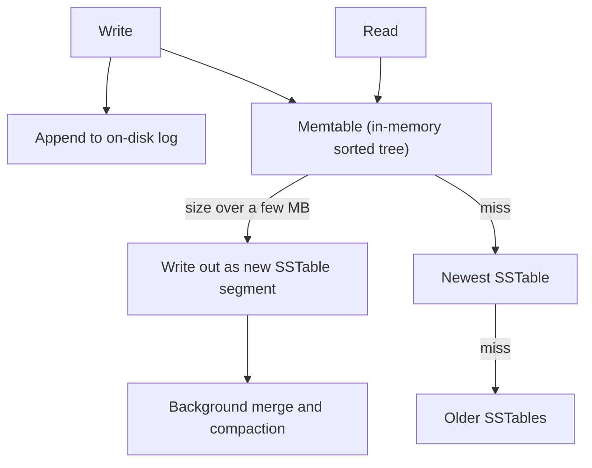
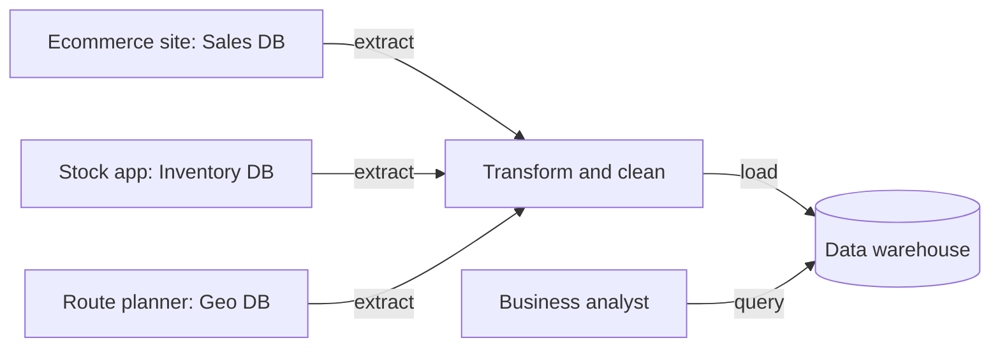

---
tags:
  - ddia/chapter-3
  - databases/storage-engines
date: 2026-11-21
---

# Chapter 3: Storage and Retrieval

> [!abstract] Summary
> **A database must store data and give it back, and how it lays data out on disk decides what it is fast at.** The chapter compares two families of OLTP storage engines: log-structured (Bitcask, SSTables, LSM-trees) and update-in-place (B-trees). It then covers other index types (secondary, clustered, multi-column, full-text, in-memory) and contrasts OLTP with analytics (OLAP). Analytics systems use star schemas and column-oriented storage with compression, sorting and materialized aggregates. Source: pages 69-104.

Reader assumed: an engineer who knows SQL, indexes and basic backend work, but not how engines work inside.

## 1. Why care about internals

- You rarely write a storage engine, but you must **choose** one and **tune** it for your workload.
- Big split: engines tuned for transactions (OLTP) versus analytics (OLAP).
- OLTP engines come in two families: **log-structured** and **page-oriented** (B-trees).

## 2. The simplest database: an append-only log

The book's two-line Bash database: `db_set` appends `key,value` to a file; `db_get` greps the file and takes the last match (`tail -n 1`).

| Operation | Cost | Why |
|---|---|---|
| Write (`db_set`) | Very cheap | Appending to a file is the simplest write |
| Read (`db_get`) | $O(n)$ | Scans the whole file; doubling records doubles lookup time |

- A **log** here means any append-only sequence of records, not only human-readable application logs.
- An **index** is extra structure derived from the primary data. It speeds reads but **slows writes**, because every write must update it.
- So databases do not index everything by default. You pick indexes based on your query patterns.

## 3. Hash indexes and Bitcask

Idea: keep an **in-memory hash map** from each key to a **byte offset** in the data file. Write appends and updates the map. Read looks up the offset, seeks, reads (Figure 3-1).

- This is essentially **Bitcask** (default engine in Riak). Reads and writes are fast, but **all keys must fit in RAM**. Values can exceed RAM (one disk seek, or none if cached).
- Good fit: few distinct keys, many updates per key (e.g. play counter per cat-video URL).

**Avoiding running out of disk**

1. Split the log into **segments**; when one reaches a size limit, close it and start a new one.
2. **Compaction**: drop duplicate keys, keep the most recent value (Figure 3-2).
3. **Merge** several segments while compacting, in a background thread, into a new file (Figure 3-3). Reads keep using old segments until the switch, then old files are deleted.
4. Each segment has its own hash map. Lookup checks the newest segment first, then older ones.

**Real-world details**

| Issue | Solution |
|---|---|
| File format | Binary: length of string, then raw bytes (no escaping) instead of CSV |
| Deletes | Append a **tombstone**; merging discards earlier values for that key |
| Crash recovery | In-memory maps are lost. Rebuilding means rereading segments, so Bitcask stores hash-map snapshots on disk |
| Partial writes | Checksums detect and ignore corrupt record tails |
| Concurrency | One writer thread; immutable segments can be read by many threads |

**Why append-only beats update-in-place**

- Sequential writes are much faster than random writes, especially on spinning disks (somewhat on SSDs).
- Concurrency and crash recovery are simpler (no half-old, half-new values).
- Merging avoids fragmentation.

**Limits of hash indexes**

- The hash table must fit in memory. An on-disk hash map performs badly (random I/O, costly growth, collisions).
- **Range queries are inefficient**: you cannot scan `kitty00000` to `kitty99999`; each key needs its own lookup.

## 4. SSTables and LSM-trees

**SSTable** (Sorted String Table): a segment whose key-value pairs are **sorted by key**, with each key appearing once per segment.

Advantages over hash-indexed log segments:

1. **Merging is mergesort-like.** Read files side by side, copy the lowest key. Works even if files exceed memory. When a key appears in several segments, keep the newest segment's value (Figure 3-4).
2. **Sparse in-memory index.** You need not index every key. To find `handiwork`, jump to the offset of `handbag` and scan forward until you hit it or pass it (Figure 3-5). One key per few KB is enough.
3. **Block compression.** Scanned ranges can be grouped into a block and compressed. Each sparse-index entry points at a block start. This saves space and I/O bandwidth.

### Building and maintaining SSTables

- Sorted order is easy to maintain **in memory** with a red-black or AVL tree. This tree is the **memtable**.
- When the memtable passes a threshold (typically a few MB), flush it as an SSTable. Writes continue into a new memtable meanwhile.
- Reads check memtable, then newest segment, then older ones.
- Crash risk: the memtable is lost. Fix: append every write to a separate **unsorted log** whose only job is to rebuild the memtable. Discard it after each flush.

### The LSM-tree

- This design is the **Log-Structured Merge-Tree** (O'Neil et al.). It is used in **LevelDB** and **RocksDB**, and in Cassandra and HBase (inspired by Google's Bigtable paper, which coined *SSTable* and *memtable*).
- **Lucene** (Elasticsearch, Solr) keeps its term dictionary (term to postings list of document IDs) in SSTable-like files merged in the background.

**Optimizations**

| Problem | Remedy |
|---|---|
| Lookup of a key that does not exist must check everything | **Bloom filter**: memory-efficient set approximation that can say "definitely not present" |
| When and how to compact | **Size-tiered** (newer small tables merged into older larger ones; HBase, Cassandra) versus **leveled** (key range split into small tables, data moved through levels; LevelDB, RocksDB, Cassandra) |

Summary: sorted data allows range queries, and sequential writes give very high write throughput, even when data exceeds memory.

## 5. B-trees

Introduced in 1970 and still the standard index in almost all relational databases. Like SSTables they keep keys sorted, but the design differs.

| | Log-structured (LSM) | B-tree |
|---|---|---|
| Unit | Variable-size **segments** (MB+), written sequentially | Fixed-size **pages** (traditionally 4 KB), read/written one at a time |
| Writes | Append, never modify files | **Overwrite pages in place** |
| Matches hardware | Sequential I/O | Disk's fixed-size blocks |

**Structure (Figure 3-6)**: a root page holds keys and references to child pages. Each child covers a continuous key range between the boundary keys. Following references down (e.g. looking up 251 between boundaries 200 and 300) reaches a **leaf page** holding values inline or references to them.

- **Branching factor**: number of child references per page. The example has 6; in practice it is several hundred.
- **Update**: find the leaf, change the value, write the page back.
- **Insert**: find the page whose range covers the key. If it is full, **split** into two half-full pages and update the parent (Figure 3-7).
- The tree stays balanced, depth $O(\log n)$. A four-level tree of 4 KB pages with branching factor 500 stores up to **256 TB**.

### Making B-trees reliable

- A page split overwrites several pages. A crash midway can leave an **orphan page** and a corrupt index.
- Solution: a **write-ahead log (WAL, redo log)**, an append-only file where every change is written before the tree pages. It restores consistency after a crash.
- Concurrent access needs **latches** (lightweight locks). Log-structured designs are simpler: they merge in the background and atomically swap segments.

**Optimizations**

- **Copy-on-write** (e.g. LMDB): write modified pages to a new location and create new parent pages. No WAL needed, and helps concurrency control.
- **Abbreviated keys** in interior pages give a higher branching factor and fewer levels (sometimes called a B+ tree).
- Lay out leaf pages sequentially on disk for range scans (hard to maintain as the tree grows; LSM merges make this easier).
- **Sibling pointers** on leaves allow ordered scans without going back to the parent.
- Variants such as **fractal trees** borrow log-structured ideas.

## 6. Comparing B-trees and LSM-trees

Rule of thumb: **LSM-trees are faster for writes, B-trees for reads** (LSM reads check several structures). Benchmarks are workload-sensitive, so test your own workload.

| Aspect | LSM-tree | B-tree |
|---|---|---|
| Write amplification | Repeated compaction rewrites data, but often lower overall | Every write goes to WAL and page (maybe again on split), whole page even for a few bytes |
| Write throughput | Typically higher; sequential compact files | Lower; random page overwrites |
| Space | Better compression, less fragmentation | Unused space in split or partly filled pages |
| Latency predictability | Compaction can stall requests; **high percentiles** can be bad | More predictable |
| Compaction vs. incoming writes | Share finite disk bandwidth; if compaction cannot keep up, segments pile up, disk fills and reads slow. Usually no write throttling, so monitor | Not applicable |
| Key location | Same key may exist in several segments | Each key in exactly one place |
| Transactions | Harder | Range locks attach directly to the tree (useful for strong transaction semantics) |

- **Write amplification**: one logical write causing several physical writes over time. It matters on SSDs, which wear out after limited overwrites, and when disk bandwidth is the bottleneck.
- Many SSD firmwares use log-structured algorithms internally, so write-pattern impact is smaller, but compactness still helps.
- Verdict: B-trees are deeply ingrained and consistently good. Log-structured indexes are increasingly popular in new datastores. No quick rule; test empirically.

## 7. Other indexing structures

### Secondary indexes

- A **primary key** index identifies one row/document/vertex. **Secondary indexes** (`CREATE INDEX`) are crucial for joins.
- Keys are not unique, so either store a **list of row IDs** as the value or make keys unique by appending the row ID. Works with B-trees and LSM-trees.

### Where the value lives

| Approach | What the index stores | Notes |
|---|---|---|
| **Heap file** (nonclustered) | Reference to row in an unordered heap | No data duplication across indexes. In-place update works if new value fits, else move row and update indexes or leave a forwarding pointer |
| **Clustered index** | The row itself | Avoids extra hop on reads. InnoDB primary key is clustered and secondary indexes point to the primary key. SQL Server: one clustered index per table |
| **Covering index** (included columns) | Some columns | Answers some queries from the index alone |

Clustered and covering indexes speed reads but cost extra storage and write overhead, and need care to stay consistent.

### Multi-column indexes

- **Concatenated index**: columns appended into one key, like a phone book on (lastname, firstname). Useful for last name or both. **Useless for first name only.**
- **Multi-dimensional indexes** answer queries such as a latitude and longitude rectangle. A B-tree or LSM index gives one range, not both at once. Options: a **space-filling curve** to one number plus a B-tree, or **R-trees** (PostGIS).
- Also useful beyond geography: (red, green, blue) colour ranges, or (date, temperature) for 2013 observations between 25 and 30 degrees C (HyperDex).

### Full-text and fuzzy search

- Lucene supports synonyms, grammatical variations, nearby words, and typos via **edit distance** (distance 1 = one letter added, removed or replaced).
- Its in-memory term index is a **finite state automaton** (trie-like) that can become a **Levenshtein automaton**. LevelDB instead uses a sparse key index.

### In-memory databases

- RAM is getting cheaper and many datasets fit in memory (possibly across machines). Disks stay because they are durable and cheaper per GB.
- Durability options: battery-powered RAM, change log on disk, periodic snapshots, replication. Memcached is cache-only (loss acceptable). Redis and Couchbase write to disk asynchronously (weak durability).
- Products: VoltDB, MemSQL, Oracle TimesTen (relational); RAMCloud (log-structured KV).
- **Surprise**: the speed gain is not from avoiding disk reads (the OS cache already helps). It comes from avoiding the overhead of **encoding data structures for disk**.
- Easier rich structures: Redis offers priority queues and sets.
- **Anti-caching**: evict least recently used records to disk, at record granularity (better than OS paging). Indexes must still fit in memory. Non-volatile memory may force further design changes.

## 8. Transaction processing vs. analytics

- **Transaction** here means a group of reads and writes forming a logical unit. It need not be ACID. OLTP means low-latency reads and writes, as opposed to periodic batch jobs.

| Property | OLTP | OLAP |
|---|---|---|
| Read pattern | Few records by key | Aggregate over many records |
| Write pattern | Random-access, low latency from user input | Bulk import (ETL) or event stream |
| Used by | End users via web app | Internal analysts |
| Data represents | Latest state | History of events |
| Size | GB to TB | TB to PB |

Example analytic queries: revenue per store in January; extra bananas sold during a promotion; brand of baby food most bought with brand X diapers.

## 9. Data warehousing

- OLTP databases are guarded: they must be highly available and low-latency, and ad hoc analytic scans can harm them.
- A **data warehouse** is a separate read-only copy for analysts, fed by **ETL** (Extract-Transform-Load) from periodic dumps or a continuous stream of updates (Figure 3-8).

- Common in large enterprises, rare in small companies (few systems, small data).
- Main benefit: the warehouse can be **optimized for analytic access**, which OLTP indexes handle poorly.
- Data model is usually relational (SQL), with drill-down and slicing and dicing tools. Internals diverge from OLTP. SQL Server and SAP HANA host both but are becoming two separate engines behind one SQL interface.
- Vendors: Teradata, Vertica, ParAccel (hosted as Amazon Redshift). Open source SQL-on-Hadoop: Hive, Spark SQL, Impala, Presto, Tajo, Drill (some based on Google's Dremel).

## 10. Stars and snowflakes

- **Star schema** (dimensional modeling): a central **fact table** (each row an event, e.g. one product purchase in `fact_sales`) with foreign keys to **dimension tables** (who, what, where, when, how, why).
- Figure 3-9 dimensions: `dim_product`, `dim_store`, `dim_date`, `dim_customer`, `dim_promotion`.
- Facts are stored as individual events for maximum flexibility, so fact tables can be huge (tens of PB at Apple, Walmart, eBay).
- Dates are dimension tables too, so you can encode holidays.
- **Snowflake schema**: dimensions broken into sub-dimensions (brand, category tables). More normalized, but stars are often preferred as simpler.
- Tables are **wide**: fact tables often 100+ columns, sometimes hundreds.

## 11. Column-oriented storage

**Motivation**: a fact table has over 100 columns, but a typical query touches 4 or 5. Example 3-1 (fruit vs candy sales by weekday in 2013) reads only `date_key`, `product_sk`, `quantity`. Row storage must load and parse every full row.

**Idea**: store each **column** together (e.g. one file per column), with rows in the **same order** in every file. The k-th entry of each file rebuilds row k (Figure 3-10). Parquet is a columnar format (based on Dremel) that also supports documents.

> [!warning] Column families are not columnar
> Cassandra and HBase "column families" (from Bigtable) store all columns of a row together and do not use column compression. The Bigtable model is still mostly row-oriented.

### Compression

**Bitmap encoding** (Figure 3-11): when a column has few distinct values $n$ compared with the row count (e.g. 100,000 products across billions of sales), make one bitmap per value with one bit per row.

- Few distinct values (e.g. about 200 countries): plain bitmaps.
- Many distinct values: bitmaps are sparse, so add **run-length encoding**. Example for `product_sk = 31`: 5 zeros, 4 ones, 3 zeros, 3 ones.
- Queries become bit operations:
  - `product_sk IN (30, 68, 69)` is a bitwise **OR** of three bitmaps.
  - `product_sk = 31 AND store_sk = 3` is a bitwise **AND** (works because row order is identical across columns).

### CPU efficiency

- Disk-to-memory bandwidth is not the only bottleneck. Memory-to-CPU-cache bandwidth, branch mispredictions and SIMD use also matter.
- Compressed column chunks fit in L1 cache and are processed in tight loops with no function calls. Bitwise AND/OR operate directly on chunks. This is **vectorized processing**.

### Sort order

- Rows are sorted **a whole row at a time**, never each column independently (that would lose row identity).
- Admin chooses sort keys from common queries, e.g. `date_key` first for date-range scans, `product_sk` second to group same-product sales per day.
- Sorting helps compression: the first sort key has long repeated runs (run-length encoding can shrink it to a few KB even for billions of rows). Later keys compress less.
- **Several sort orders** (C-Store, Vertica): store replicas sorted differently and use the best fit. Similar to multiple secondary indexes, except a column store has no pointers back to a single row location, only columns of values.

### Writing to a column store

- Reads dominate, but writes are hard: in-place insert into compressed, sorted columns would rewrite every column file.
- Solution: the **LSM approach**. Writes go to an in-memory sorted store (row or column based), then merge into column files in bulk (Vertica). Queries combine disk data and recent in-memory writes, and the optimizer hides this.

## 12. Aggregation: materialized views and data cubes

| Concept | Meaning | Trade-off |
|---|---|---|
| Virtual view | Shortcut that is expanded into its query on read | No stored data |
| **Materialized view** | Actual copy of query results on disk | Must be updated when data changes, so writes cost more. Rare in OLTP, reasonable in read-heavy warehouses |
| **Data cube (OLAP cube)** | Grid of aggregates (e.g. SUM of `net_price`) by dimensions | Fast precomputed answers, but less flexible than raw data |

- Figure 3-12: a date by product grid. Each cell is a SUM. Row and column totals give per-date and per-product sums (examples in the figure: 149.60 for one date and product, 40710.53 per date, 14967.09 per product).
- With five dimensions (date, product, store, promotion, customer) it is a hypercube, still summarized along each dimension.
- Limit: you cannot compute "share of sales from items over 100 dollars" if price is not a dimension. So warehouses keep raw data and use cubes only as a speed-up.

## Common mistakes

| Mistake | What happens | Fix |
|---|---|---|
| Index every column | Every write updates every index | Choose indexes from real query patterns |
| Assume LSM is always faster | Reads and tail latency can suffer, compaction can fall behind | Benchmark your workload and monitor compaction |
| Use a concatenated index to search the second column alone | Index is useless | Order columns by query need, or add another index |
| Call Cassandra column families columnar | Expect compression benefits that do not exist | Treat them as row-oriented |
| Sort each column of a column store independently | Rows cannot be rebuilt | Sort whole rows by chosen keys |

## Quick recall

- Append-only log: fast writes, $O(n)$ reads; an index trades write speed for read speed.
- Bitcask: in-memory hash map to byte offsets. Needs all keys in RAM, no range queries.
- SSTable: sorted segment, mergesort merge, sparse index, block compression.
- LSM-tree: memtable plus WAL, flush to SSTables, background compaction (size-tiered or leveled), Bloom filters for missing keys.
- B-tree: 4 KB pages, branching factor of hundreds, depth about $\log n$, updates in place, WAL for crash safety, latches for concurrency.
- LSM: better write throughput and compression, but compaction interference and tail latency. B-tree: predictable, one copy per key, easy range locks.
- Secondary indexes: row-ID lists or unique keys; heap file vs clustered vs covering index.
- Multi-dimensional needs (R-trees); full-text uses edit-distance automata.
- In-memory databases win by skipping disk encoding overhead, not only disk reads.
- OLTP = small key lookups; OLAP = big scans and aggregates, served by a warehouse fed by ETL.
- Star schema: fact table plus dimensions. Columnar storage reads only needed columns, compresses with bitmaps and run-length encoding, uses sorted rows, and writes via LSM-style buffering.
- Materialized views and data cubes precompute aggregates at the cost of flexibility.
