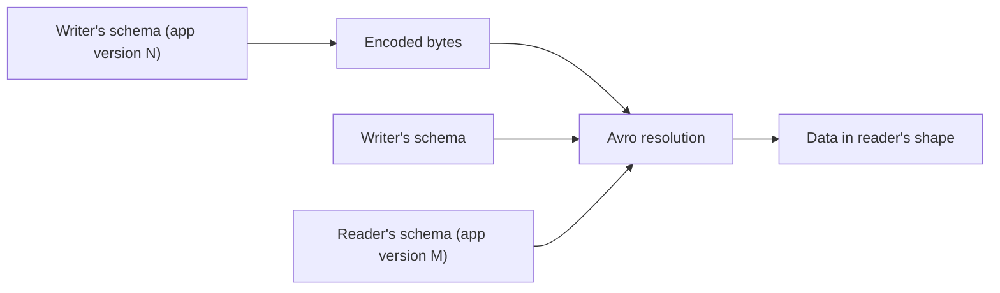
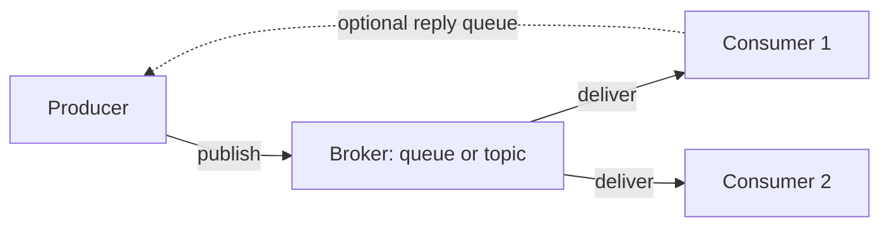

---
tags:
  - ddia/chapter-4
  - databases/encoding
  - databases/schema-evolution
date: 2026-11-21
---

# Chapter 4: Encoding and Evolution

> [!abstract] Summary
> **Applications change, so old and new code and old and new data formats must coexist, which needs backward and forward compatibility.** The chapter compares ways to turn in-memory data into bytes: language-specific formats, JSON/XML/CSV, and schema-driven binary formats (Thrift, Protocol Buffers, Avro). It shows how each one handles schema evolution. It then walks through three dataflow modes where encoding matters: databases, services (REST and RPC), and asynchronous message passing. Source: pages 111-140.

Reader assumed: an engineer who has used JSON APIs and databases and has heard of protobuf or Avro, but wants the compatibility rules clear.

## 1. Why this chapter exists

- Features change, so the stored data format changes (new field, new record type).
- Relational databases keep **one schema** at a time (changed through `ALTER` migrations). Schema-on-read ("schemaless") databases can hold a mix of old and new formats.
- Code cannot change everywhere at once:
  - Server side: **rolling upgrade** (staged rollout) to a few nodes at a time, with no downtime.
  - Client side: the user decides when to update.
- So old and new code and data coexist. You need both:

| Property | Meaning | Difficulty |
|---|---|---|
| **Backward compatibility** | Newer code can read data written by older code | Easy: you know the old format |
| **Forward compatibility** | Older code can read data written by newer code | Harder: old code must ignore additions it does not understand |

## 2. Formats for encoding data

- In memory: objects, lists, hash tables, pointers. On disk or network: a self-contained byte sequence.
- **Encoding** (serialization, marshalling) is in-memory to bytes. **Decoding** (parsing, deserialization, unmarshalling) is the reverse.
- "Serialization" also means something unrelated in transactions (Chapter 7), so the book says *encoding*. Encoding has nothing to do with encryption.

### Language-specific formats

Examples: Java `Serializable`, Ruby `Marshal`, Python `pickle`, Kryo.

| Problem | Why it hurts |
|---|---|
| Tied to one language | Locks you in and blocks integration with other organizations |
| Needs to instantiate arbitrary classes | Security hole: attacker-controlled bytes can lead to remote code execution |
| Versioning is an afterthought | Poor forward and backward compatibility |
| Efficiency is an afterthought | Java serialization is slow and bloated |

Verdict: avoid except for very transient purposes.

### JSON, XML, CSV and binary variants

Textual, human-readable, language-independent, and likely to stay popular for **data interchange between organizations**, because agreeing on anything across organizations is the hard part.

| Issue | Detail |
|---|---|
| Numbers | XML and CSV cannot tell a number from a digit string. JSON has no int/float distinction and no precision |
| Large integers | Above $2^{53}$ they lose precision as IEEE 754 doubles (e.g. JavaScript). Twitter returns tweet IDs twice, as a number and as a decimal string |
| Binary data | No binary string support, so people use **Base64**, which adds 33% size |
| Schemas | Optional and complex (XML Schema, JSON Schema). Many JSON tools skip them, so interpretation is hardcoded |
| CSV | No schema, vague escaping rules (commas and newlines in values); parsers differ |

**Binary JSON/XML variants** (MessagePack, BSON, BJSON, UBJSON, BISON, Smile; WBXML, Fast Infoset) keep the data model, so they must still store field names.

- Example record (Example 4-1): `{"userName": "Martin", "favoriteNumber": 1337, "interests": ["daydreaming", "hacking"]}`.
- MessagePack encoding (Figure 4-1): first byte `0x83` = object (top 4 bits `0x8`) with 3 fields (bottom 4 bits). Then `0xa8` = string of 8 bytes, followed by `userName` and so on. Length prefixes mean no end markers or escaping.
- Result: **66 bytes versus 81 bytes** for compact textual JSON. A small gain that costs human readability.

## 3. Schema-driven binary formats

### Thrift and Protocol Buffers

- Protocol Buffers (Google) and Thrift (Facebook), both open sourced in 2007-08. Both **require a schema** and provide **code generation** for many languages.

```text
Thrift IDL                               Protocol Buffers
struct Person {                          message Person {
  1: required string userName,             required string user_name = 1;
  2: optional i64 favoriteNumber,          optional int64 favorite_number = 2;
  3: optional list<string> interests     repeated string interests = 3;
}                                        }
```

- Encoded fields carry a **field tag** (number 1, 2, 3 from the schema) plus a type annotation, instead of field names.
- Thrift has two main binary encodings (plus a C++-only third one and JSON ones).

| Encoding | Size for Example 4-1 | How |
|---|---|---|
| Textual JSON (no whitespace) | 81 bytes | Field names spelled out |
| MessagePack | 66 bytes | Field names still included |
| Thrift BinaryProtocol | 59 bytes | Field tags and types, lengths |
| Thrift CompactProtocol | 34 bytes | Type and tag packed in one byte, **variable-length integers** (1337 in two bytes; -64 to 63 in one byte; -8192 to 8191 in two) |
| Protocol Buffers | 33 bytes | Similar to Compact, packed slightly differently |
| Avro | 32 bytes | No tags or types at all (see below) |

- `required` versus `optional` does not change the encoding. `required` only enables a runtime check that fails when the field is not set.

**Schema evolution with tags**

- An encoded record is the concatenation of its fields. Unset fields are omitted.
- **Rename** a field: fine (names are never encoded). **Change a tag**: never (invalidates existing data).
- **Add a field**: give it a **new tag**.
  - Forward compatible: old code skips unknown tags, using the type annotation to know how many bytes to skip.
  - Backward compatible: new code reads old data, but the new field **cannot be `required`**. It must be optional or have a default.
- **Remove a field**: only if optional, and **never reuse its tag number**.
- **Change datatype**: risky. For example widening 32-bit to 64-bit: new code reads old data fine, but old code reading a large new value truncates it.
- Protocol Buffers has no list type, only `repeated`, so the same tag appears multiple times. You can turn an optional field into repeated: new code reading old data sees 0 or 1 element; old code reading new data sees only the last element. Thrift has a real list type (supports nested lists, but not that single-to-multi evolution).

### Avro

- Started in 2009 as a Hadoop subproject because Thrift did not fit Hadoop well.
- Two schema syntaxes: Avro IDL (human) and JSON (machine). **No tag numbers.**

```text
record Person {
    string userName;
    union { null, long } favoriteNumber = null;
    array<string> interests;
}
```

- The encoding is just **values concatenated** in schema order. Nothing identifies fields or types. 32 bytes, the smallest.
- So decoding requires the **exact schema** used to write. Avro handles this with two schemas:
  - **Writer's schema**: used when encoding.
  - **Reader's schema**: what the decoding code expects.
  - They need only be **compatible**; the library resolves differences by comparing them side by side (Figure 4-6).



**Resolution rules**

- Field order may differ: fields are matched **by name**.
- Field in writer but not in reader: ignored.
- Field in reader but not in writer: filled with the reader's **default value**.
- Forward compatibility = new writer, old reader. Backward = new reader, old writer.
- You may only **add or remove a field that has a default**. Adding without default breaks backward compatibility; removing without default breaks forward compatibility.
- `null` is not a default for everything. A nullable field needs a **union type** such as `union { null, long }`, and null must be in the union (the default must match the union's first branch). Avro has no `optional`/`required` markers. This is more verbose but explicit and prevents bugs.
- Datatype changes are allowed if Avro can convert the type.
- Renaming uses **aliases** in the reader's schema: backward compatible, not forward compatible. Adding a union branch is backward compatible, not forward compatible.

**How does the reader get the writer's schema?** Attaching the schema to every record would defeat the savings.

| Context | Approach |
|---|---|
| Big file with millions of records | Schema once at the start of the file (object container file) |
| Database with individually written records | Version number at the start of each record, plus a schema version list in the database (Espresso does this) |
| Network connection | Negotiate schema version at connection setup (Avro RPC) |

A schema registry also serves as documentation and lets you check compatibility. The version can be an incrementing integer or a schema hash.

**Dynamically generated schemas**

- No tag numbers makes Avro friendly to schemas generated automatically. Example: dump a relational database into an Avro container file by making one record schema per table and one field per column. If the table schema changes, just regenerate; name-based matching copes.
- With Thrift or Protocol Buffers, tags would likely be assigned by hand, and a generator must never reuse an old tag. That was not their design goal.

**Code generation vs. dynamic languages**

- Thrift and Protocol Buffers rely on code generation, useful in statically typed languages (efficient structures, type checks, IDE help). Little point in dynamic languages.
- Avro makes code generation optional. Container files are **self-describing**, so tools like Apache Pig can open and analyze them without thinking about schemas.

## 4. The merits of schemas

- Schema languages here are far simpler than XML Schema or JSON Schema, so they are easier to implement and support many languages.
- The ideas are old: **ASN.1** (1984) uses tag numbers like protobuf and its DER encoding is still used for X.509 certificates. It is complex and badly documented, so a poor choice for new applications.
- Databases often have proprietary wire protocols with vendor drivers (ODBC, JDBC).

Benefits of binary schema formats:

- More compact than binary JSON (no field names).
- The schema is documentation that is guaranteed current (needed for decoding).
- A schema database allows compatibility checks before deployment.
- Code generation gives compile-time type checking.
- Same flexibility as schema-on-read, with stronger guarantees and tooling.

## 5. Modes of dataflow

Compatibility is a relationship between the process that **encodes** and the process that **decodes**. Three common paths: databases, service calls, asynchronous message passing.

### Dataflow through databases

- Writing to a database is like **sending a message to your future self**, so backward compatibility is essential.
- Multiple processes or rolling upgrades mean a newer writer and older reader, so **forward compatibility** is needed too.
- **Snag (Figure 4-7)**: old code reads a record with a new field (`photoURL`), decodes into a model object, updates, and writes back. The new field is **silently lost**. The formats can preserve unknown fields, but application code that maps to model objects may drop them. Be aware.
- **Data outlives code**: you can replace code in minutes, but five-year-old records remain in their old encoding unless migrated. Migration is expensive, so databases avoid it.
  - Relational databases support adding a nullable column without rewriting data. Old rows get nulls filled in at read time. (MySQL often rewrites the whole table.)
  - LinkedIn's Espresso stores data in Avro and uses its evolution rules.
- **Archival storage**: backups and warehouse dumps are encoded consistently with the latest schema. Avro container files or a column-oriented format like Parquet fit well.

### Dataflow through services: REST and RPC

- Clients and servers: servers expose an API (a **service**), clients call it. Browsers, native apps and Ajax code all act as clients. A server can also be a client of another service.
- **SOA / microservices** goal: services that are independently deployable and evolvable, each owned by one team. So old and new versions must interoperate.
- Services differ from databases: they expose application-specific APIs with predetermined inputs and outputs, giving encapsulation.
- **Web service** = service over HTTP, in three contexts: client to service over the internet; service to service in the same organization (middleware); service to another organization's service (payment APIs, OAuth).

| | REST | SOAP |
|---|---|---|
| What it is | Design philosophy on HTTP (not a protocol) | XML-based protocol |
| Style | Simple formats, URLs for resources, HTTP caching, auth, content negotiation | Avoids HTTP features; sprawling WS-* standards |
| Description | OpenAPI (Swagger) optional | WSDL, not human-readable, heavy code generation and tooling |
| Trend | Growing, esp. cross-organization and microservices | Used in large enterprises, out of favor elsewhere (interoperability problems) |

### Problems with RPC

RPC (since the 1970s) tries to make a remote call look like a local function call (**location transparency**). Older technologies: EJB and RMI (Java only), DCOM (Microsoft only), CORBA (complex, no compatibility). The approach is fundamentally flawed because a network request differs from a local call:

| Local call | Network request |
|---|---|
| Predictable; outcome depends on your parameters | Request or response may be lost; remote may be slow or down |
| Returns, throws, or never returns | May also **time out** with unknown outcome |
| Retry is safe | Retry may repeat the action unless the protocol is **idempotent** (deduplicates) |
| Similar execution time each call | Latency varies wildly, under 1 ms to many seconds |
| Pass pointers to local memory | Parameters must be encoded to bytes (hard for large objects) |
| Single language | Cross-language type translation (e.g. $2^{53}$ number issues) |

Part of REST's appeal is that it does not hide being a network protocol.

**Current RPC directions**: Thrift and Avro have RPC built in; gRPC uses Protocol Buffers; Finagle uses Thrift; Rest.li uses JSON over HTTP. Newer frameworks are explicit about remote calls: **futures/promises** for async failure and parallel calls (Finagle, Rest.li), **streams** (gRPC), and **service discovery**. Binary RPC can outperform JSON over REST, but REST is good for debugging (browser, `curl`), universally supported, and has a vast tool ecosystem. REST dominates public APIs; RPC suits internal services in the same datacenter.

### Evolution of services

- Reasonable assumption: **servers are updated before clients**. So you need **backward compatibility on requests** and **forward compatibility on responses**.
- Compatibility is inherited from the encoding: Thrift, gRPC and Avro RPC follow their format's rules; SOAP uses XML schemas (subtle pitfalls); REST typically uses JSON, where adding optional request parameters and new response fields is considered compatible.
- Across organizations you cannot force clients to upgrade, so compatibility may need to last indefinitely, or you run multiple API versions side by side.
- No agreement on API versioning. Options: version in the URL, in the HTTP `Accept` header, or a client's requested version stored server-side per API key (Stripe style).

### Message-passing dataflow

Between RPC and databases: low-latency delivery like RPC, but via an intermediary **message broker** (message queue) that stores the message temporarily.



Advantages over direct RPC:

- Buffers if the recipient is down or overloaded.
- Redelivers to a crashed process, avoiding lost messages.
- Sender needs no IP address or port of the recipient (handy in the cloud).
- One message can go to several recipients.
- Decouples sender from recipient.

It is usually **one-way and asynchronous**: the sender does not wait for a reply.

Brokers: RabbitMQ, ActiveMQ, HornetQ, NATS, Kafka (older: TIBCO, IBM WebSphere, webMethods). A consumer may republish to another topic or a reply queue. Messages are just bytes with metadata, so any encoding works.

Use a compatible one so publishers and consumers deploy independently. Preserve unknown fields when republishing.

**Distributed actor frameworks**

- **Actor model**: concurrency without threads and locks. Each actor has private state, processes one message at a time, and talks through asynchronous messages. Delivery is not guaranteed.
- Distributed actors use the same mechanism across nodes, encoding messages for the network. Location transparency works better here than in RPC, since actors already assume message loss.
- Rolling upgrades still need compatibility:

| Framework | Default encoding | Rolling upgrade |
|---|---|---|
| Akka | Java serialization (no compatibility); replaceable, e.g. with Protocol Buffers | Possible after replacing |
| Orleans | Custom format | No; set up a new cluster, shift traffic, shut down the old one (plug-ins possible) |
| Erlang OTP | Records | Hard to change record schemas; rolling upgrades need careful planning (new `maps` type may help) |

## Common mistakes

| Mistake | What happens | Fix |
|---|---|---|
| Reuse or change a protobuf/Thrift tag | Old data decodes wrongly | Only add new tags; never reuse removed ones |
| Add a `required` field after launch | New code fails reading old data | Make it optional or give it a default |
| Add or remove an Avro field with no default | Backward or forward compatibility breaks | Always give defaults |
| Parse 64-bit IDs as JSON numbers in JavaScript | Precision loss above $2^{53}$ | Send IDs as strings too |
| Use Java `Serializable` or `pickle` for long-lived data | Lock-in, security risk, no versioning | Use a standard format |
| Old code read-modify-write through model objects | New fields silently dropped | Preserve unknown fields |
| Treat remote calls as local | Timeouts, duplicate retries, latency | Plan for failure and idempotence |

## Quick recall

- Backward = new code reads old data. Forward = old code reads new data. Rolling upgrades require both.
- Avoid language-specific formats. JSON/XML/CSV are fine for interchange but vague on numbers and binary data.
- Same record: JSON 81 bytes, MessagePack 66, Thrift Binary 59, Thrift Compact 34, Protocol Buffers 33, Avro 32.
- Thrift/protobuf use field tags: rename freely, never change tags, new fields must be optional or defaulted, never reuse removed tags.
- Avro has no tags: writer's schema and reader's schema are resolved by field name; add or remove only fields with defaults; nulls need unions.
- Avro suits dynamically generated schemas and self-describing files; tags suit static code-generation workflows.
- Databases: data outlives code; preserve unknown fields; archive in a consistent format.
- Services: REST (simple, ubiquitous) versus SOAP (heavy); RPC hides the network, which is flawed (timeouts, retries, idempotence, latency). Assume servers upgrade first.
- Message brokers decouple and buffer; actors bring the same idea into the programming model; compatibility still matters there.
