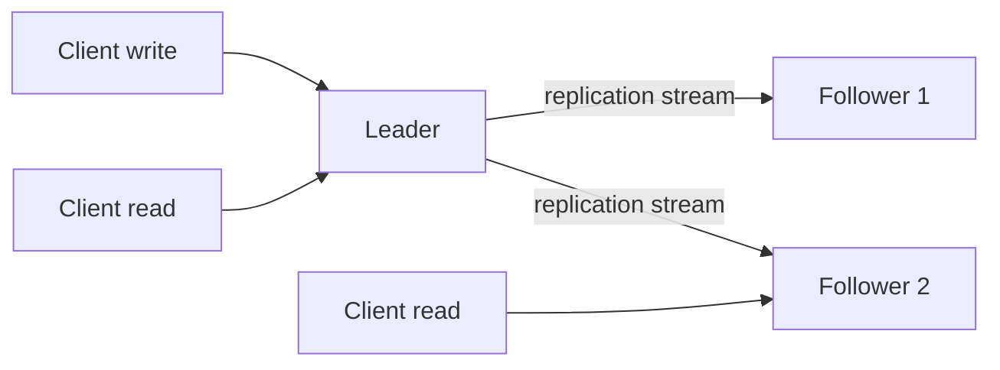
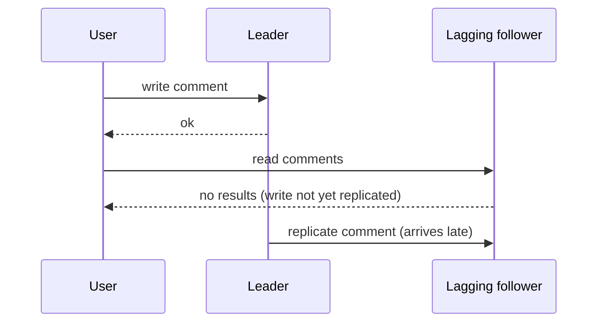
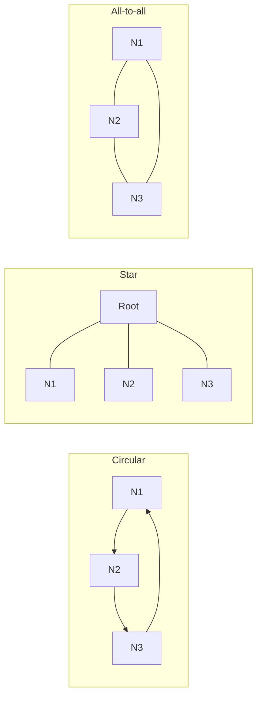

---
tags:
  - ddia/chapter-5
  - distributed-systems/replication
date: 2026-11-21
---

# Chapter 5: Replication

> [!abstract] In a nutshell
> **Replication keeps a copy of the same data on several machines, for availability, lower latency, read scalability and disconnected operation. The hard part is handling changes to the data.**
>
> | Approach | Who accepts writes | Main price |
> |---|---|---|
> | Single-leader | One leader | Stale reads from followers, failover pain |
> | Multi-leader | Several leaders | Write conflicts must be resolved |
> | Leaderless (Dynamo-style) | Any replica, via quorums | Weak guarantees, concurrent-write merging |
>
> Reader assumption: you know basic databases and backend work. This chapter assumes the whole dataset fits on one machine; partitioning is Chapter 6.

## 1. Leaders and followers

- Each node holding a copy is a **replica**. Every write must reach every replica.
- **Leader-based replication** (active/passive, master-slave): clients write only to the **leader**, which stores the write locally and sends it to **followers** (read replicas, secondaries, hot standbys) as a **replication log / change stream**. Followers apply writes in the same order. Reads can go to the leader or any follower.
- Used by PostgreSQL (9.0+), MySQL, Oracle Data Guard, SQL Server AlwaysOn, MongoDB, RethinkDB, Espresso, and also Kafka and RabbitMQ queues, DRBD.

### Synchronous vs asynchronous

| | Synchronous follower | Asynchronous follower |
|---|---|---|
| Leader waits for follower ack? | Yes, before reporting success | No |
| Up-to-date copy guaranteed? | Yes | No, may lag (usually under a second, but possibly minutes) |
| If follower is down/slow | Writes block | Leader keeps going |

- Making **all** followers synchronous is impractical: one outage halts writes.
- **Semi-synchronous**: one follower is synchronous, the rest async; if the sync one is slow or dead, an async one is promoted to sync. You always have an up-to-date copy on at least two nodes.
- **Fully asynchronous**: if the leader dies unrecoverably, unreplicated writes are lost, so a confirmed write is not durable. Still widely used, especially with many or geo-distributed followers.
- Research: **chain replication** is a synchronous variant used in Microsoft Azure Storage. Replication consistency is tied to **consensus** (Chapter 9).

## 2. Setting up a new follower

A plain file copy is inconsistent because data keeps changing, and locking the DB hurts availability. Steps:

1. Take a consistent snapshot of the leader without a full lock (same feature as backups; e.g. innobackupex for MySQL).
2. Copy it to the new follower.
3. Follower requests all changes since the snapshot. The snapshot must be tied to an exact log position: PostgreSQL **log sequence number**, MySQL **binlog coordinates**.
4. When the backlog is processed it has **caught up**.

## 3. Handling node outages

**Follower failure, catch-up recovery.** The follower keeps a log of received changes on disk. After a crash or network blip it knows the last transaction processed, asks the leader for everything after that, and catches up.

**Leader failure, failover.** Promote a follower, reconfigure clients, make other followers follow the new leader. Can be manual or automatic. Automatic steps:

1. **Detect failure**: usually a timeout (e.g. 30 seconds) since there is no foolproof way.
2. **Choose a new leader**: election by majority or appointed by a controller node; best candidate is the replica with the most up-to-date data. This is a consensus problem (Chapter 9).
3. **Reconfigure**: route writes to the new leader; the old leader must become a follower if it returns.

> [!warning] Failover pitfalls
> - **Lost writes** with async replication: the new leader may lack the old leader's latest writes; the common fix is to discard them, violating durability expectations.
> - **GitHub incident**: an out-of-date MySQL follower was promoted; its auto-increment counter lagged, so it reused primary keys already used in Redis, leaking some private data to the wrong users.
> - **Split brain**: two nodes both believe they are leader. Mitigation is **fencing / STONITH** (shut one down), but a poorly designed mechanism can shut down both.
> - **Timeout tuning**: too long means slow recovery; too short means unnecessary failovers, which make an overloaded system worse.
>
> Because of this, some teams prefer manual failover.

## 4. Implementation of replication logs

| Method | What is shipped | Pros | Cons / notes |
|---|---|---|---|
| Statement-based | The SQL statements (INSERT/UPDATE/DELETE) | Compact | Breaks with NOW(), RAND(), autoincrement/order-dependent updates, triggers and side effects. Old MySQL (before 5.1); VoltDB makes it safe by requiring deterministic transactions |
| WAL shipping | The storage engine's append-only log (bytes changed in disk blocks) | Exact copy; used by PostgreSQL, Oracle | Tightly coupled to storage format, so leader and follower usually cannot run different versions, which blocks zero-downtime upgrades |
| Logical (row-based) log | Row-level records: new values for inserts, row identity (primary key) for deletes, identity plus new values for updates, plus commit record | Decoupled from storage engine, backward compatible, easy for external systems to parse (change data capture, Chapter 11). MySQL row-based binlog | Needs row identity or all old values if no primary key |
| Trigger-based | Application-level: triggers write changes to a table, an external process replicates them | Flexible: subset of data, different DB types, custom conflict logic (Oracle GoldenGate, Databus, Bucardo) | More overhead, more bugs |

## 5. Problems with replication lag

Read-scaling architecture: many followers, mostly reads (common on the web). It realistically works only with async replication, which means followers can serve **stale** data.

This is **eventual consistency**: if writes stop, followers eventually catch up. "Eventually" has no bound. Lag is normally a fraction of a second but can be seconds or minutes under load or network trouble.

### The three anomalies and their guarantees

| Anomaly | Symptom | Guarantee needed | Techniques |
|---|---|---|---|
| Read-your-writes (Fig 5-3) | User submits, reloads, data seems lost | **Read-after-write consistency**: you see your own updates (no promise about others) | Read user-modifiable data from the leader (e.g. own profile); read from leader for 1 minute after last update; block followers more than 1 minute behind; client remembers last-write timestamp (logical, like a log sequence number, or clock) and the replica must be at least that fresh |
| Monotonic reads (Fig 5-4) | User sees a comment, refreshes, it disappears (time goes backward) | **Monotonic reads**: no older data after newer data; weaker than strong, stronger than eventual | Pin each user to one replica, e.g. by hash of user ID (reroute if it fails) |
| Consistent prefix reads (Fig 5-5) | Observer sees the answer before the question (Mr. Poons and Mrs. Cake) | **Consistent prefix reads**: writes appear in the order they happened | Matters in partitioned DBs with no global write order; write causally related data to the same partition, or track causality explicitly |

Extra complications for read-after-write: replicas in multiple datacenters (route to the leader's datacenter) and **cross-device** consistency (timestamp metadata must be centralized; devices may be routed to different datacenters).

> [!tip] Design rule
> Ask what happens if lag grows to minutes or hours. If that is a bad user experience, provide a stronger guarantee. Do not pretend async replication is synchronous. Handling this in application code is complex; **transactions** exist so the database can provide stronger guarantees (Chapters 7 and 9). Claims that transactions are inherently too expensive for scalable systems are "overly simplistic".

## 6. Multi-leader replication

Multiple nodes accept writes; each leader is also a follower of the others (master-master, active/active). It rarely makes sense within one datacenter.

### Use cases

- **Multi-datacenter**: a leader per datacenter, normal leader-follower inside it.
- **Offline clients**: every device (calendar app) has a local DB acting as a leader with async sync; lag can be hours or days. CouchDB targets this.
- **Collaborative editing** (Etherpad, Google Docs): small units of change with no locking need conflict resolution; with locking it is effectively single-leader.

| Dimension | Single-leader | Multi-leader (multi-DC) |
|---|---|---|
| Write performance | Every write crosses the internet to the leader's DC | Writes processed locally, replicated async; inter-DC delay hidden |
| Datacenter outage | Failover to another DC | Each DC keeps working; catches up later |
| Network problems | Sensitive to inter-DC link | Async replication tolerates interruptions |
| Downside | none for conflicts | Concurrent writes in different DCs conflict. Autoincrement keys, triggers and constraints behave oddly; often seen as "dangerous territory" |

Tools: Tungsten Replicator (MySQL), BDR (PostgreSQL), GoldenGate (Oracle).

### Handling write conflicts

Example (Fig 5-7): two users change a wiki title from A to B and A to C at different leaders. Both succeed locally; the conflict appears only asynchronously. Making detection synchronous defeats the purpose, so you might as well use single-leader.

- **Avoid conflicts**: route all writes for a record through one leader (e.g. a user's "home" datacenter). Breaks when that DC fails or the user moves.
- **Converge**: no write order exists, so all replicas must reach the same final value. Options:
  - Highest unique ID wins (timestamp means **last write wins, LWW**): data loss.
  - Higher replica ID wins: data loss.
  - Merge values (e.g. concatenate "B/C").
  - Record the conflict and resolve later in application code or by asking the user.
- **Custom logic**: **on write** (handler runs in the background, e.g. Bucardo) or **on read** (all versions stored and returned, app resolves, e.g. CouchDB). Resolution is per row or document, not per transaction.
- **Automatic resolution research**: **CRDTs** (Riak 2.0), **mergeable persistent data structures** (Git-like three-way merge), **operational transformation** (Etherpad, Google Docs). Amazon cart example: a handler kept added items but not removed ones, so removed items reappeared.
- Subtle conflicts: a meeting room booked twice on two leaders even though each checked availability.

### Topologies

- Circular (MySQL default) and star: writes pass through several nodes, so each write is tagged with the IDs of nodes it has passed through to prevent infinite loops. One failed node interrupts the flow; reconfiguration is usually manual.
- All-to-all is more fault tolerant but messages can **overtake** each other (Fig 5-9): an update may reach a replica before the insert it depends on. A causality problem; timestamps are not enough because clocks are unreliable. Fix: **version vectors** (section 7). PostgreSQL BDR does not give causal ordering; Tungsten does not detect conflicts. Test your database carefully.

## 7. Leaderless replication

No leader; any replica accepts writes.

Revived by Amazon's **Dynamo** (not the same as DynamoDB, which is single-leader). Riak, Cassandra, Voldemort are **Dynamo-style**. 

The client (or a coordinator that does not enforce ordering) sends writes to several replicas. There is **no failover**.

### Writing when a node is down, repair

- Write goes to all replicas; success after enough acks (e.g. 2 of 3). A returning node is stale, so **reads also go to several nodes** and use **version numbers** to pick the newest.
- **Read repair**: the client sees a stale replica in a read and writes the new value back. Good for frequently read values.
- **Anti-entropy process**: background process copies missing data between replicas, in no particular order. Voldemort lacks it; without it, rarely read values may have reduced durability.

### Quorums

With **n** replicas, a write needs **w** acks and a read queries **r** nodes. If **w + r > n**, read and write sets overlap, so at least one node read is up to date.

| Config | Tolerates |
|---|---|
| n=3, w=2, r=2 | 1 unavailable node |
| n=5, w=3, r=3 (Fig 5-11) | 2 unavailable nodes |
| w=n, r=1 | Fast reads, but one failed node blocks all writes |

- Common choice: n odd (3 or 5), w = r = (n+1)/2 rounded up. Quorums need not be majorities; only overlap matters. There may be more than n nodes in the cluster; each value lives on only n (links to partitioning).
- Smaller w and r (w + r <= n): lower latency and higher availability, but more stale reads.
- If fewer than w or r nodes respond, the operation errors.

> [!warning] Quorums are not an absolute guarantee
> Stale reads can still occur with w + r > n when: a **sloppy quorum** is used; two writes are concurrent (LWW can lose writes via clock skew); a write races with a read; a write succeeds on fewer than w replicas and is not rolled back; a node with the new value is restored from an older replica; or because of timing edge cases (linearizability, Chapter 9). You usually do **not** get read-your-writes, monotonic reads or consistent prefix reads. Stronger guarantees need transactions or consensus.

**Monitoring staleness**: with leaders you can compute lag as the leader's log position minus the follower's. Leaderless has no fixed order, and with read repair only there is no bound on staleness. Research (e.g. predicting stale-read percentage from n, w, r) is not yet common practice.

### Sloppy quorums and hinted handoff

During a network interruption a client may reach live nodes that are not among the value's n "home" nodes. A **sloppy quorum** accepts writes on any reachable nodes.

When the home nodes return, the temporary holder forwards the data: **hinted handoff**. Raises write availability.

But it is "not a quorum at all" for reads until handoff completes, only a durability assurance. Optional: on by default in Riak, off in Cassandra and Voldemort.

### Multi-datacenter

Cassandra and Voldemort: n includes nodes in all DCs, you configure replicas per DC, and clients wait for a quorum only in the local DC; other DCs are replicated asynchronously. Riak keeps client communication local to one DC and replicates between clusters asynchronously, like multi-leader.

## 8. Detecting concurrent writes

In Dynamo-style stores, concurrent writes occur even with strict quorums, and also during read repair and hinted handoff. In Fig 5-12, nodes receive writes A and B in different orders; naive overwriting leaves replicas permanently inconsistent.

**Last write wins (LWW)**: attach a timestamp, keep the biggest. Converges but sacrifices durability: concurrent writes reported successful are silently dropped, and even non-concurrent writes may be lost due to clock issues. Only option in Cassandra, optional in Riak. Acceptable for caching. Safe use: write each key once and treat it as immutable (e.g. UUID keys in Cassandra).

**Happens-before and concurrency**: A happens before B if B knows about, depends on, or builds on A. Two operations are **concurrent** if neither happens before the other (neither knows of the other). Wall-clock overlap does not matter, only awareness. For any pair: A before B, B before A, or concurrent.

### The shopping-cart algorithm (single replica, Fig 5-13/5-14)

| Step | Client action | Server result |
|---|---|---|
| 1 | C1 adds milk | v1: [milk] |
| 2 | C2 adds eggs (unaware of milk) | v2: [eggs]; also keeps [milk]; returns both |
| 3 | C1 sends [milk, flour] with version 1 | v3: [milk, flour]; overwrites v1, keeps [eggs] |
| 4 | C2 merges and sends [eggs, milk, ham] with version 2 | v4; keeps [milk, flour] as concurrent |
| 5 | C1 merges and sends [milk, flour, eggs, bacon] with version 3 | Overwrites [milk, flour]; keeps [eggs, milk, ham] |

Rules:

- Server keeps a version number per key, bumps it on each write, and returns all non-overwritten values plus the latest version.
- A client must read before writing, send the version from the read, and merge all values it received.
- On write, the server overwrites all values with that version or lower and keeps higher ones (they are concurrent). A write without a version is concurrent with everything.
- The server never needs to interpret the value.

**Merging siblings** (Riak's term for concurrent values): LWW loses data; a cart can take the union. But with removals the union resurrects deleted items, so use a **tombstone** (deletion marker with a version). CRDTs (Riak datatypes) merge automatically, preserving deletions.

**Version vectors**: with several replicas, use one version number **per replica** per key. The collection is a **version vector** (Riak 2.0 uses **dotted version vectors**, encoded as the **causal context**). It is returned on reads and sent back on writes, so it is safe to read from one replica and write to another; siblings may result but no data is lost if merged correctly. Version vectors and vector clocks are subtly different; for comparing replica state, version vectors are the right structure.

## Summary: choosing an approach

| | Single-leader | Multi-leader | Leaderless |
|---|---|---|---|
| Write path | One node | Several leaders | Any replicas, quorum |
| Conflicts | None | Yes | Yes |
| Robustness to faults, network, latency spikes | Lower | Higher | Higher |
| Reasoning difficulty | Easiest | Harder | Hardest, weakest guarantees |

Purposes of replication: high availability, disconnected operation, latency, scalability.

## Quick recall

- Leader-based: writes to the leader, followers apply the log in order; semi-synchronous = one sync follower, rest async.
- Async replication can lose confirmed writes on leader failure; failover pitfalls: lost writes, key reuse (GitHub), split brain, timeout tuning.
- Log formats: statement (fragile), WAL (storage-coupled), logical row-based (decoupled, good for CDC), trigger-based (flexible, costly).
- Lag anomalies and fixes: read-your-writes (read own data from leader or by timestamp), monotonic reads (sticky replica), consistent prefix reads (keep causally related writes together).
- Multi-leader fits multi-DC, offline clients and collaborative editing, but needs conflict resolution: avoid, converge (LWW loses data), custom merge, CRDT/OT.
- Leaderless: w + r > n gives overlap but not a hard guarantee; read repair, anti-entropy, sloppy quorum plus hinted handoff.
- Concurrent means neither knew of the other; version numbers/vectors detect it, clients merge siblings, tombstones record deletes.
