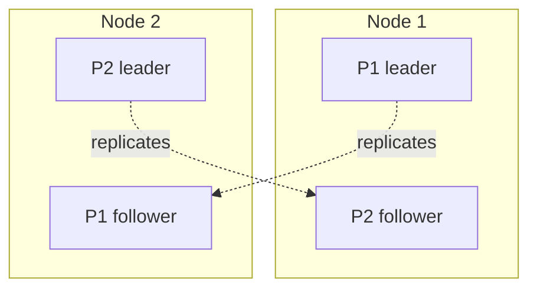
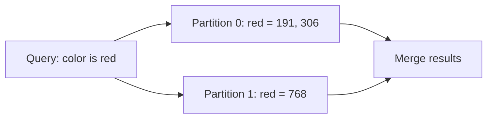
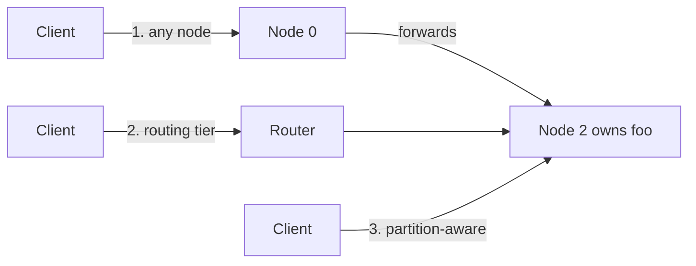

---
tags:
  - ddia/chapter-6
  - distributed-systems/partitioning
date: 2026-11-21
---

# Chapter 6: Partitioning

> [!abstract] In a nutshell
> **Partitioning (sharding) splits a dataset too big or too busy for one machine into pieces, each record belonging to exactly one partition, so storage and query load spread across many nodes.**
>
> | Question | Main options |
> |---|---|
> | How to assign keys? | Key range, or hash of key |
> | How to index non-key fields? | Document-partitioned (local) or term-partitioned (global) secondary indexes |
> | How to add or remove nodes? | Fixed partitions, dynamic splitting, partitions per node |
> | How does a client find the node? | Any-node forwarding, routing tier, or partition-aware client |
>
> Goal throughout: spread data and load evenly and avoid **hot spots**. Reader assumption: you know replication basics from Chapter 5.

## 1. Basics

- Different names for the same idea: **shard** (MongoDB, Elasticsearch, SolrCloud), **region** (HBase), **tablet** (Bigtable), **vnode** (Cassandra, Riak), **vBucket** (Couchbase).
- Each partition is effectively a small database; different partitions live on different nodes of a shared-nothing cluster. Single-partition queries scale by adding nodes; complex queries can be parallelised but that is harder.
- Pioneered in the 1980s by Teradata and Tandem NonStop SQL; rediscovered by NoSQL and Hadoop-based warehouses. Applies to both transactional and analytic workloads.
- Not the same as a **network partition** (a network fault, Chapter 8).

**Partitioning plus replication**: each partition is replicated on several nodes. A node holds several partitions; it can be leader for some and follower for others (Fig 6-1). The partitioning scheme is mostly independent of the replication scheme, so the chapter ignores replication.

## 2. Partitioning key-value data

**Skew**: unfair partitioning, some partitions with more data or queries. A partition with disproportionate load is a **hot spot**; in the extreme, 9 of 10 nodes idle. Assigning records randomly avoids skew but forces querying all nodes to find a record.

### Key range partitioning

Each partition owns a continuous range of keys (like encyclopedia volumes, Fig 6-2). Boundaries adapt to the data (volume 1 covers A-B, volume 12 covers T-Z) and are chosen manually or automatically. Used by Bigtable, HBase, RethinkDB, MongoDB before 2.4.

- Pro: keys sorted within a partition, so **range scans** are easy; the key can be a concatenated index (e.g. fetch all sensor readings for a month).
- Con: some access patterns create hot spots. If the key is a timestamp (partition per day), all current writes hit today's partition.
- Fix: put something else first, e.g. sensor name then timestamp; a multi-sensor time range then needs a separate range query per sensor.

### Hash partitioning

A hash function turns skewed keys into uniformly distributed numbers; each partition owns a range of **hash values** (Fig 6-3 uses the first 2 bytes of MD5, range 0 to 65,535).

- The hash need not be cryptographically strong: Cassandra and MongoDB use MD5, Voldemort uses Fowler-Noll-Vo.
- Do not use language built-ins like Java `Object.hashCode()` or Ruby `Object#hash`: the same key may hash differently across processes.
- Boundaries can be evenly spaced or pseudorandom (sometimes called consistent hashing).

> [!note] Consistent hashing is a confusing term
> Karger et al.'s consistent hashing spreads load across caches/CDNs using random boundaries with no central control or consensus. It has nothing to do with replica or ACID consistency, and works poorly for databases, so the book suggests just saying "hash partitioning".

| | Key range | Hash |
|---|---|---|
| Range queries | Efficient | Lost; keys scattered. MongoDB hash mode sends range queries to all partitions; Riak, Couchbase, Voldemort do not support primary-key range queries |
| Load distribution | Risk of hot spots | Even |
| Typical rebalancing | Dynamic splitting | Fixed number of partitions (or dynamic) |

**Compound key compromise (Cassandra)**: only the first column is hashed to pick the partition; the other columns form a concatenated sorted index (in SSTables). With key (user_id, update_timestamp) you can scan one user's updates over a time interval efficiently, all on one partition, while users spread across partitions.

### Skewed workloads and hot keys

Hashing cannot help when all requests hit one key, e.g. a celebrity user. 

Most systems do not compensate automatically, so the application must. Technique: append or prepend a random number (a two-digit number splits one key into 100). Trade-off: reads must fetch all 100 keys and combine them, and you must track which keys are split.

## 3. Partitioning and secondary indexes

A secondary index finds occurrences of a value (all red cars, all articles containing a word) and does not map neatly to partitions. It is the raison d'etre of Solr and Elasticsearch. Example: used cars, partitioned by document ID, with indexes on color and make.

| | Document-partitioned (local index) | Term-partitioned (global index) |
|---|---|---|
| Where index entries live | In the same partition as the documents; each partition indexes only its own documents (Fig 6-4) | Index covers all partitions but is itself partitioned by **term** (e.g. colors a-r in partition 0, s-z in partition 1) (Fig 6-5) |
| Write | Touches one partition | May touch several index partitions; slower, more complex |
| Read | **Scatter/gather** over all partitions; prone to tail latency amplification | One request to the partition holding the term |
| Used by | MongoDB, Riak, Cassandra, Elasticsearch, SolrCloud, VoltDB | DynamoDB global secondary indexes, Riak search, Oracle warehouse (can choose local or global) |

- Term-partitioned index can be partitioned by the term (good for range scans, e.g. asking price) or by hash of the term (more even load).
- Keeping a global index in sync needs a distributed transaction, not supported everywhere, so updates are often **asynchronous**: a read just after a write may miss it. DynamoDB says global index updates take a fraction of a second normally, longer during faults.
- Vendors advise structuring partitioning so index queries hit one partition, but that fails for multiple secondary indexes in one query.
- Rolling your own index in a key-value store risks inconsistency from race conditions and partial failures.

## 4. Rebalancing partitions

Rebalancing moves load between nodes when throughput grows, data grows, or a machine fails. Requirements: load shared fairly afterward; reads and writes continue during it; move no more data than necessary.

### Strategies

| Strategy | How it works | Pros / cons | Used by |
|---|---|---|---|
| **hash mod N** (do not do this) | partition = hash mod number of nodes | Changing N moves most keys: hash 123456 is on node 6 with 10 nodes, node 3 with 11, node 0 with 12 | - |
| **Fixed number of partitions** | Create many more partitions than nodes (e.g. 1,000 over 10 nodes, ~100 each). A new node steals whole partitions from each existing node (Fig 6-6) | Only partition-to-node assignment changes, not key-to-partition. Big nodes can get more partitions. Partition count is fixed up front, so it caps node count; too large means overhead, too small or too big makes recovery and rebalancing costly, hard if dataset size varies | Riak, Elasticsearch, Couchbase, Voldemort |
| **Dynamic partitioning** | Split a partition when it exceeds a size (HBase default 10 GB); merge when it shrinks, like B-tree splits. Halves can move to other nodes | Partition count adapts to data volume. An empty database starts with one partition, so one node takes all writes until the first split; fix with **pre-splitting** (needs known key distribution) | HBase, RethinkDB, MongoDB (key-range and hash, since 2.4) |
| **Proportional to nodes** | Fixed number of partitions **per node** (Cassandra default 256). A new node randomly picks existing partitions to split and takes half of each | Partition size stays stable as data and nodes grow together. Random boundaries need hash partitioning; matches the original consistent hashing; Cassandra 3.0 added an algorithm avoiding unfair splits | Cassandra, Ketama |

Partitions in the fixed scheme move only for the new node: in Fig 6-6, going from 4 nodes with 20 partitions to 5, only four partitions (p4, p9, p14, p19) move to the new node, one from each old node, and the rest stay put. Until the transfer finishes, the old assignment serves reads and writes.

### Automatic or manual

Fully automatic rebalancing is convenient but unpredictable, since moving data is expensive and can overload the network and nodes. 

Combined with automatic failure detection it can cascade: an overloaded, slow node is declared dead, load is moved away, making things worse. Couchbase, Riak and Voldemort suggest an assignment and require an administrator to commit it. A human in the loop is slower but avoids surprises.

## 5. Request routing

How does a client know which IP and port serves key "foo"? This is **service discovery**. Three approaches (Fig 6-7):

1. Contact any node (e.g. round-robin load balancer); it forwards to the right node.
2. A **routing tier**, a partition-aware load balancer that handles no requests itself.
3. Clients know the partition assignment and connect directly.

Key problem: how does the deciding component learn about assignment changes? Everyone must agree, which is a consensus problem (Chapter 9).

- **ZooKeeper** (coordination service): nodes register, it holds the authoritative partition-to-node map, and routers or clients subscribe for changes (Fig 6-8). Used by LinkedIn Espresso (via Helix), HBase, SolrCloud, Kafka.
- **MongoDB**: own config servers plus **mongos** routers.
- **Cassandra and Riak**: **gossip protocol** spreads cluster state; any node can take a request and forward it (approach 1). More complexity in nodes, no external dependency.
- **Couchbase**: no automatic rebalancing; routing tier **moxi** learns changes from nodes.
- Finding IPs for a router or random node changes slowly, so DNS is often enough.

## 6. Parallel query execution

Most NoSQL stores only support single-key reads/writes and scatter/gather. **Massively parallel processing (MPP)** relational warehouses support joins, filters, grouping and aggregation: the optimizer splits a query into stages and partitions executed in parallel across nodes, which benefits large scans. Details are in Chapter 10.

## Summary

- Partitioning is needed when data or load exceeds one machine; aim to avoid hot spots and rebalance as nodes change.
- Two main schemes: **key range** (sorted, range queries, hot-spot risk, dynamic splitting) and **hash** (even load, no range queries, typically fixed partition count); hybrids use a compound key.
- Secondary indexes: **local** (cheap writes, scatter/gather reads) versus **global** (single-partition reads, multi-partition writes).
- Routing ranges from partition-aware load balancing to parallel query engines.
- Each partition works mostly independently, but writes spanning several partitions raise the question of partial failure, addressed in later chapters.

## Quick recall

- Partition = shard/region/tablet/vnode/vBucket; each record in exactly one partition; usually combined with replication.
- Key range gives range scans but timestamp keys cause hot spots; hash gives even spread but kills range queries; Cassandra's compound key is the middle ground.
- Hot key (celebrity) is the application's problem: add a random suffix, pay with fan-out reads.
- Local index: write to one partition, read scatter/gather. Global index: read from one partition, write to many, often async.
- Never use hash mod N; use fixed partitions, dynamic splitting, or partitions per node.
- Automatic rebalancing plus automatic failure detection can cascade; keep a human in the loop.
- Routing: forward from any node, routing tier, or smart client; ZooKeeper or gossip keeps the map current.
