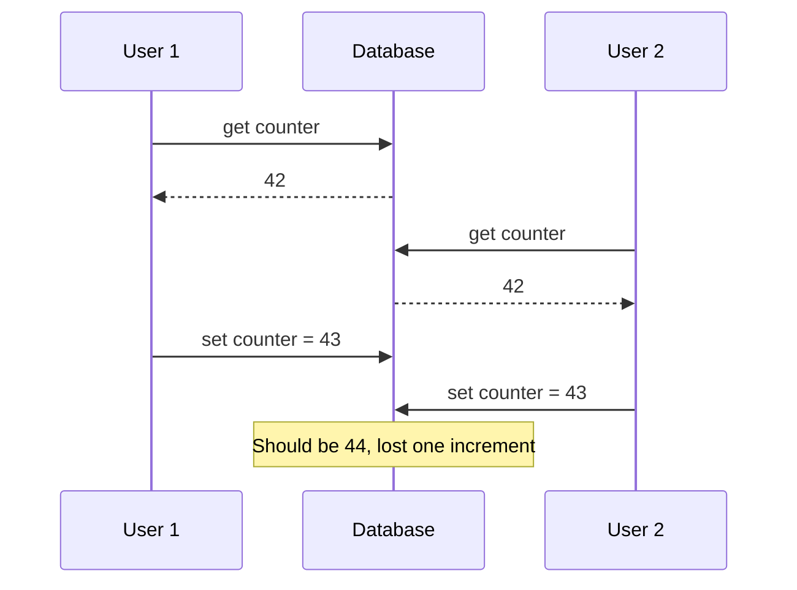
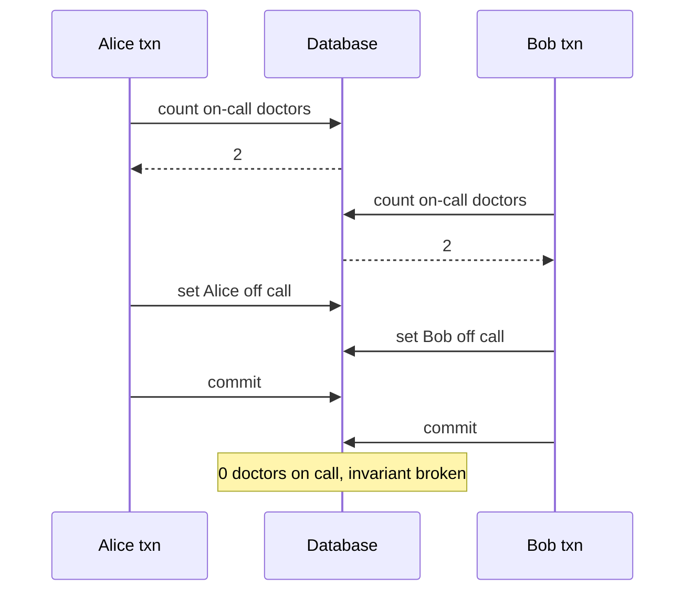

---
tags:
  - ddia/chapter-07
  - databases/transactions
date: 2026-11-21
---

# DDIA Chapter 7: Transactions

Reader: a backend engineer who knows SQL and basic database ideas and wants a fast revision.

> [!abstract] Summary
> A **transaction** groups several reads and writes into one unit that either commits or aborts, so the application can ignore partial failure and (to a degree) concurrency. The chapter unpacks ACID, shows that "isolation" is the slippery letter, and walks through the weak isolation levels used in practice (read committed, snapshot isolation) and the race conditions they allow (dirty writes, read skew, lost updates, write skew, phantoms). It ends with the three ways to get true serializability: actual serial execution, two-phase locking (2PL), and serializable snapshot isolation (SSI).

## 1. Why transactions, and the slippery concept

Things that go wrong: DB or app crashes mid-write, network cuts, concurrent clients overwriting each other, reads of half-updated data, races. Transactions simplify this: all-or-nothing, and on failure the app can **safely retry**.

- Transactions are a programming-model simplification, not a law of nature. They give *safety guarantees*.
- Style comes from IBM System R (1975); MySQL, PostgreSQL, Oracle, SQL Server are "uncannily similar".
- NoSQL movement (late 2000s) dropped or weakened transactions. The belief "transactions kill scalability" and the vendor claim "serious data needs ACID" are both called hyperbole.
- Not every app needs them; some safety can be had without. Decide by knowing the guarantees and their costs.

## 2. The meaning of ACID

ACID (Haerder and Reuter, 1983) is now mostly a marketing term: "ACID compliant" says little about real guarantees, especially isolation. **BASE** just means "not ACID".

| Letter | What it means here | Whose job |
|---|---|---|
| **A**tomicity | If a fault hits after some writes, abort and undo all of them. Not about concurrency. "Abortability" would be a better name | Database |
| **C**onsistency | Application invariants (e.g. credits and debits balance) stay true | Mostly the application; DB checks only constraints like FK/uniqueness |
| **I**solation | Concurrent transactions do not step on each other; formally serializability | Database |
| **D**urability | Committed data is not forgotten after crash or hardware fault | Database |

> [!warning] "Consistency" has four meanings
> Replica consistency (ch. 5), consistent hashing (ch. 6), CAP-style linearizability (ch. 9), and ACID consistency (app invariants). The C "was tossed in to make the acronym work".

**Atomicity** example: without it, a mid-way failure leaves unknown partial changes, and a retry may duplicate work. With it, an aborted transaction changed nothing, so retry is safe.

**Isolation** example (Figure 7-1): two clients read counter 42, each writes 43. Should be 44.

Serializable isolation is rarely used because of its cost. Oracle 11g's "serializable" is actually snapshot isolation (weaker).

**Durability**: single node means data on SSD/disk plus a write-ahead log; replicated means copied to several nodes before reporting commit. No perfect durability exists. Risks listed by the book:

- Disk-only: data inaccessible until machine is fixed; replication keeps availability.
- Correlated faults (power loss, a crashing input) can take out all replicas, so in-memory data is lost.
- Async replication can lose recent writes on leader failure.
- SSDs may violate guarantees on power loss (even `fsync` may not work); firmware and filesystem bugs; silent corruption.
- 30% to 80% of SSDs develop at least one bad block in 4 years; an unpowered SSD can lose data within weeks.

Takeaway: combine disk, replication and backups; treat "guarantees" with a grain of salt.

## 3. Single-object and multi-object operations

Multi-object transactions keep several pieces of data in sync. Figure 7-2 (email app with a denormalized unread counter): user 2 sees the new email but the counter is still 0 (a **dirty read**). Figure 7-3: if the counter update fails, atomicity rolls back the inserted email.

- Relational DBs group operations by the TCP connection: everything between `BEGIN` and `COMMIT`. If the connection drops after commit is requested but before the ack, the client does not know the outcome.
- Many NoSQL "multi-put" calls are **not** transactions: they can succeed for some keys and fail for others.

**Single-object writes** (e.g. a 20 KB JSON doc): storage engines almost always give atomicity (log for crash recovery) and isolation (per-object lock) on one object. Atomic increment and **compare-and-set** avoid read-modify-write races, but calling them "light-weight transactions" or "ACID" is misleading.

**When you need multi-object transactions:**

| Situation | Why |
|---|---|
| Foreign keys / graph edges | References must stay valid |
| Denormalized document data | Several documents must update together |
| Secondary indexes | Index and row must not diverge |

**Handling aborts and retries**: ORMs (Rails ActiveRecord, Django) often do not retry. Retry is imperfect:

- Commit succeeded but ack lost: retry runs it twice unless you deduplicate.
- Overload: retries make it worse; use a retry cap and exponential backoff.
- Only retry transient errors (deadlock, failover); a constraint violation is permanent.
- Side effects outside the DB (e.g. sending email) are not undone; 2PC can coordinate them.
- Client dies while retrying: the data is lost.

Leaderless-replication stores work "best effort": they do not undo what they already did.

## 4. Weak isolation levels

Race conditions appear only on unlucky timing, so tests rarely find them. Serializable isolation hides all of them but costs performance, so many systems use weaker levels, which are hard to understand. Weak isolation has caused real money loss, auditor investigations and corrupted data. "Use an ACID database for financial data" misses the point, since many "ACID" databases default to weak isolation.

### 4.1 Read committed

Two guarantees:

1. **No dirty reads**: only see committed data. In Figure 7-4, user 1 sets x = 3 but user 2 still reads 2 until commit.
2. **No dirty writes**: never overwrite uncommitted data. Figure 7-5: Alice and Bob buy the same car, listing goes to Bob but invoice to Alice.

Read committed does **not** fix the Figure 7-1 counter race, because the second write comes after the first commit.

Implementation:

- Dirty writes: row-level locks held until commit/abort (automatic).
- Dirty reads: read locks would let one long write block readers, so most DBs keep the old committed value and the new uncommitted value, and serve the old one to others.
- Default in Oracle 11g, PostgreSQL, SQL Server 2012, MemSQL.
- Only DB2 and SQL Server (with `read_committed_snapshot=off`) use locks for reads.

### 4.2 Snapshot isolation and repeatable read

Read committed allows **read skew (nonrepeatable read)** (Figure 7-6). Alice has $500 in each of two accounts. She reads account 1 ($500), then a $100 transfer commits, then she reads account 2 ($400). She sees $900 total.

Usually harmless after a reload, but not for:

- **Backups**: parts from different times become permanently inconsistent.
- **Analytic queries and integrity checks**: nonsensical results.

**Snapshot isolation**: each transaction reads from a consistent snapshot, everything committed at its start. Supported by PostgreSQL, MySQL/InnoDB, Oracle, SQL Server. Key principle: **readers never block writers, writers never block readers** (writes still use locks to prevent dirty writes).

**MVCC (multi-version concurrency control)** keeps several committed versions per object. PostgreSQL-style (Figure 7-7):

- Each transaction gets a unique, increasing `txid`.
- Each row has `created_by` and `deleted_by`. An update is a delete plus a create (txn 13 changes account 2 from $500 to $400: two rows exist).
- Garbage collection removes rows no transaction can see.

Visibility rules: ignore writes from (1) transactions in progress when mine started, (2) aborted transactions, (3) transactions with a later txid. Everything else is visible. So txn 12 still sees $500 even though txn 13 changed it.

Read committed in MVCC engines uses a new snapshot per query; snapshot isolation uses one snapshot per transaction.

Indexes: either point to all versions and filter, or use **append-only / copy-on-write B-trees** (CouchDB, Datomic, LMDB) where each write creates a new root, and each root is a snapshot (needs background compaction).

> [!warning] Naming mess
> The SQL standard predates snapshot isolation, so it only defines "repeatable read". Oracle calls snapshot isolation "serializable"; PostgreSQL and MySQL call it "repeatable read"; DB2 uses "repeatable read" for real serializability. "Nobody really knows what repeatable read means."

### 4.3 Preventing lost updates

Lost update: a read-modify-write cycle where the later write **clobbers** the earlier one (counter increment, editing a JSON document, two users saving a wiki page).

| Technique | How it works | Caveats |
|---|---|---|
| Atomic write ops | `UPDATE counters SET value = value + 1 WHERE key='foo'`; also MongoDB, Redis ops. Implemented with an exclusive lock ("cursor stability") or single thread | Best if expressible; ORMs make it easy to write unsafe cycles |
| Explicit locking | `SELECT ... FOR UPDATE` (Example 7-1, multiplayer game move) | Easy to forget a lock somewhere |
| Automatic detection | DB runs cycles in parallel, aborts on detected lost update | PostgreSQL repeatable read, Oracle serializable, SQL Server snapshot do this; **MySQL/InnoDB repeatable read does not** |
| Compare-and-set | `UPDATE ... WHERE id=1234 AND content='old content'` | Unsafe if the WHERE reads an old snapshot; check your DB |

Replicated databases (multi-leader, leaderless): locks and CAS assume a single up-to-date copy, so they do not apply. Instead keep conflicting versions (siblings) and merge, or use **commutative** operations (counter increment, set add; Riak 2.0 datatypes). **Last write wins** loses updates and is the default in many replicated DBs.

### 4.4 Write skew and phantoms

**Write skew** (Figure 7-8): a hospital needs at least one doctor on call. Alice and Bob both check "count >= 2" under snapshot isolation, both see 2, each takes themself off call, and the count becomes 0.

It is neither a dirty write nor a lost update, because different objects are updated. It generalizes lost update: two transactions read the same objects, then update (possibly different) ones.

Options are limited:

- Atomic single-object ops do not help; automatic lost-update detection does not catch it.
- Only true serializable isolation prevents it automatically.
- Multi-object constraints are rarely supported (triggers or materialized views maybe).
- Second best: lock the rows the decision depends on (`SELECT ... FOR UPDATE`).

More examples (all unsafe under snapshot isolation): meeting room double booking (Example 7-2), multiplayer game moving two figures to one square, **claiming a username** (a unique constraint fixes this), **double-spending** (balance goes negative).

**Phantoms**: common pattern is SELECT a condition, decide, write, and the write changes the SELECT result. When the check looks for the *absence* of rows, `FOR UPDATE` has nothing to lock. A write changing another transaction's search result is a **phantom**.

**Materializing conflicts**: pre-create lock rows (e.g. a room x 15-minute slot table for six months) and lock those. It leaks concurrency control into the data model, so it is a last resort; prefer serializable.

## 5. Serializability

Problem with weak levels: hard to understand, inconsistently implemented, hard to tell if app code is safe, and no good tools to detect races. Researchers' answer since the 1970s: use serializable. It means the result equals some serial order, so it prevents **all** race conditions. Three implementation families:

| | Actual serial execution | Two-phase locking (2PL) | SSI |
|---|---|---|---|
| Style | Pessimistic to the extreme | Pessimistic | Optimistic |
| Reads block writes? | n/a, one thread | Yes, both ways | No |
| Main limit | One CPU core; small, fast transactions; data in RAM | Poor, unstable latency; deadlocks | Abort rate under contention; short read-write txns |
| Used by | VoltDB/H-Store, Redis, Datomic | MySQL InnoDB and SQL Server serializable; DB2 repeatable read | PostgreSQL 9.1+ serializable, FoundationDB (similar) |

### 5.1 Actual serial execution

Run one transaction at a time on a single thread. Became feasible around 2007 because (1) RAM is cheap enough for the active dataset, and (2) OLTP transactions are short; long read-only analytics run on a snapshot outside the loop.

- **Stored procedures**: interactive multi-statement transactions waste time on network round-trips (Figure 7-9), so the whole transaction is submitted up front and runs without waiting on I/O. Needs data in memory.
- Stored-procedure criticisms: vendor-specific languages (PL/SQL, T-SQL, PL/pgSQL), hard to debug/version/test/monitor, and a bad procedure hurts a shared database badly. Modern systems use general languages: VoltDB Java/Groovy, Datomic Java/Clojure, Redis Lua.
- VoltDB replicates by running the same procedure on each replica, so procedures must be **deterministic** (use special APIs for time).
- **Partitioning**: single-partition transactions scale roughly linearly with cores. Cross-partition transactions need lock-step coordination; VoltDB reported about 1,000 cross-partition writes/s, and adding machines does not help. Secondary indexes tend to force cross-partition work.

Constraints: every transaction small and fast (one slow one stalls everything); active dataset fits in memory (or use **anti-caching**: abort, fetch data async, restart); write throughput within one core, or partitionable.

### 5.2 Two-phase locking, 2PL

For about 30 years the only widely used serializability algorithm. Often called strong strict 2PL.

> [!warning] 2PL is not 2PC
> Two-phase *locking* is concurrency control. Two-phase *commit* is atomic commit across nodes (ch. 9).

Rules: many readers may share an object, but any writer needs exclusive access. Writers block readers and readers block writers. This is the opposite of snapshot isolation's mantra.

- Read needs a **shared** lock; write needs an **exclusive** lock; read-then-write upgrades shared to exclusive.
- Locks are held until commit or abort: phase 1 acquires (during execution), phase 2 releases (at end).
- **Deadlock**: detected automatically, one transaction aborted and retried.

Performance: the big downside. Lock overhead, but mostly reduced concurrency. Latencies are unstable, high percentiles are very slow under contention, one slow transaction can stall everything. Deadlocks are far more frequent than under lock-based read committed, and retries waste work.

**Predicate locks** stop phantoms: a lock belongs to all objects matching a search condition (including not-yet-existing ones). A reader takes a shared predicate lock; a writer checks if the old or new value matches an existing predicate lock. Too slow with many locks.

**Index-range (next-key) locks** are the practical approximation: attach the lock to an index entry or range (e.g. `room_id = 123`, or a time range). It locks a superset, which is safe but less precise. With no usable index, fall back to a shared lock on the whole table.

### 5.3 Serializable snapshot isolation, SSI

Full serializability with only a small penalty versus snapshot isolation. First described in 2008 (Cahill); PostgreSQL since 9.1; FoundationDB uses a similar algorithm.

**Pessimistic vs optimistic**: 2PL waits when something might go wrong. SSI proceeds, then checks at commit and aborts if isolation was violated. Optimistic does badly under high contention and near max throughput (retries add load), but is better with spare capacity and low contention. Commutative atomic operations reduce contention.

**Core idea: decisions based on an outdated premise.** A transaction reads a premise ("two doctors on call"), then writes. The DB cannot know how the read is used, so it assumes any change to the read result may invalidate the writes. It detects two cases:

1. **Stale MVCC read** (Figure 7-10): txn 43 ignores uncommitted txn 42's write to Alice. If 42 has committed by the time 43 commits, 43 aborts. The check waits until commit, because 43 may be read-only, and 42 may still abort.
2. **Write affecting a prior read** (Figure 7-11): both txns read the `shift_id = 1234` index range; the DB records "read by 42, read by 43" in the index. A write looks up recent readers and notifies them. Unlike 2PL these are **tripwires, not blocking locks**. Txn 42 commits first and succeeds; when 43 tries to commit, 42's write has taken effect, so 43 aborts and retries.

Performance notes:

- Tracking granularity trades bookkeeping cost against unnecessary aborts. PostgreSQL avoids some aborts by proving certain overwritten reads are still serializable.
- No blocking: predictable latency, and read-only queries run lock-free on a snapshot.
- Not limited to one core: FoundationDB distributes conflict detection across machines.
- Abort rate matters: read-write transactions should be fairly short; long read-only ones are fine. SSI is less sensitive to slow transactions than 2PL or serial execution.

## 6. Anomalies vs protection

| Anomaly | Meaning | Prevented by |
|---|---|---|
| Dirty read | Read uncommitted data | Read committed and stronger |
| Dirty write | Overwrite uncommitted data | Almost every implementation |
| Read skew | Different parts seen at different times | Snapshot isolation (MVCC) |
| Lost update | Concurrent read-modify-write clobbers | Auto-detect in some snapshot impls, else manual lock / atomic op |
| Write skew | Decision based on stale premise | Only serializable |
| Phantom | Write changes another's search result | Snapshot isolation for plain reads; index-range locks or serializable for write skew |

> [!question] Q1 · Why does snapshot isolation not stop the on-call doctor bug?
>
> > [!success] Answer
> > Each transaction reads a consistent snapshot showing 2 doctors on call, then updates a different row. No dirty write or lost update occurs, and no lock conflict arises. Only serializable isolation (2PL, SSI, serial) catches it.

> [!question] Q2 · Why can `SELECT FOR UPDATE` not fix the room double booking?
>
> > [!success] Answer
> > The query finds zero rows, so there is nothing to lock. This is a phantom. Fixes: index-range or predicate locks (2PL), SSI, or materializing conflicts as a last resort.

## Common mistakes

| Mistake | What happens | Fix |
|---|---|---|
| Assuming "ACID database" means serializable | Defaults are often read committed or snapshot isolation; write skew slips through | Check the actual isolation level and test (e.g. Hermitage-style) |
| Assuming "repeatable read" is portable | Means different things in different DBs | Read the docs per database |
| Retrying every error | Duplicates, overload, pointless retries on permanent errors | Retry only transient errors, with backoff and dedup |
| Using read-modify-write in app code | Lost updates | Atomic ops, `FOR UPDATE`, or a DB that detects them |
| Confusing 2PL with 2PC | Wrong mental model | 2PL = locking, 2PC = atomic commit |

## Quick recall

- Transaction = commit or abort as a unit; abort enables safe retry.
- ACID: A (abort and undo), C (app's job), I (concurrency), D (never perfect: disk + replicas + backups).
- Read committed = no dirty reads/writes; snapshot isolation = consistent snapshot via MVCC, readers and writers do not block.
- Lost updates: atomic ops, explicit locks, auto-detection (not MySQL RR), compare-and-set (check safety).
- Write skew and phantoms need serializability, or locks and materialized conflicts as a fallback.
- Serial execution: single thread, in-memory, stored procedures, partition by key.
- 2PL: shared/exclusive locks held to the end, predicate or index-range locks; slow and deadlock-prone.
- SSI: optimistic, detect stale reads and writes affecting reads at commit; PostgreSQL and FoundationDB.
