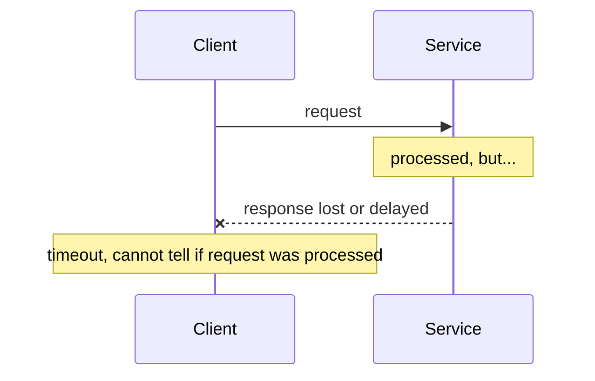
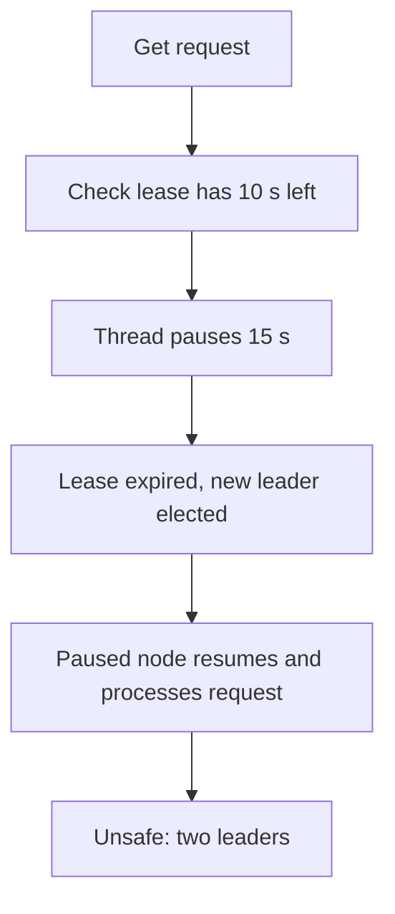
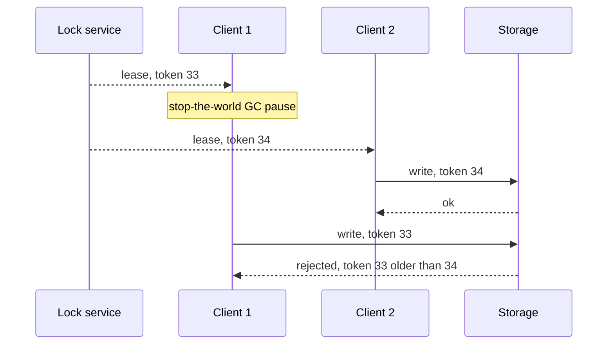

---
tags:
  - ddia/chapter-08
  - distributed-systems/faults
date: 2026-11-21
---

# DDIA Chapter 8: The Trouble with Distributed Systems

Reader: a backend engineer who has used replicated databases and message queues and wants a fast revision of why distributed systems are hard.

> [!abstract] Summary
> Assume anything that can go wrong will (except Byzantine lying). On a single computer, things either work or crash. Across a network you get **partial failures**, and they are nondeterministic. The chapter covers three sources of trouble: **unreliable networks** (loss, unbounded delay, no way to tell why a reply is missing), **unreliable clocks** (drift, jumps, no confidence interval, so timestamps cannot order events), and **process pauses** (GC, VM suspend, so a node can be declared dead and come back unaware). It then explains how to reason about truth by quorum, how fencing tokens protect against zombie leaders, what Byzantine faults are, and how system models and safety/liveness properties let algorithms (chapter 9) be proven correct.

## 1. Faults and partial failures

- A single computer is deterministic: it works or fails completely (kernel panic). Computers deliberately crash rather than return wrong results.
- A multi-node system has **partial failure**: some parts broken in unpredictable ways while others work. It is **nondeterministic**: the same operation may sometimes work and sometimes fail, and you may not even know which.
- Coda Hale's anecdote lists real faults: network partitions, PDU and switch failures, rack power cycles, whole-DC outages, and a truck hitting the HVAC system.

**Cloud computing vs supercomputing**

| | HPC / supercomputer | Cloud / internet services |
|---|---|---|
| Workload | Offline batch (weather, molecular dynamics) | Online, low latency, must stay up |
| Fault handling | Checkpoint; stop the whole job on node failure, restart (partial failure becomes total) | Tolerate failed nodes; rolling upgrades; kill and replace slow VMs |
| Hardware | Specialized, reliable nodes, RDMA, meshes/toruses | Commodity machines, higher failure rate, IP/Ethernet in Clos topologies |
| Network | Nodes close together | Possibly geo-distributed over the internet |

In big systems something is always broken. We must build a reliable system from unreliable components, e.g. TCP over IP (retransmits, deduplicates, reorders) and error-correcting codes. There are limits: TCP cannot remove delays. Test with deliberately injected faults: "suspicion, pessimism, and paranoia pay off".

## 2. Unreliable networks

The systems in this book are **shared-nothing**: machines communicate only over an **asynchronous packet network** (no guarantee on delivery or timing).

**Why a missing reply is ambiguous** (Figure 8-1). The request may have been lost, queued, the node may be down or paused (GC), or it processed the request but the response was lost or delayed. You cannot tell which of these happened. The usual answer is a **timeout**, but it still does not tell you whether the request was processed.

**Network faults in practice**. One study of a medium datacenter found about 12 network faults per month (half disconnect one machine, half a whole rack). Redundant gear does not help much against human error such as misconfiguration. Other examples: a switch upgrade causing over a minute of delay, sharks biting undersea cables, a NIC that drops inbound but sends outbound. Untested fault handling can deadlock a cluster or even delete data (Chaos Monkey idea: trigger faults on purpose). Handling a fault need not mean tolerating it: showing an error may be fine.

### 2.1 Detecting faults

Feedback is possible only in special cases: OS sends RST/FIN if the process is dead but the host is up; a script can notify others (HBase does this); switch management interfaces; ICMP Destination Unreachable. You cannot count on these. Even a TCP ack does not mean the application processed the request; you need an application-level response. In general: retry, wait for a timeout, then declare the node dead.

### 2.2 Timeouts and unbounded delays

- Long timeout: slow detection. Short timeout: risk of false positives (action done twice; load moves to others, which can cause **cascading failure**).
- If delays were bounded by $d$ and processing by $r$, a timeout of $2d + r$ would be correct. Real asynchronous networks and servers give no such bounds.

**Why delays vary: queueing**

| Source | Effect |
|---|---|
| Switch queue (Figure 8-2: ports 1, 2, 4 all send to port 3) | Wait, or dropped packet and resend |
| Destination OS queue when all CPU cores are busy | Arbitrary wait |
| Virtual machine paused for tens of ms | Incoming data buffered |
| TCP flow control (backpressure) and retransmission timeouts | Queueing at sender, delay from retransmit |

- **TCP vs UDP**: UDP has no flow control or retransmit, so it is used where late data is worthless (VoIP, video calls).
- Queues are worst near capacity. Noisy neighbors in shared clouds (e.g. MapReduce saturating links) add variance.
- Pick timeouts experimentally, or better, adapt them to observed response times and jitter with a **Phi Accrual failure detector** (Akka, Cassandra).

### 2.3 Synchronous vs asynchronous networks

Telephone networks use **circuits**: ISDN reserves 16 bits per frame, 4,000 frames per second, which is 16 bits every 250 microseconds. No queueing, so delay is **bounded**.

| | Circuit-switched (phone) | Packet-switched (Ethernet/IP, TCP) |
|---|---|---|
| Bandwidth | Fixed reservation | Dynamic share |
| Delay | Bounded | Unbounded (queues) |
| Utilization | Wasted when idle, bad for bursty traffic | High, cheaper |

- Datacenters and the internet use packet switching because traffic is **bursty**. Using circuits for file transfers wastes capacity and forces you to guess a bandwidth.
- ATM and InfiniBand are partial hybrids. QoS and admission control can emulate circuits, but are not enabled in public clouds or the internet.
- Variable delay is a **cost/benefit trade-off** (utilization vs latency guarantees), not a law of nature. So there is no "correct" timeout.

## 3. Unreliable clocks

Clocks answer **duration** questions (timeouts, percentiles, throughput) and **point in time** questions (publish date, expiry, log timestamps). Each machine has its own quartz clock that drifts; NTP synchronizes them imperfectly.

### 3.1 Two kinds of clock

| | Time-of-day clock | Monotonic clock |
|---|---|---|
| Examples | `clock_gettime(CLOCK_REALTIME)`, `System.currentTimeMillis()` | `CLOCK_MONOTONIC`, `System.nanoTime()` |
| Meaning | Wall-clock since the epoch (1970 UTC) | Arbitrary origin, only differences matter |
| Can jump back? | Yes (NTP reset, leap seconds) | No; NTP may only slew rate by up to 0.05% |
| Use for | Dates and timestamps | Timeouts, elapsed time |
| Compare across machines? | Roughly, if synced | Never |

### 3.2 Clock accuracy problems

- Drift: Google assumes 200 ppm, i.e. 6 ms if synced every 30 s, 17 s if synced once a day.
- Forced resets when too far off; NTP blocked by a firewall unnoticed.
- NTP accuracy is bounded by network delay: about 35 ms best case over the internet, spikes to about 1 s.
- Misconfigured NTP servers (hours off); clients query several and drop outliers.
- Leap seconds (a minute of 59 or 61 seconds) have crashed systems; smearing spreads the adjustment over a day.
- VMs: pauses look like the clock jumping. Mobile or embedded devices: the user may set a wrong clock.
- High accuracy is possible, e.g. MiFID II requires high-frequency traders to sync within 100 microseconds of UTC, using GPS and PTP, but it takes effort.

### 3.3 Relying on synchronized clocks

Bad clocks fail silently (data loss rather than a crash). So monitor clock offsets and evict nodes that drift.

**Timestamps for ordering events** (Figure 8-3). With multi-leader replication, client A writes x=1 on node 1 with timestamp 42.004. Client B, causally later, increments x on node 3, giving x=2 with timestamp 42.003. Skew is under 3 ms. Node 2 sees 42.004 as newer and drops B's write.

**Last write wins (LWW)** problems:

- Writes silently disappear when a lagging node's write loses to a fast clock.
- It cannot tell sequential writes from truly concurrent ones (needs version vectors).
- Timestamp ties need a tiebreaker (e.g. random number), which can also violate causality.
- Used in Cassandra and Riak.

Better: **logical clocks** (incrementing counters, ordering only) versus **physical clocks** (time-of-day and monotonic). More in chapter 9, "Ordering Guarantees".

**Confidence intervals.** A reading is a range, not a point: ±100 ms makes microsecond digits meaningless. Most APIs hide the uncertainty. Google's **TrueTime** (Spanner) returns `[earliest, latest]`.

**Global snapshots**. Snapshot isolation needs monotonically increasing transaction IDs, which need coordination across machines. Spanner uses timestamps from TrueTime: if two intervals do not overlap, order is certain. It **waits out the confidence interval** before committing a read-write transaction, so later readers' intervals do not overlap. Google puts a GPS receiver or atomic clock in each datacenter (about 7 ms uncertainty). Snowflake-style IDs are only approximately monotonic and not causal.

### 3.4 Process pauses

Example: a leader holds a **lease** (a lock with a timeout) and checks `lease.expiryTimeMillis - currentTimeMillis() < 10000` in a loop before processing each request.

Two flaws: it compares a remote expiry time to the local clock, and (even with a monotonic clock) it assumes little time passes between the check and `process(request)`.

Causes of pauses: stop-the-world **GC** (sometimes minutes), VM suspend and live migration, laptop lid closed, context switches and VM **steal time**, synchronous disk I/O (including lazy class loading, EBS), swapping and thrashing, SIGSTOP (Ctrl-Z). A node must assume it can be paused at any point; mutexes and semaphores do not translate, since there is no shared memory.

**Response time guarantees.** Hard real-time systems (airbags, flight control) have deadlines and need an RTOS, documented worst-case times, limited dynamic memory, and heavy testing. This is expensive and lowers throughput, so it is not suitable for most servers. Real-time is not the same as high-performance.

**Limiting GC impact.** Treat a GC like a planned brief outage: the runtime warns, the node stops taking new requests and drains, then collects (used in some trading systems). Or restart processes periodically so only short-lived objects are collected, shifting traffic like a rolling upgrade.

## 4. Knowledge, truth and lies

A node cannot know anything for sure; it only guesses from messages. We state assumptions as a **system model** and design to meet them.

### 4.1 The truth is defined by the majority

Scenarios where a healthy node is wrongly declared dead: asymmetric network fault (it receives but its replies are dropped), or a long GC pause after which it wakes up unaware. A node cannot trust its own judgment, so use a **quorum**: usually more than half the nodes. Three nodes tolerate 1 failure, five tolerate 2, and there can only be one majority, so no conflicting decisions. A node declared dead by a quorum must step down.

### 4.2 Leader, lock and fencing tokens

Only-one-of-something needs: one leader per partition (avoid split brain), one lock holder, one user per username. A node that believes it is the leader may be wrong.

Figure 8-4 (a real HBase bug): client 1 gets a lease, has a GC pause, the lease expires, client 2 gets the lease and writes, then client 1 wakes up and also writes, corrupting the file.

**Fencing token**: a number that increases every time a lock or lease is granted. Each write to storage carries its token, and storage rejects any token lower than the highest already seen.

- With ZooKeeper, `zxid` or `cversion` can serve as the token (monotonic).
- The **resource** must check tokens; clients checking their own lock status is not enough. For resources without support, you might put the token in a filename.
- Servers should protect themselves from clients that misbehave by accident.

### 4.3 Byzantine faults

Fencing stops nodes that err **inadvertently**, not ones that lie. The book assumes nodes are unreliable but honest. A **Byzantine fault** means a node may send arbitrary or false messages. The Byzantine Generals Problem generalizes the Two Generals Problem (consensus over unreliable messengers). A system is **Byzantine fault-tolerant** if it works despite malfunctioning or malicious nodes.

- Relevant for: aerospace (radiation-corrupted memory), multi-organization systems such as Bitcoin and blockchains.
- Usually not relevant in your own datacenter: the protocols are complicated and costly. Typically needs more than two-thirds of nodes correct (4 nodes, at most 1 faulty). It does not protect against a bug present in every node, or an attacker who compromises one node and so likely all of them; use authentication, access control, encryption and firewalls instead.
- Web servers treat clients as untrusted via validation, sanitization and output escaping, not BFT protocols.

**Weak forms of lying** worth guarding against: application-level checksums for corrupted packets that slip past TCP/UDP checksums; sanitizing user input (ranges, string sizes); NTP clients using multiple servers and a majority agreement.

## 5. System model and reality

A **system model** abstracts the faults an algorithm may assume.

| Timing model | Assumption |
|---|---|
| Synchronous | Bounded network delay, pauses, and clock error. Unrealistic |
| Partially synchronous | Behaves synchronously most of the time, sometimes exceeds bounds. Realistic |
| Asynchronous | No timing assumptions, no clock, no timeouts. Very restrictive |

| Node failure model | Assumption |
|---|---|
| Crash-stop | A node fails only by crashing and never returns |
| Crash-recovery | A node may crash and return; disk survives, memory is lost |
| Byzantine | Anything, including deceit |

The most useful combination: **partially synchronous with crash-recovery**.

**Correctness via properties.** Example for fencing tokens: *uniqueness* (no two requests return the same token), *monotonic sequence* (if x finished before y began, then $t_x < t_y$), *availability* (a non-crashed requester eventually gets a response).

| | Safety | Liveness |
|---|---|---|
| Informal | Nothing bad happens | Something good eventually happens |
| Examples above | Uniqueness, monotonic sequence | Availability |
| If violated | Can point to the moment; cannot be undone | May not hold now, but can still be satisfied later |
| Requirement | Must **always** hold, even if all nodes crash | May carry caveats (majority alive, network recovers) |

Eventual consistency is a liveness property. Reality bites: disk data may be corrupted or lost (amnesia breaks quorum algorithms), firmware may not see the drives. Real implementations must handle "impossible" cases, even if only by alerting a human. Theory and testing are equally important: a proof does not guarantee a correct implementation, but it finds problems that might otherwise stay hidden.

## 6. Summary

- Packets can be lost or delayed, and replies too; no reply means no knowledge.
- Clocks can be far off, jump, and have an unknown error interval.
- Processes can pause at any time and come back unaware.
- Timeouts are the main failure detector but cannot tell network from node failure, and a "limping" degraded node (e.g. a Gigabit NIC dropping to 1 Kb/s) is harder than a dead one.
- No shared state, so important decisions need quorums.
- If everything fits on one machine, keep it there; but fault tolerance and low latency need distribution.
- Hard real-time and bounded networks exist but are expensive. Supercomputers stop and restart on failure; distributed services can run forever, though a bad config rolled to all nodes can still sink them.

## Common mistakes

| Mistake | What happens | Fix |
|---|---|---|
| Treating "no response" as "node dead" | Duplicate actions, cascading failover | Timeouts tuned and adaptive; idempotence or dedup |
| Using time-of-day for elapsed time | Jumps break timeouts | Monotonic clock |
| Ordering events by wall-clock timestamps (LWW) | Silent data loss | Logical clocks or version vectors |
| Trusting a lease without checking time of use | Zombie leader writes | Fencing tokens checked by the resource |
| Assuming clock reading is exact | Wrong ordering decisions | Treat as a confidence interval (TrueTime style) |
| Mixing up node failure with lying | Overspending on BFT, or none where needed | Honest-but-faulty is the default; BFT only for untrusted parties |

> [!question] Q1 · A client's write is rejected by storage even though it believes it holds the lock. Which mechanism caused this?
>
> > [!success] Answer
> > A fencing token. Its lease expired during a pause, a newer token was granted to another client, and storage rejects the lower token (33 after 34 in Figure 8-5).

> [!question] Q2 · Why can Spanner use clock timestamps as transaction IDs when NTP timestamps cannot be trusted?
>
> > [!success] Answer
> > TrueTime exposes the uncertainty interval, and Spanner waits out the interval before committing, so non-overlapping intervals guarantee ordering. GPS or atomic clocks keep the wait short (about 7 ms).

## Quick recall

- Partial failure plus nondeterminism is what defines distributed systems.
- Async networks: no bound on delay; no reply is ambiguous; timeouts are tuned experimentally or adaptively (Phi Accrual).
- Delay variance comes from queueing, a utilization trade-off, not a law of nature.
- Time-of-day clocks jump; monotonic clocks measure durations; neither can order events across machines reliably.
- Process pauses (GC, VM, swapping) mean a node can act on stale beliefs.
- Truth is decided by a majority quorum; use fencing tokens to stop zombies.
- Assume honest-but-faulty nodes (non-Byzantine) in a datacenter.
- Use system models (partially synchronous plus crash-recovery) and safety/liveness properties to reason about algorithms.
