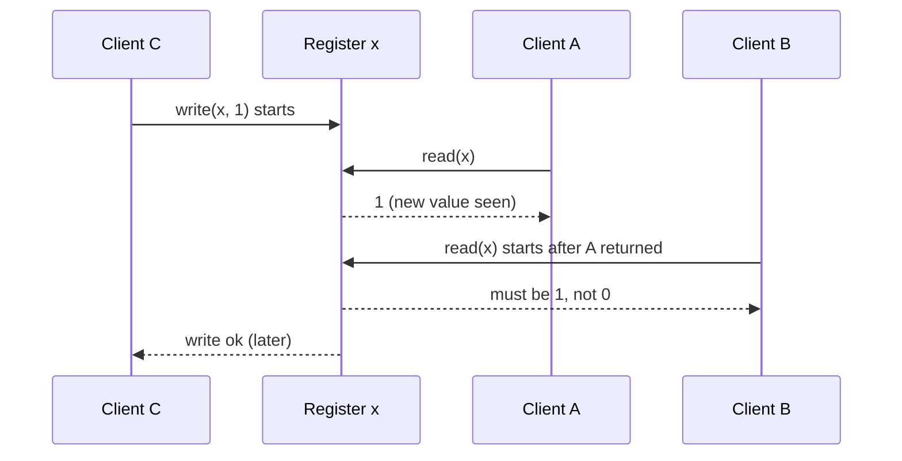
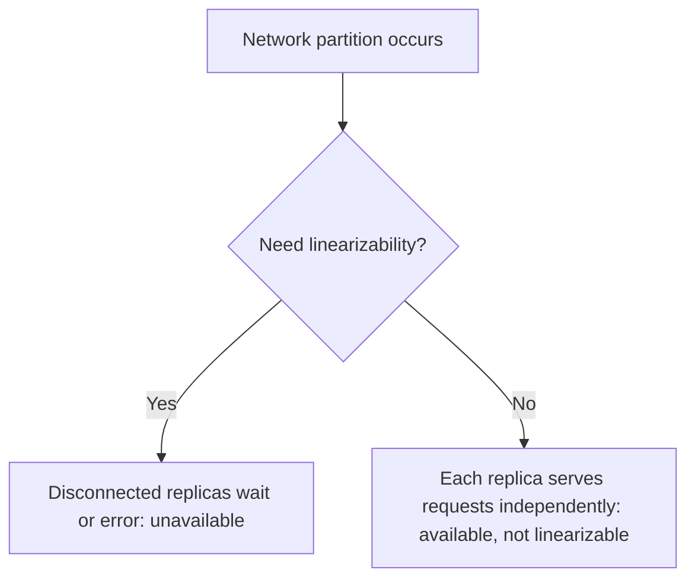
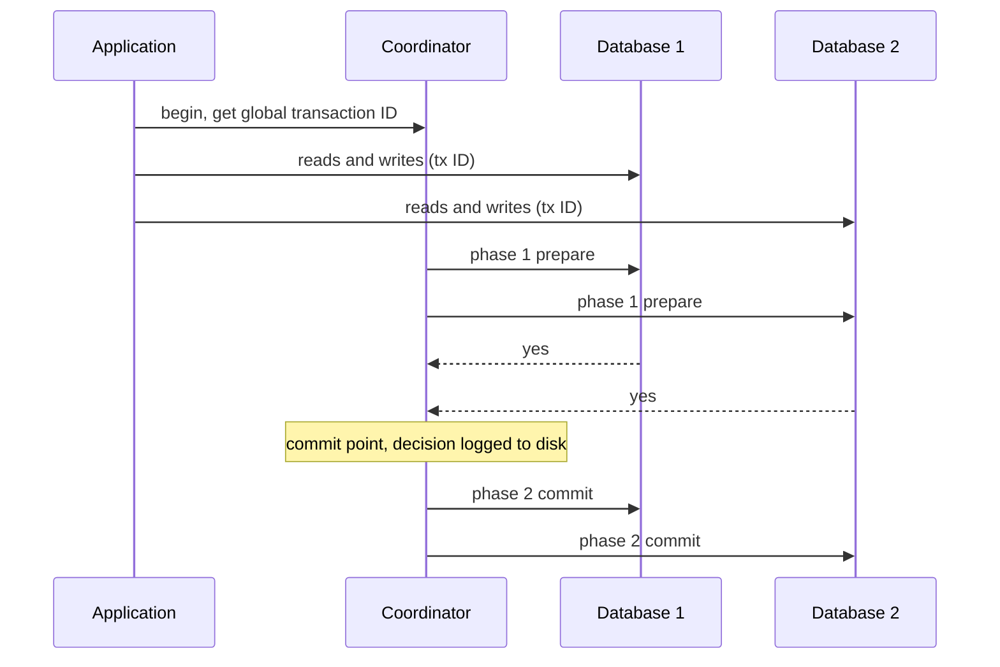

---
tags:
  - ddia/chapter-9
  - distributed-systems/consistency
  - distributed-systems/consensus
date: 2026-11-21
---

# Chapter 9: Consistency and Consensus

**Summary.** Distributed systems fail in many ways (Chapter 8), so the best approach is to build a few general-purpose abstractions with strong guarantees and let applications rely on them, as transactions do. This chapter covers three such ideas. **Linearizability** makes replicated data look like a single copy, at the cost of speed and availability. **Ordering** (causality, Lamport timestamps, total order broadcast) captures "what happened before what". **Consensus** gets nodes to agree irrevocably, and turns out to be equivalent to atomic commit, total order broadcast, linearizable compare-and-set, locks, and uniqueness constraints. ZooKeeper and etcd package consensus as a service.

> [!info] Reader assumed
> You know replication (single-leader, multi-leader, leaderless), transactions and isolation levels, and the Chapter 8 faults (delays, clock skew, pauses). This note is for fast revision.

## 1. Consistency guarantees

- Replicas differ at any instant because writes arrive at different times. This holds for every replication method.
- **Eventual consistency** (better name: *convergence*): if writes stop, all replicas eventually return the same value. It says nothing about *when*; until then reads can return anything, even your own write is not guaranteed to be visible.
- It is hard to program against: a database looks like a variable but does not behave like one. Bugs show up only under faults or high concurrency.
- Stronger models cost performance or fault tolerance, but are easier to use correctly.
- Consistency models vs isolation levels: mostly independent. Isolation is about concurrent *transactions*; distributed consistency is about coordinating *replica state* under delays and faults.

Roadmap: linearizability, then ordering (causality, total order), then atomic commit and consensus.

## 2. Linearizability

**Idea:** make the system behave as if there were one copy of the data and every operation were atomic. Also called atomic, strong, immediate, or external consistency. It is a **recency guarantee**: once a write completes, all later reads see it.

Football example (Fig 9-1): Alice reloads and sees the final score, tells Bob, Bob reloads and hits a lagging replica and sees the game still running. Bob started his read *after* Alice's finished, so seeing older data violates linearizability.

### What makes a system linearizable

Model a key as a **register**. Operations are `read(x)`, `write(x, v)`, and `cas(x, old, new)` (compare-and-set). Each operation is a bar from request sent to response received; it took effect atomically at some point inside the bar.

Rules (Fig 9-2, 9-3, 9-4):

1. A read that finishes before the write starts returns the old value.
2. A read that starts after the write finishes returns the new value.
3. Reads overlapping the write may return either...
4. ...but once any read returns the new value, **all later reads must too**, even before the write completes.

Equivalent picture: join the points at which operations took effect into a line; the line must only move forward in time and each read must return the latest write.

Notice that B's read must return 1 even though C's write has not yet been acknowledged.

Fig 9-4 details worth remembering:

- Requests can be processed in an order different from the order sent, as long as they were concurrent.
- A read can return a value before the writer gets its `ok`; the ack was just delayed.
- No isolation is assumed: C reads 1 then 2 because B changed it. `cas` detects that: B and C's `cas` succeed, D's `cas(x,0,3)` fails.
- B's final read returning 2 is **not** linearizable: A had already read 4 before B's read started.
- Testing linearizability is possible but expensive (record all timings, check for a valid sequential order).

### Linearizability vs serializability

| | Serializability | Linearizability |
|---|---|---|
| Scope | Transactions over multiple objects | Single object (register) |
| Guarantee | Behaves as if run in *some* serial order | Recency of reads and writes |
| Prevents write skew? | Yes | No, unless extra measures |
| Order must match real time? | No | Yes |

- Both together = **strict serializability** (strong-1SR). 2PL and actual serial execution are typically linearizable.
- **SSI is not linearizable**: it reads from a consistent snapshot, which by design excludes newer writes.

### When you need linearizability

| Use case | Why |
|---|---|
| Locking and leader election | All nodes must agree who holds the lock, else split brain. ZooKeeper and etcd build this on consensus. Oracle RAC uses a lock per disk page. |
| Uniqueness constraints | Username, file path, seat booking, non-negative balance, stock level: a single up-to-date value everyone agrees on. A username claim is like a `cas` from null to user ID. |
| Cross-channel timing | Two channels carry related info, e.g. photo in file storage plus resize job on a message queue (Fig 9-5). If storage is stale when the job arrives, the resizer reads an old or missing image and sizes become permanently inconsistent. |

- Hard uniqueness needs linearizability; foreign key and attribute constraints do not. Loosely interpreted constraints (overbooking with compensation) may not need it (see Chapter 12, "Timeliness and Integrity").
- ZooKeeper/etcd: writes are linearizable, reads may be stale by default. etcd has *quorum reads*; ZooKeeper needs `sync()` first.

### Implementing linearizable systems

| Replication | Linearizable? | Why |
|---|---|---|
| Single-leader | Potentially | Reads from leader or sync followers. Breaks with snapshot isolation, bugs, a "delusional" old leader, or async failover losing writes. |
| Consensus (ZooKeeper, etcd) | Yes | Built-in protection against split brain and stale replicas. |
| Multi-leader | No | Concurrent writes on several nodes, async replication, conflicts. |
| Leaderless (Dynamo-style) | Probably not | LWW with clocks, sloppy quorums, and even strict quorums can fail. |

**Quorums are not enough (Fig 9-6).** With n=3, w=3, r=2: the write reaches replica 2 first. Reader A queries a quorum that includes replica 2 and gets 1. Reader B starts after A finished, queries two other replicas, and gets 0. w+r>n holds but linearizability is violated. You can fix this with synchronous read repair plus a writer that first reads the latest state from a quorum, at a performance cost. Riak skips synchronous read repair; Cassandra does it but loses linearizability through last-write-wins. Even then, a linearizable `cas` still needs consensus. Safest assumption: leaderless systems are not linearizable.

### The cost of linearizability

Two datacenters with a network partition between them (Fig 9-7):

- **Multi-leader:** each datacenter keeps working, writes queue and sync later. Not linearizable, but available.
- **Single-leader:** clients in the follower datacenter cannot reach the leader, so no writes and no linearizable reads (stale follower reads are still possible). They are unavailable.

**CAP theorem.** Read it as "either consistent or available *when partitioned*". Partitions are faults, not a choice, so "pick 2 of 3" is misleading. When the network works you can have both. The theorem's formal "availability" does not match the usual meaning, and it covers only one model (linearizability) and one fault (partitions), so it has little practical value and is mostly historical. It did push the field toward shared-nothing designs (NoSQL).

**Performance is the real cost.**

- Even RAM on a multi-core CPU is not linearizable (per-core caches and store buffers; memory barriers are needed). That choice is made for speed, not fault tolerance.
- Many distributed databases drop linearizability for the same reason.
- Attiya and Welch: linearizable read and write response time is at least proportional to network delay uncertainty. No faster algorithm exists, so latency-sensitive systems need weaker models.

## 3. Ordering guarantees

Ordering recurs everywhere: the leader orders the replication log, serializability gives a serial order, timestamps try to order events.

### Ordering and causality

- **Causality**: cause before effect. Examples from earlier chapters: a question before its answer (consistent prefix reads), a row created before updated, A happened-before B, snapshots consistent with causality, write skew as a causal dependency, Alice and Bob.
- A system that obeys causal order is **causally consistent**. Snapshot isolation is causally consistent.

| | Order type | Concurrency |
|---|---|---|
| Linearizability | **Total** order: any two operations comparable | None: one timeline |
| Causality | **Partial** order: related operations ordered, concurrent ones incomparable | Branches and merges, like a Git history |

- **Linearizability implies causality** (that is why it is simple), but is not required for it.
- **Causal consistency is the strongest model that does not slow down from network delays and stays available under network failures.** CAP does not apply. Many systems that seem to need linearizability only need causal consistency. Research systems exist but production adoption is limited.
- To capture causality, track what a node had "seen" when it wrote. Version vectors can be generalized across the whole database. A replica must delay an operation until all its causal predecessors are processed.

### Sequence number ordering

Tracking all causal dependencies is impractical (clients read lots before writing). Instead use **sequence numbers or logical clocks**: small, totally ordered, and consistent with causality (if A happened before B, A gets a lower number; concurrent operations ordered arbitrarily).

- Single-leader: the replication log counter gives such an order for free.
- Without a single leader, common generators are **not** causality-consistent:

| Generator | Problem |
|---|---|
| Odd/even (or node-ID bits) per node | Nodes progress at different rates |
| Physical timestamps | Clock skew |
| Pre-allocated blocks (node A 1-1000, B 1001-2000) | Later operation may get a lower block |

**Lamport timestamps** (1978): a pair `(counter, node ID)`. Compare by counter, then node ID. Every node and client tracks the **maximum counter seen** and sends it with each request; a node that sees a larger max bumps its own counter to it (Fig 9-8: node 1 at counter 1 receives max 5 from client A, then its next op is 6). Every causal dependency increases the timestamp.

- Lamport timestamps vs version vectors: version vectors detect concurrency; Lamport timestamps always give a total order and cannot tell concurrent from causal, but are more compact.

> [!warning] Timestamp order is not enough
> To enforce unique usernames, comparing Lamport timestamps works only *after* collecting all claims. A node deciding *right now* cannot know whether another node is creating the same name with a lower timestamp. Asking every node halts the system if one is unreachable. You need to know when the order is **finalized**. That is total order broadcast.

### Total order broadcast

Also called atomic broadcast (unrelated to ACID atomicity). Two safety properties, always satisfied even under faults (delivery may wait for the network to heal):

- **Reliable delivery**: if one node gets a message, all do.
- **Totally ordered delivery**: all nodes get messages in the same order.

Uses and facts:

- ZooKeeper and etcd implement it; it is the basis of **state machine replication**, serializable transactions via deterministic stored procedures, and fencing tokens (ZooKeeper `zxid`).
- It behaves like an append-only **log**. The order is fixed at delivery time: you cannot insert into an earlier position, which makes it stronger than timestamp ordering.
- It is asynchronous (no guarantee on *when*), while linearizability is a recency guarantee.

**Linearizable `cas` from total order broadcast** (username claim):

1. Append a tentative claim message to the log.
2. Read the log until your message is delivered back.
3. If the first claim for that name is yours, you win; otherwise abort.

All nodes agree who was first. This gives linearizable **writes** but reads from an async replica may be stale (this is really sequential or timeline consistency). Options for linearizable reads: sequence the read through the log (etcd quorum reads), fetch the latest log position and wait for it (ZooKeeper `sync()`), or read from a synchronously updated replica (chain replication).

**Total order broadcast from a linearizable register**: use an atomic increment-and-get register; stamp each message with its number; recipients deliver consecutively. Unlike Lamport timestamps these numbers have **no gaps**, so a node that has delivered 4 and receives 6 knows to wait for 5. That is the key difference. Building a fault-tolerant linearizable counter leads inevitably to consensus.

**Result:** linearizable cas/increment registers and total order broadcast are each equivalent to consensus.

## 4. Distributed transactions and consensus

Consensus = getting nodes to agree. Needed for **leader election** (avoid split brain) and **atomic commit** (all nodes commit or all abort).

**FLP result.** No algorithm can always reach consensus if a node may crash, but only in the asynchronous model with no clocks or timeouts. With timeouts, failure suspicion, or randomness, consensus is solvable. In practice it works.

### Atomic commit and two-phase commit

On one node, commit is decided by a single event: the commit record reaching the log on disk (data first, then the commit record). Across nodes, sending "commit" to each independently can leave some committed and others aborted (constraint violations, lost requests, crashes). A commit is **irrevocable**; only a separate compensating transaction can undo its effects, and that is the application's problem.

**2PC** uses a **coordinator** (transaction manager) and **participants**:

Why it works: **two points of no return**.

1. A participant that votes "yes" promises it can commit under all circumstances (data durably written, conflicts checked). It gives up the right to abort.
2. When the coordinator has all votes it writes its decision to its log (the **commit point**), then retries commit/abort forever until delivered. Any "no" or timeout in phase 1 means abort.

> [!warning] 2PC is not 2PL
> Two-phase commit gives atomic commit across nodes. Two-phase locking gives serializable isolation. Unrelated.

**Coordinator failure.** If it crashes after participants voted yes (Fig 9-10), they are **in doubt**: they cannot commit or abort unilaterally and must wait. The coordinator recovers from its log and aborts any transaction with no commit record. That is why 2PC is a **blocking** protocol.

**3PC** is nonblocking in theory, but assumes bounded delays and response times. Nonblocking atomic commit needs a perfect failure detector, which timeouts are not in real networks. So 2PC stays in use.

### Distributed transactions in practice

- Reputation is mixed. Cost comes from extra fsyncs and round trips; MySQL distributed transactions were reported over 10 times slower than single-node ones. Many cloud services avoid them.
- Two kinds:

| Kind | Example | Notes |
|---|---|---|
| Database-internal | VoltDB, MySQL Cluster (NDB) | Same software on all nodes, can optimize; often works well |
| Heterogeneous | Two vendors' databases, or a database plus message broker | Much harder |

- **Exactly-once processing**: atomically commit the message acknowledgement and the database writes. On abort the broker redelivers and the side effects are rolled back, so processing is effectively exactly once. All systems involved must support the same commit protocol (an email server that does not will send duplicates).
- **XA** (1991): a C API to a transaction coordinator, not a network protocol. Used via JTA/JDBC/JMS. Supported by PostgreSQL, MySQL, DB2, SQL Server, Oracle, ActiveMQ, IBM MQ, and others. The coordinator is usually a library in the application process with a log on local disk.
- **Locks held while in doubt**: participants keep their row locks until the outcome is known. A coordinator down for 20 minutes means 20 minutes of blocked rows; a lost log means locks held forever. **Orphaned in-doubt transactions** survive reboots (they must, for atomicity) and need an administrator to resolve manually. XA's escape hatch, **heuristic decisions**, lets a participant decide alone and *probably breaks atomicity*.

Limitations:

- The coordinator is a database of outcomes; unreplicated, it is a single point of failure.
- A coordinator in the app server makes the app **stateful**; its log becomes critical durable state.
- XA is a lowest common denominator: no cross-system deadlock detection, no SSI.
- All participants must respond, so distributed transactions **amplify failures**.
- Alternatives are in Chapters 11 and 12.

### Fault-tolerant consensus

Formal definition: nodes **propose** values, the algorithm **decides** one. Four properties:

| Property | Meaning | Kind |
|---|---|---|
| Uniform agreement | No two nodes decide differently | Safety |
| Integrity | No node decides twice | Safety |
| Validity | Decided value was proposed by someone (rules out "always decide null") | Safety |
| Termination | Every non-crashed node eventually decides | Liveness |

- Without fault tolerance a "dictator" node satisfies the first three. Termination is what demands fault tolerance, and 2PC fails it (it waits for the coordinator to recover).
- The model assumes a crashed node never returns. Termination needs a **majority** of nodes working; safety holds even if a majority fails. Most algorithms assume no Byzantine faults (tolerating them needs fewer than one third faulty).
- Main algorithms: Viewstamped Replication, Paxos, Raft, Zab. Most decide a *sequence* of values, so they are really **total order broadcast**: repeated consensus rounds (Multi-Paxos in Paxos). Agreement gives same order, integrity no duplicates, validity no fabricated messages, termination no loss.
- **Leader election paradox**: electing a leader needs consensus, which needs a leader. The way out is **epoch numbers** (Paxos ballot, VSR view, Raft term): monotonically increasing, and each epoch has at most one leader; the higher epoch wins.
- Before deciding, a leader needs a **quorum** vote, and the quorums for "elect leader" and "accept proposal" overlap, so a leader learns if a higher epoch exists. Compared to 2PC: the coordinator is elected, only a majority must vote (not all), and there is a recovery process.

Limits of consensus:

- Voting is synchronous replication, so costlier than async.
- Needs a strict majority: 3 nodes tolerate 1 failure, 5 tolerate 2. The minority side of a partition blocks.
- Fixed membership is assumed; dynamic membership is less well understood.
- Timeout-based failure detection causes needless elections on flaky networks (safety kept, performance hurt).
- Raft has edge cases with one unreliable link, where leadership keeps bouncing.

### Membership and coordination services

ZooKeeper, etcd (and Consul) look like key-value stores but hold **small, in-memory, slow-changing** data, replicated by total order broadcast. You mostly use them indirectly (HBase, YARN, OpenStack Nova, and Kafka rely on ZooKeeper). It is modeled on Google Chubby.

| Feature | Purpose |
|---|---|
| Linearizable atomic ops (cas) | Locks, usually as **leases** with expiry |
| Total ordering | `zxid` as fencing token |
| Failure detection | Heartbeat sessions; ephemeral nodes released on timeout |
| Change notifications | Watch instead of poll |

Only the atomic operations truly need consensus.

- Use cases: leader election and failover, assigning partitions to nodes and rebalancing. Libraries like Curator help; implementing consensus yourself has a poor success record.
- Runs on a fixed small cluster (3 or 5) while serving many clients, "outsourcing" coordination. Fast-changing application state needs other tools such as BookKeeper.
- **Service discovery** (registering endpoints) does not really need consensus: DNS is not linearizable and stale answers are tolerable. Read-only caching replicas can serve non-linearizable reads.
- **Membership services** agree on which nodes are alive. A node may be wrongly declared dead, but agreement still matters, e.g. for choosing the lowest-numbered live member as leader.

## 5. Summary: everything reduces to consensus

Equivalent problems: linearizable cas register, atomic commit, total order broadcast, locks and leases, membership/coordination, uniqueness constraints.

Single-leader gets these trivially, but if the leader fails there are three options:

1. Wait for recovery (XA coordinators): blocks, violates termination.
2. Manual failover by humans ("consensus by act of God"): slow.
3. Automatic election with a proven consensus algorithm.

A leader only "kicks the can down the road": consensus is still needed for leadership changes. Multi-leader and leaderless systems avoid global consensus and cope with branching and merging histories instead.

## Common mistakes

| Mistake | What happens | Fix |
|---|---|---|
| Assuming w+r>n gives linearizability | Stale reads (Fig 9-6) | Treat Dynamo-style as non-linearizable |
| Treating CAP as "pick 2 of 3" | Misleading, partitions are not optional | "Consistent or available when partitioned"; think latency too |
| Confusing serializability with linearizability | Wrong guarantee assumed | Multi-object isolation vs single-object recency |
| Confusing 2PC with 2PL | Wrong concept | Atomic commit vs isolation |
| Thinking timestamps solve uniqueness | Cannot decide now | Total order broadcast or consensus |
| Reading from any ZooKeeper replica | Stale value | `sync()` or quorum read |

## Quick recall

- Eventual consistency is weak; linearizability = single-copy illusion, a recency guarantee on one object.
- Linearizability is needed for locks, leader election, uniqueness constraints, cross-channel races. It costs latency (always) and availability (under partition).
- Single-leader may be linearizable; consensus is; multi-leader and leaderless are not.
- CAP: when partitioned, choose consistency or availability. Narrow, mostly historical.
- Causality is a partial order; linearizability is a total order and implies causality. Causal consistency is the strongest model with no delay penalty.
- Lamport timestamps `(counter, node ID)` give total order consistent with causality but cannot enforce constraints in real time.
- Total order broadcast = reliable plus same-order delivery = a log. It is equivalent to consensus.
- 2PC: prepare then commit, with two points of no return. The coordinator is a single point of blocking; in-doubt transactions hold locks.
- Consensus: uniform agreement, integrity, validity, termination. It needs a majority, uses epochs and overlapping quorums, and algorithms are VSR, Paxos, Raft, Zab.
- ZooKeeper/etcd outsource consensus, leases with fencing tokens, failure detection, and notifications.
