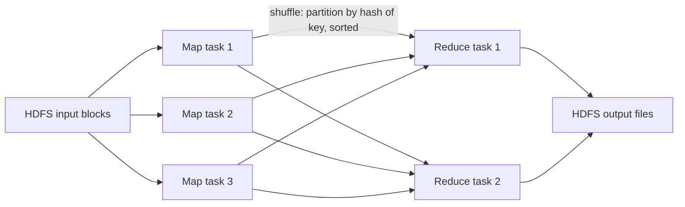

---
tags:
  - ddia/chapter-10
  - data-processing/batch
  - mapreduce
date: 2026-11-21
---

# Chapter 10: Batch Processing

**Summary.** Batch processing takes a large, bounded input, runs a job, and produces derived output, with throughput (not response time) as the main metric. The chapter starts with Unix pipelines and their philosophy (small tools, uniform interface, immutable inputs, logic separated from wiring), then shows MapReduce on a distributed filesystem (HDFS) as the same ideas at cluster scale. It covers how joins and grouping work by partitioning, sorting, and brings related data together (reduce-side and map-side joins), what batch jobs output, how Hadoop compares with MPP databases, and how dataflow engines (Spark, Tez, Flink) and Pregel-style graph processing improve on MapReduce.

> [!info] Reader assumed
> You know partitioning, replication, joins, indexes, and the OLTP vs analytics split from earlier chapters. This note is for fast revision.

## 1. Three kinds of systems

| Type | Input | Main metric | Example |
|---|---|---|---|
| Services (online) | A request from a waiting client | Response time, availability | Web server, database |
| Batch (offline) | Large bounded dataset, run on a schedule (minutes to days) | Throughput | MapReduce, log analysis |
| Stream (near-real-time) | Events shortly after they happen | Latency | Chapter 11 |

MapReduce (published 2004) was implemented in Hadoop, CouchDB, MongoDB. Its importance is declining, but it clearly shows why and how batch processing works. Batch computing is old: Hollerith punch-card machines in the 1890 US Census.

## 2. Batch processing with Unix tools

**Example: five most popular URLs from an nginx access log.**

```text
cat access.log | awk '{print $7}' | sort | uniq -c | sort -r -n | head -n 5
```

| Step | Does |
|---|---|
| `awk '{print $7}'` | Extracts the request URL (7th field) |
| `sort` | Puts identical URLs next to each other |
| `uniq -c` | Counts adjacent duplicates |
| `sort -r -n` | Sorts by count, largest first |
| `head -n 5` | Keeps top five |

Output looked like `4189 /favicon.ico`, `3631 /2013/05/24/improving-security-of-ssh-private-keys.html`, and so on. It processes gigabytes in seconds and is easy to adapt (change `$7` to `$1` for client IPs).

**Sorting vs in-memory aggregation.** A Ruby script with a hash table of counters works when the **working set** (distinct URLs plus counters, say under 1 GB) fits in memory. The `sort` pipeline wins when the working set exceeds memory: GNU `sort` spills to disk, merges sorted chunks (same idea as SSTables and LSM-trees, sequential I/O), and parallelizes across cores.

### The Unix philosophy

1. Make each program do one thing well.
2. Expect its output to become another program's input (no clutter, no interactive input).
3. Build and try early; throw away clumsy parts.
4. Prefer tools over unskilled help for lightening a task.

What makes composition work:

| Principle | Meaning in Unix | Caveat |
|---|---|---|
| Uniform interface | A file (byte sequence, usually newline-separated text) covers files, pipes, devices, sockets | Parsing fields is vague (`{print $7}` is unreadable); few other systems compose this well |
| Separation of logic and wiring | Programs use `stdin`/`stdout`; the shell wires them (loose coupling, late binding, inversion of control) | Multiple inputs/outputs and network connections are awkward |
| Transparency | Inputs are immutable; you can inspect any stage with `less` or save intermediate files and restart later stages | |

Biggest limit: Unix tools run on a single machine, which is where Hadoop comes in.

## 3. MapReduce and distributed filesystems

A MapReduce job is like a Unix process: reads inputs, writes outputs, does not modify input, and has no side effects besides output (written sequentially once).

**HDFS** (open source GFS clone; similar services: GlusterFS, QFS, S3, Azure Blob Storage, Swift):

- **Shared-nothing**: ordinary machines on an ordinary network, unlike shared-disk NAS/SAN appliances.
- A daemon on each machine serves its blocks; a central **NameNode** tracks which blocks live where.
- Blocks are replicated, or erasure coded (Reed-Solomon, lower overhead, like RAID over the network).
- Scale: tens of thousands of machines, hundreds of petabytes, at lower cost than dedicated appliances.

### How a job executes

Matching the log example:

1. Read input files and split into **records**.
2. **Mapper** called once per record, emits any number of key-value pairs, keeps no state between records.
3. Framework **sorts** all pairs by key (implicit).
4. **Reducer** called once per key with an iterator over all its values; emits output records.

A second sort (for example ranking by count) needs a **second job**: the mapper prepares data for sorting, the reducer processes sorted data.



Notice that every mapper sends a sorted partition to every reducer.

- One map task per input file block; the scheduler runs it on a machine holding a replica ("put the computation near the data"). Code (e.g. JARs) is copied to the machine.
- Number of reducers is chosen by the job author; a **hash of the key** decides which reducer gets a pair, so equal keys meet.
- Each mapper writes sorted, partitioned files on local disk; reducers fetch their partition from every mapper and merge them preserving order. This partition, sort, copy step is the **shuffle** (no randomness involved).
- Reducer output is written to the distributed filesystem (one local replica plus others).

### Workflows

- One job is limited (page views per URL, but not the top URLs). Jobs are chained by **directory name**: output dir of job 1 is input dir of job 2. This is like Unix commands writing temp files, not pipes.
- A job's output is valid only if it completes; a downstream job starts only after upstream jobs succeed. Schedulers: Oozie, Azkaban, Luigi, Airflow, Pinball. Recommendation workflows often have 50-100 jobs.
- Higher-level tools build such workflows automatically: Pig, Hive, Cascading, Crunch, FlumeJava.

## 4. Reduce-side joins and grouping

MapReduce has no indexes; it reads whole input (a full table scan). That is fine for analytics over many records. "Join" in batch means resolving **all** associations in the dataset, not looking up one user.

**Example (Fig 10-2):** join user activity events (fact table, only user IDs) with a user database (date of birth). Querying a remote database per event is too slow, nondeterministic, and can overload it. Instead, copy the user DB into HDFS (ETL) and join in the cluster.

**Sort-merge join (Fig 10-3):**

1. One set of mappers reads activity events and emits `user_id -> event`; another reads the user DB and emits `user_id -> date_of_birth`.
2. Partitioning and sorting by key puts the user record and that user's events together in one reducer call.
3. A **secondary sort** puts the user record first, then events by timestamp.
4. Reducer keeps the birth date in a local variable and outputs (URL, viewer age) for each event. Only one user record is in memory at a time; no network requests.

Key idea: the key is like a **destination address**. Mappers "send messages" to reducers, separating physical network communication from application logic, and the framework retries failed tasks transparently.

**GROUP BY** is the same pattern: mappers emit the grouping key, reducers aggregate (COUNT, SUM, top-k). **Sessionization** groups all of a user's events (by session cookie or user ID) from many server logs, e.g. for A/B tests.

**Handling skew.** A hot key (linchpin object, such as a celebrity with millions of followers) overloads one reducer, and the whole job waits for the slowest reducer.

| Technique | How |
|---|---|
| Pig skewed join | Sampling job finds hot keys; hot-key records go to random reducers, the other join side is replicated to all of them |
| Crunch sharded join | Same, but you list hot keys explicitly |
| Hive skewed join | Hot keys in table metadata, stored in separate files, joined map-side |
| Two-stage grouping | Stage 1 groups on random reducers into partial aggregates; stage 2 combines them |

## 5. Map-side joins

Reduce-side joins make no assumptions about the data but pay for sorting, copying, and merging. **Map-side joins** use map-only jobs (no reducers, no sorting) when you can assume something about the inputs:

| Variant | Requirement | How |
|---|---|---|
| Broadcast hash join | One input small enough for memory | Each mapper loads the small input into a hash table (or a read-only local-disk index cached by the OS), scans its block of the large input. Pig "replicated join", Hive "MapJoin", Impala |
| Partitioned hash join | Both inputs partitioned identically (same key, hash function, partition count) | Each mapper loads only the matching partition. Hive "bucketed map join" |
| Map-side merge join | Same partitioning **and sorted** by the key | Mapper merges both inputs incrementally; no memory limit |

- Output layout differs: reduce-side output is partitioned and sorted by join key; map-side output follows the large input's partitioning.
- Optimizing joins requires knowing physical layout (partition count, keys, sort order), tracked in HCatalog or the Hive metastore.

## 6. The output of batch workflows

Batch is neither OLTP nor plain analytics; the output is often some other data structure.

| Output | Notes |
|---|---|
| Search indexes | Google's original use (5-10 jobs). Mappers partition documents, reducers build each partition's index, files are immutable. Rebuild fully (simple, "documents in, indexes out") or build incrementally (Lucene segments; Chapter 11) |
| Key-value stores for ML and recommendations | Build the database files **inside** the job, then bulk-load into read-only servers (Voldemort, Terrapin, ElephantDB, HBase bulk load) |

**Do not write to a production database from tasks.** Reasons: a network round trip per record is far slower than batch throughput; parallel tasks can overwhelm the database; and external writes are visible side effects that break the all-or-nothing guarantee (partial jobs, retries, speculative execution). With bulk loading, Voldemort keeps serving old files, copies new ones, atomically switches, and can switch back.

**Philosophy: treat inputs as immutable and avoid side effects.**

- Bad code? Roll back and rerun, or keep old output in another directory and switch back ("human fault tolerance"). A read-write database cannot do this.
- Fast feature development (minimizing irreversibility).
- Failed tasks are retried safely because inputs are immutable and failed output is discarded.
- Same files feed multiple jobs, including monitoring jobs that compare outputs.
- Logic separated from wiring, so teams can reuse jobs.
- Unlike Unix text, Hadoop uses structured, schema-based formats (Avro, Parquet).

## 7. Hadoop vs distributed (MPP) databases

MPP databases (Gamma, Teradata, Tandem NonStop SQL) had the same parallel join algorithms a decade earlier. MPP focuses on parallel analytic SQL; MapReduce plus a DFS is closer to a general-purpose operating system.

| Aspect | MPP database | Hadoop (HDFS plus MapReduce and others) |
|---|---|---|
| Storage | Model data up front, import into proprietary format | Any bytes, dump first and interpret later (schema-on-read, data lake, "sushi principle": raw data is better) |
| Processing | Monolithic, tuned, SQL for analysts | Arbitrary code: ML, search indexes with ranking, image analysis; SQL is possible (Hive) |
| Mixing workloads | One model | Many engines on one cluster and shared files (HBase, Impala use HDFS without MapReduce) |
| Faults | Abort and rerun whole query (short queries, memory-heavy, hash joins) | Retry individual tasks, write to disk eagerly |

- Typical use: dump raw OLTP data to HDFS, clean it with jobs, load it into an MPP warehouse. Modeling still happens, but decoupled from collection.
- **Why MapReduce tolerates frequent task kills:** at Google, low-priority batch tasks share machines with production services and are preempted when higher-priority tasks need resources. A task running one hour has about 5% risk of termination (over an order of magnitude more than hardware failures); 100 tasks of 10 minutes each have over 50% chance that at least one is killed. Overcommitting resources improves utilization. YARN, Mesos, and Kubernetes did not support general priority preemption at the time, so the design makes less sense there.

## 8. Beyond MapReduce

Raw MapReduce is robust but laborious (you write joins yourself) and can be orders of magnitude slower than alternatives for some work. Pig, Hive, Cascading, and Crunch help but do not fix the execution model.

### Materialization of intermediate state

MapReduce **materializes** every job's output in the DFS. That suits data you publish for other teams, but is wasteful for intermediates:

- A job waits for **all** tasks of the previous job (stragglers), whereas Unix pipe stages run concurrently.
- Mappers are often redundant (re-read what a reducer just wrote).
- Intermediate files are replicated needlessly.

### Dataflow engines

Spark, Tez, Flink treat the whole workflow as one job with flexible **operators** (not strictly map and reduce). Connections between operators: repartition and sort (shuffle), repartition without sort (for hash joins), or broadcast.

Advantages over MapReduce:

- Sort only where needed.
- No redundant mappers.
- Scheduler sees all dependencies, so locality optimizations are possible.
- Intermediate state in memory or local disk, not HDFS.
- Operators start as soon as input is ready.
- JVM reuse reduces startup.

Pig, Hive, and Cascading workflows can switch to Tez or Spark by configuration. Tez is a thin library over the YARN shuffle service; Spark and Flink are full frameworks.

**Fault tolerance without durable intermediates:** recompute lost data from earlier stages or original input. Spark tracks ancestry with **RDDs**; Flink checkpoints operator state. Operators should be **deterministic**, or downstream operators must be killed and rerun. Hidden nondeterminism: hash-table iteration order, random numbers (use fixed seeds), system clock, external data. Recompute is not always best: materialize if intermediates are much smaller than the source or computation is CPU-heavy.

**Pipelining:** Flink is built around pipelined execution, closer to Unix pipes. Sorting must consume all input before output, but other stages can stream. Final output still goes to HDFS.

### Graphs and iterative processing

- Offline graph analysis, e.g. **PageRank**, repeatedly follows edges until a condition is met. Plain MapReduce is a single pass, so iterating needs an external scheduler looping jobs, and each iteration rereads the whole graph and rewrites a new dataset (inefficient).
- Dataflow engines' DAGs are not "graph processing": the DAG is the flow of operators, not the data.
- **Pregel / bulk synchronous parallel (BSP)** (Giraph, Spark GraphX, Flink Gelly): per iteration, a function runs for each vertex with its incoming messages; vertices keep state in memory between iterations and send messages along edges (like MapReduce's key-as-address, or actors but with durable, round-based delivery). Messages are delivered exactly once in the next iteration, with a barrier between iterations.
- Fault tolerance: checkpoint all vertex state each iteration and roll back to it (or recover just the lost partition if deterministic and messages are logged).
- Parallel execution: vertices are partitioned (often arbitrarily by vertex ID), so there is much cross-machine messaging and intermediate state can exceed the graph size. If the graph fits on one machine (memory, or disk with GraphChi), single-machine algorithms are likely faster.

### High-level APIs and languages

- Relational-style dataflow APIs (join, group, filter, aggregate) in Hive, Pig, Spark, Flink, with interactive shell use.
- **Declarative** joins let cost-based optimizers (Hive, Spark, Flink) pick the join algorithm and reorder joins.
- Unlike SQL, callbacks allow arbitrary code and libraries, which is what distinguishes these systems from MPP databases (whose UDFs are awkward).
- Adding declarative parts enables column-oriented reads and **vectorized execution** (Spark generates JVM bytecode, Impala uses LLVM), making batch frameworks resemble MPP databases while keeping flexibility.
- Domain-specific building blocks: ML (Mahout, MADlib), k-nearest neighbors and similarity search (also approximate search for genomics).

## 9. Summary

Two core problems frameworks solve:

| Problem | MapReduce | Dataflow engines |
|---|---|---|
| Partitioning | Mappers by input block; shuffle brings related keys together | Similar, but avoid sorting unless needed |
| Fault tolerance | Disk writes, restart single tasks; slower when no failures | More in memory, more recomputation; determinism helps |

Join algorithms recap: **sort-merge** (all inputs shuffled by key), **broadcast hash** (one small input), **partitioned hash** (same partitioning on both).

The restricted model (stateless callbacks, no side effects except the designated output) lets the framework retry safely and discard failed output, so the result is the same as if no faults occurred. That is much stronger than online services that write to databases as a side effect. A batch job's input is **bounded** (known size, so the job completes); Chapter 11 turns to unbounded streams.

## Common mistakes

| Mistake | What happens | Fix |
|---|---|---|
| Writing job output row by row to a live database | Slow, overloads the database, partial results visible | Build files in the job, bulk-load, switch atomically |
| Joining by querying a remote DB per record | Throughput limited by round trips, nondeterministic | Copy the data into the DFS, use a sort-merge or hash join |
| Ignoring hot keys | One reducer is slow, the job waits | Skewed or sharded join, two-stage aggregation |
| Nondeterministic operators in Spark or Flink | Recovery gives different data, cascading reruns | Seed randomness, avoid clocks and unordered iteration |
| Assuming a map-side join works on any data | Wrong or failing join | Check size, partitioning, and sort order first |
| Confusing a dataflow DAG with graph processing | Wrong tool | DAG describes operators; graph processing has a graph as data |

## Quick recall

- Batch: bounded input, derived output, throughput focus; inputs immutable, output replaces old.
- Unix philosophy (do one thing, uniform interface, logic separated from wiring) carries into MapReduce, with HDFS as the "file" interface.
- MapReduce: map, shuffle (hash partition and sort), reduce; chain jobs through directories; one map task per block, computation near data.
- Reduce-side joins: key is the destination address; secondary sort puts the user record first; sort-merge needs no assumptions but is costly.
- Map-side joins (broadcast hash, partitioned hash, merge) skip shuffle but need assumptions about size, partitioning, sort.
- Skew: sample hot keys, spread across reducers, replicate the other side.
- Output: search indexes and read-only key-value files built inside the job; never write remotely from tasks.
- Hadoop vs MPP: schema-on-read, arbitrary code, multiple engines, task-level fault tolerance driven by preemption.
- Dataflow engines avoid materialization, recompute lost data (RDD lineage, checkpoints), need determinism.
- Pregel/BSP: vertex messages in rounds with checkpointing; use a single machine if the graph fits.
- Declarative APIs plus optimizers make batch frameworks converge toward MPP databases.
