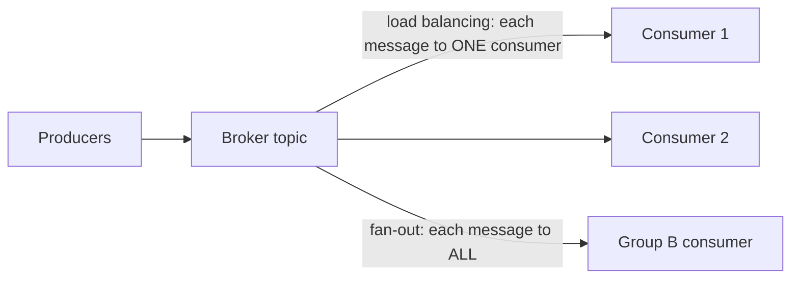
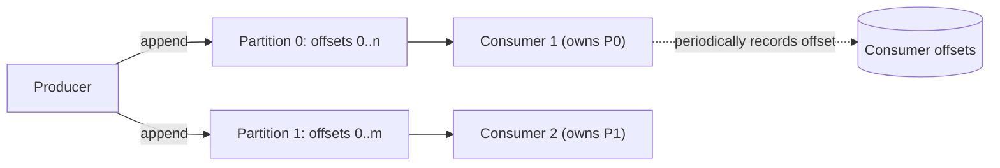
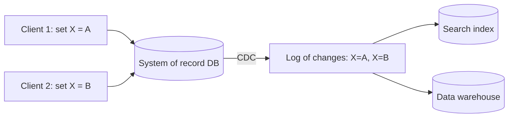
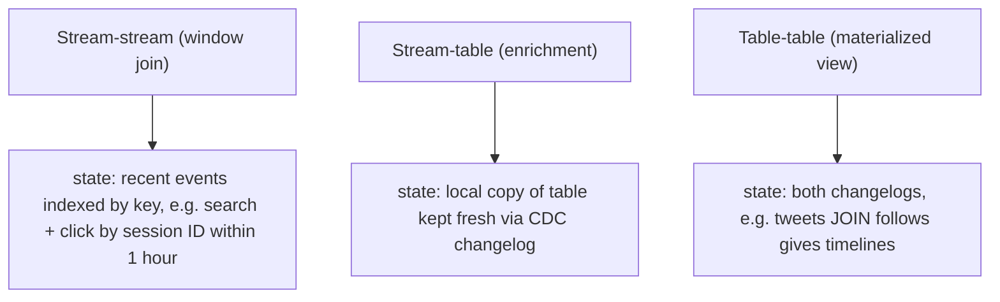

---
tags:
  - ddia/chapter-11
  - stream-processing
  - data-systems
date: 2026-11-21
---

# Chapter 11: Stream Processing

> [!abstract] Summary
> Batch jobs (Ch. 10) need bounded input. Real data is **unbounded**: it keeps arriving, so waiting for "all of it" never ends. **Stream processing** handles each event as it happens. The chapter covers how events are transported (message brokers vs log-based brokers), how database changes become streams (CDC, event sourcing), and how streams are processed (windows, joins, fault tolerance, exactly-once effects). Core theme: a durable, ordered **log** is the common thread between databases, replication, and messaging.

**Reader:** a backend engineer who knows queues, replication and batch basics.

## 1. Why streams

- Batch input is bounded; sorting (MapReduce) must read everything before producing output.
- Real data is unbounded. Batch gets around it by cutting artificial chunks (a day, an hour), so output lags by up to the chunk size.
- Stream processing removes the chunk: process every event as it happens. "Stream" = data made available incrementally over time (Unix `stdin/stdout`, lazy lists, TCP, video).

## 2. Transmitting event streams

| Batch world | Stream world |
|---|---|
| record in a file | **event**: small, self-contained, immutable record with a (time-of-day) timestamp |
| writer / reader job | **producer** (publisher) / **consumer** (subscriber) |
| file name groups records | **topic** (stream) groups related events |

- Polling a datastore for new events gets expensive at low latency (most polls return nothing). Better: notify consumers.
- Relational **triggers** exist but are limited, an afterthought. Hence dedicated messaging tools.

## 3. Messaging systems

Two questions distinguish systems:

1. **Producers faster than consumers?** Drop, buffer in a queue, or **backpressure** (block the producer; Unix pipes and TCP do this). If queueing: does it spill to disk, and what does that do to speed?
2. **Do crashes lose messages?** Durability costs disk writes/replication. Occasional lost sensor readings may be fine; lost counter events are not.

### Direct messaging (no broker)

UDP multicast (stock feeds, low latency), ZeroMQ/nanomsg, StatsD/Brubeck (UDP metrics, approximate), webhooks (HTTP callback). Fast, but the app must handle loss and consumers must be online. A crashed producer loses its retry buffer.

### Message brokers (message queues)

A server (essentially a database tuned for message streams) between producers and consumers. Durability moves to the broker; consumers are **asynchronous** (producer waits only for "buffered").

| Aspect | Database | Traditional message broker |
|---|---|---|
| Retention | until deleted | deleted after delivery and ack |
| Working set | any size | assumed small (short queues) |
| Finding data | secondary indexes, queries | subscribe to topic patterns |
| Change awareness | snapshot, must re-poll | **notifies** on new messages |

Standards/products: JMS, AMQP; RabbitMQ, ActiveMQ, IBM MQ, Azure Service Bus, Google Cloud Pub/Sub.

### Multiple consumers

- **Load balancing**: share work on expensive messages (AMQP: many clients on one queue; JMS: shared subscription).
- **Fan-out**: independent consumers each see everything (JMS topic subscription, AMQP exchange bindings). Can be combined via consumer groups.

### Acks and redelivery

Consumer must **ack**; no ack (closed connection or timeout) means redelivery to another consumer. An ack lost in the network means a duplicate (fixing that needs atomic commit).

> [!warning] Load balancing plus redelivery reorders messages
> Book example (Fig. 11-2): consumer 2 crashes on m3 while consumer 1 handles m4. m3 is redelivered, so consumer 1 sees m4, m3, m5. Fix: one queue per consumer (no load balancing). It matters only if messages are causally dependent.

## 4. Partitioned logs

**Problem:** AMQP/JMS receipt is destructive; a new consumer sees only future messages; you cannot rerun a consumer for the same result. **Idea:** combine database-style durable storage with messaging-style notification = **log-based message broker**.

- A **log** is an append-only record sequence. Producer appends; consumer reads sequentially and waits at the end (like `tail -f`).
- To scale, **partition** the log across machines. A topic = group of partitions. Each message gets a monotonically increasing **offset** per partition; ordering holds **within** a partition only.
- Examples: Apache Kafka, Amazon Kinesis Streams, Twitter DistributedLog. Millions of msgs/sec through partitioning and replication, even though everything is written to disk. Google Pub/Sub is architecturally similar but with a JMS-style API.

### Logs vs traditional messaging

| | JMS/AMQP style | Log-based |
|---|---|---|
| Fan-out | exchange/topic bindings | free: reading does not delete |
| Load balancing | per message | per **partition** to a consumer |
| Max parallelism | add consumers freely | at most number of partitions |
| Slow message | delays only that consumer | blocks the rest of its partition (head-of-line blocking) |
| Ordering | can be reordered on redelivery | preserved per partition |
| Best for | expensive messages, order unimportant | high throughput, fast messages, order matters |

### Consumer offsets

- Everything below the offset is processed, above is not. Broker records only offsets, not per-message acks: less bookkeeping, more batching.
- Offset resembles the **log sequence number** in leader-follower replication: the broker is the leader, the consumer the follower.
- Consumer failure: another node takes over its partitions from the last recorded offset. Messages processed after that offset get **processed twice**.

### Disk space and slow consumers

- Segments are deleted/archived, so the log is a large on-disk **ring buffer**.
- Book math: 6 TB disk at 150 MB/s sequential write fills in about **11 hours** at full speed; realistic loads give days or weeks of retention.
- Throughput stays roughly constant regardless of retention (always written to disk), unlike in-memory brokers that slow when spilling.
- A slow consumer falling off the end of the log loses messages, but only **that consumer** is affected. Monitor consumer lag and alert.
- Operational bonus: you can consume production logs for testing/debugging safely; a dead consumer leaves only an offset behind.

### Replaying

Consuming is **read-only**; only the offset moves, and you control it. Start a copy with yesterday's offsets, write output elsewhere, vary the code, repeat. This makes log-based messaging like batch: repeatable transformations and easy recovery from bugs.

## 5. Databases and streams

A replication log **is** a stream of write events. State machine replication: same deterministic events in the same order give the same state.

### 5.1 Keeping systems in sync

Real apps use an OLTP DB, cache, search index, warehouse: several copies of the same data. Options:

- **ETL / batch dumps**: slow.
- **Dual writes**: app writes each system itself. Two problems:
  - **Race**: client 1 sets X=A, client 2 sets X=B; the DB sees A then B, the search index sees B then A. They stay inconsistent forever with no error (Fig. 11-4).
  - **Partial failure**: one write succeeds, the other fails; fixing needs atomic commit (2PC, expensive).

Root cause: no single leader decides the order. Want one leader (the DB) and the others as followers.

### 5.2 Change data capture (CDC)

CDC observes all writes to a database and exposes them as a stream so derived systems (search index, warehouse, cache) consume it in the same order.

- Make one DB the leader, others followers. A log-based broker transports changes while **preserving order**.
- Implementation: **triggers** (fragile, overhead) or parsing the **replication log** (more robust; schema changes are hard).
- Tools named: LinkedIn Databus, Facebook Wormhole, Yahoo Sherpa, Bottled Water (Postgres WAL), Maxwell and Debezium (MySQL binlog), Mongoriver (MongoDB oplog), GoldenGate (Oracle).
- Usually **asynchronous**: slow consumers do not slow the source, but replication-lag issues apply.
- **Initial snapshot**: a full log history is rarely kept, so new derived systems need a consistent snapshot tied to a known log offset.
- **Log compaction**: keep only the latest value per key (tombstone = delete). Storage depends on current data size, not write count. A new consumer reads the compacted topic from offset 0 and gets a full copy. Kafka supports it, so the broker can serve as durable storage.
- **API support**: RethinkDB subscriptions, Firebase/CouchDB change feeds, Meteor (oplog), VoltDB export streams, Kafka Connect.

### 5.3 Event sourcing

Same "log of changes" idea at a different abstraction level.

| | CDC | Event sourcing |
|---|---|---|
| App uses DB | mutably (update/delete) | event log is append-only, no updates/deletes |
| Log captures | low-level row changes | application-level events (intent) |
| App aware? | no | yes, built on events |
| Log compaction | works: latest event per key replaces earlier | **not possible**: later events do not override earlier ones |

- Example: "student cancelled enrollment" is neutral and lets you chain a new feature ("offer place to next on waiting list").
- Current state is derived from events by a **deterministic** transform; snapshots are only a performance optimization.
- **Commands vs events**: a command may still fail; once validated it becomes an immutable **fact** (event). Consumers cannot reject events, so validate synchronously (e.g., serializable transaction) or split into tentative reservation plus confirmation events.

### 5.4 State, streams, immutability

- Mutable state and an append-only changelog are two sides of the same coin: state = integral of the event stream; stream = derivative of state (Fig. 11-6). Pat Helland: "The truth is the log. The database is a cache of a subset of the log."
- **Advantages of immutable events**: accountants add compensating entries rather than erasing (auditability); easier diagnosis and recovery from buggy code; captures extra information (item added then removed from cart).
- **Multiple views from one log**: build separate read-optimized views, run old and new side by side instead of schema migration. This is **CQRS** (separate write form from read forms); normalization vs denormalization debates matter less. Example: Twitter home timelines as a denormalized cache kept in sync by fan-out.
- **Concurrency control**: consumers are asynchronous, so read-your-writes can fail. Fixes: update view synchronously in one transaction, or use total-order-broadcast ideas. Upside: one event = one atomic append; with same-partitioning of log and state, a single-threaded consumer needs no write concurrency control.
- **Limits of immutability**: heavy update/delete churn on small data makes history grow and compaction/GC critical. Legal or privacy deletion needs real rewriting (Datomic *excision*, Fossil *shunning*); truly deleting is hard (SSDs, filesystems, backups). Deletion is "making it harder to retrieve" rather than impossible.

## 6. Processing streams

Three things to do with a stream: (1) write to a DB/cache/index, (2) push to humans (alerts, dashboards), (3) produce derived output streams via an **operator/job**. Read-only input, append-only output, like Unix/MapReduce. Key difference from batch: it **never ends**, so no sorting, no sort-merge joins, and fault tolerance cannot "restart from the beginning".

### 6.1 Uses

| Use | Idea | Notes |
|---|---|---|
| **Complex event processing (CEP)** | search for event **patterns**, like regex over events | queries stored long-term, events flow past them (reverse of a DB); Esper, IBM InfoSphere Streams |
| **Stream analytics** | aggregates over **windows**: rates, rolling averages, trend comparisons | may use approximations (Bloom filter, HyperLogLog); approximation is an optimization, not inherent to streaming |
| **Materialized views** | keep caches/indexes/state up to date | needs a window back to the beginning of time; Samza and Kafka Streams use compacted topics |
| **Search on streams** | stored queries, documents flow past (Elasticsearch percolator) | index the queries to avoid testing every one |
| **Message passing / RPC** | actors: ephemeral, one-to-one, cyclic; streams: durable, multi-subscriber, acyclic | Storm distributed RPC; actor frameworks often lack crash-safe delivery |

### 6.2 Reasoning about time

- Batch uses timestamps embedded in events (deterministic). Many stream frameworks use **processing time** (local clock): simple, but wrong under lag.
- **Event time vs processing time** (Star Wars release order analogy). Delay causes reordering (events from server B can arrive before A's). Fig. 11-7: after a one-minute restart, a processing-time rate shows a dip then a spike (18 vs the real steady 10) while the true rate never changed.
- **Knowing when a window is complete**: you cannot be sure. Stragglers can be (a) ignored with a dropped-event metric and alert, or (b) corrected by publishing an updated value (possibly retracting the old one). A special "no more events before t" message works but must be tracked per producer.
- **Whose clock?** A mobile app buffers events offline for hours or days and its clock may be wrong. Log three timestamps: event time (device clock), send time (device clock), receive time (server clock). Receive minus send estimates the device-to-server offset; apply it to the event time.

### 6.3 Window types

| Window | Rule | Example |
|---|---|---|
| **Tumbling** | fixed length, no overlap, each event in exactly one | 1 min: round timestamp down to the minute |
| **Hopping** | fixed length, overlapping | 5 min window, hop 1 min: 10:03:00-10:07:59, then 10:04:00-10:08:59 |
| **Sliding** | all events within some interval of each other | events at 10:03:39 and 10:08:12 are under 5 min apart, so they share a window |
| **Session** | no fixed length; ends after inactivity | no events for 30 min closes the user's session |

### 6.4 Stream joins

- **Stream-stream**: click-through rate from search and click events with the same session ID. The click may never come, may take days, or may arrive before the search; hence a window (say 1 hour). Emit "clicked" on match, "not clicked" when the search expires. Embedding search details in click events is not equivalent (loses un-clicked searches).
- **Stream-table**: enrich activity events with user profiles. A remote lookup per event is slow and risks overloading the DB; use a local copy (like a map-side hash join) kept current by the profile **changelog**. The table side is effectively an infinite window with newer versions overwriting older.
- **Table-table**: Twitter timeline cache = materialized view of `tweets JOIN follows`. Maintained on tweet send/delete and follow/unfollow. Change of tweets joins current followers; change of followers joins current tweets (product rule).
- **Time-dependence**: order across streams/partitions is not guaranteed, so joins can be **nondeterministic**. Example: tax rate valid at sale date. Data-warehouse fix: **slowly changing dimension** (version ID per record version). Cost: **log compaction no longer possible**.

### 6.5 Fault tolerance

Batch gets "exactly-once" (better: **effectively-once**) because tasks retry and failed output is discarded. Streams cannot wait for completion.

| Technique | How | Limit |
|---|---|---|
| **Microbatching** (Spark Streaming) | tiny batches, about 1 s; trade scheduling overhead vs delay | implicit tumbling window by processing time |
| **Checkpointing** (Flink) | rolling state snapshots to durable storage, barriers in the stream; restart from last checkpoint, drop output after it | same |
| **Atomic commit** | outputs, state changes and ack/offset move all-or-nothing | internal to framework (Dataflow, VoltDB, planned Kafka); not XA across heterogeneous systems; amortize over many messages |
| **Idempotence** | repeating gives same effect; make non-idempotent ops so by storing the message offset with the write | needs same-order replay, deterministic processing, no concurrent writers, possible fencing on failover |

> [!warning] External side effects
> Microbatching and checkpointing give exactly-once only **inside** the framework. Once output leaves (DB write, email, external broker), a retry repeats the side effect unless you use atomic commit or idempotence.

**Rebuilding state after failure:** keep state in a remote DB (slow per message), or keep it local and replicate: Flink snapshots to HDFS; Samza and Kafka Streams write changes to a compacted Kafka topic; VoltDB processes each input redundantly on several nodes. Sometimes no replication is needed: replay a short window, or rebuild from a compacted CDC stream. No universal best trade-off.

## Common mistakes

| Mistake | What happens | Fix |
|---|---|---|
| Window by processing time | artificial spikes after restart or lag | use event time, handle stragglers |
| Dual writes to DB and index | permanent silent divergence | CDC from one source of truth |
| Expect more consumers than partitions to help | extra consumers idle | add partitions |
| Compact an event-sourced log like CDC | lose history needed for state | keep full events, snapshot instead |
| Assume checkpoints make emails exactly-once | duplicate side effects | idempotence or atomic commit |
| Load balance a queue and expect order | redelivery reorders | per-consumer queue or partitioned log |

## Check yourself

> [!question] Q1 · Why does a log-based broker allow replay but an AMQP broker does not?
>
> > [!success] Answer
> > AMQP deletes a message once it is acked, so consuming is destructive. In a log, reading is read-only and the only state is the consumer's offset, which you can rewind.

> [!question] Q2 · Why can't event-sourced logs use CDC-style compaction?
>
> > [!success] Answer
> > A CDC event holds the full new record, so the latest event per key suffices. An event-sourced event records intent, and later events build on earlier ones, so the full history is needed.

> [!question] Q3 · A stream-table join gives different results on rerun. Why, and what is the cost of fixing it?
>
> > [!success] Answer
> > Event order across streams is not fixed, so some events join the old table version, others the new. Version-identifying the records (slowly changing dimension) makes it deterministic but prevents log compaction.

## Quick recall

- Stream = unbounded events; batch chunks, streams process continuously.
- Brokers: AMQP/JMS (per-message ack, delete, may reorder) vs log-based (partitions, offsets, retained, replayable, order per partition).
- Backpressure, buffer, or drop when consumers are slow; logs are a big fixed disk buffer (6 TB at 150 MB/s is about 11 h).
- Dual writes cause races and partial failures; use CDC so one DB is leader.
- Log compaction keeps the latest value per key; enables rebuilding derived systems from offset 0.
- Event sourcing records intent as immutable facts; state is derived; CQRS separates write and read models.
- Use event time, not processing time; stragglers are ignored or corrected.
- Windows: tumbling, hopping, sliding, session.
- Joins: stream-stream (windowed), stream-table (local table via CDC), table-table (materialized view); time-dependence makes them nondeterministic.
- Fault tolerance: microbatching, checkpointing, atomic commit, idempotence; state rebuilt from replicated local state or replay.
