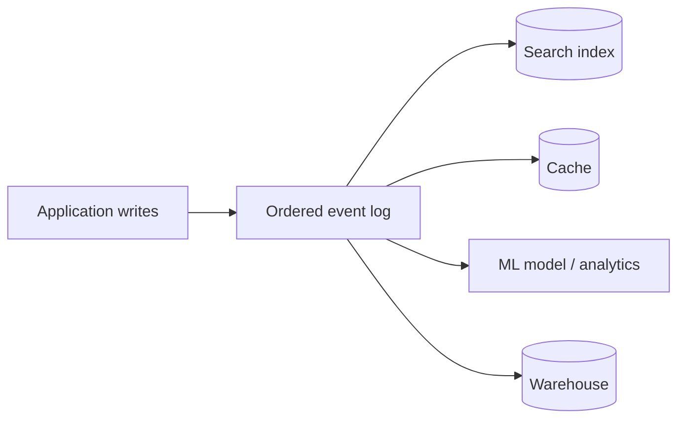
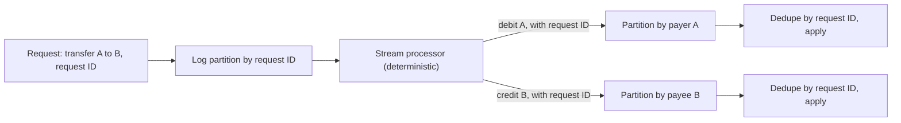

---
tags:
  - ddia/chapter-12
  - data-integration
  - correctness
  - ethics
date: 2026-11-21
---

# Chapter 12: The Future of Data Systems

> [!abstract] Summary
> The last chapter is the author's opinionated look at how data systems *should* be built. Because no single tool fits every workload, real applications combine several, and the right glue is **derived data**: one system of record, with indexes, caches, views and models derived from an ordered log of changes by batch and stream jobs. Taking this further, a database can be **unbundled** into composable, loosely coupled parts; application code becomes a derivation function in a **dataflow**; and correctness comes from **end-to-end** measures (request IDs, idempotence, async constraint checking, auditing) instead of distributed transactions. The book ends with ethics: predictive analytics, surveillance, consent and privacy.

**Reader:** backend engineer who has read (or knows) replication, transactions, batch and streams. Opinions here are the author's, flagged as such in the book.

## 1. Data integration

### Why combine tools

- Each software picks one approach to storage/query; every "general-purpose" DB is designed for a particular usage pattern. Data is used in many ways, so you end up composing several tools.
- Example: OLTP database plus full-text search index. PostgreSQL has basic full-text search; serious search needs specialist tools, but search indexes are poor systems of record.
- More copies appear: warehouses, caches, denormalized views, ML/ranking systems, notifications. Claims like "99% of people only need X" reflect the speaker's experience, not reality.

### Reasoning about dataflows

- Be explicit: where is data written first, and which representations derive from which?
- Best: write to a **system of record**, apply changes to the search index via CDC **in the same order**. If CDC is the only way into the index, it is consistent with the source (barring bugs).
- Letting the app write to DB and index directly brings back the Fig. 11-4 race (no one "in charge" of order).
- Principle: funnel all input through **one system that decides a total order**, then derive everything by processing writes in that order (state machine replication). CDC vs event sourcing matters less than choosing a total order.
- Derivation from a log can be deterministic and idempotent, so recovery is easy.

### Derived data vs distributed transactions

| | Distributed transactions (XA, 2PC) | Log-based derived data |
|---|---|---|
| Ordering of writes | locks (2PL), mutual exclusion | the log |
| Exactly-once effect | atomic commit | deterministic retry plus idempotence |
| Guarantees | usually **linearizable** (read-your-writes) | async, no timing guarantees by default |
| Fault behaviour | abort if any participant fails, amplifies failures | contains faults locally |

Author's view: XA has poor fault tolerance and performance, and log-based derived data is the most promising integration approach. But saying "eventual consistency is inevitable, deal with it" is unhelpful; later sections look for a middle ground.

### The limits of total ordering

A total-order log works at small scale (single-leader DBs do it), but breaks down when:

- throughput exceeds one machine (partitions have no order between them);
- multiple geographic datacenters (leader per DC, ambiguous cross-DC order);
- microservices with separate state (no defined order between services);
- offline-capable clients with local state (client and server see different orders).

Total order broadcast is equivalent to consensus; scaling it beyond one node and across regions is an open research problem.

**Capturing causality.** Example: a user unfriends someone, then posts a rude message to remaining friends. If friendships and messages live in different places, the notification service may process the message before the unfriend and notify the ex-partner (a join with timing issues). No simple answer; starting points: logical timestamps (still need out-of-order handling), logging the state the user saw before deciding and referencing that event ID (see "Reads are events too"), and conflict resolution (does not help external side effects like notifications).

### Batch and stream processing together

- Goal of integration: data in the right form in the right places. Batch and stream are the tools; the main difference is bounded vs unbounded input, and the line is blurring (Spark = streaming on a batch engine via microbatches; Flink = batch on a stream engine). Microbatching may do poorly on hopping/sliding windows.
- **Functional flavor**: deterministic pure functions, immutable inputs, append-only outputs; stream adds managed fault-tolerant state.
- Async maintenance is what makes log-based systems robust. Cross-partition secondary indexes are also most reliable and scalable when maintained asynchronously.
- **Reprocessing for evolution**: stream gives low delay; batch re-derives new views from history. Without reprocessing, schema changes are limited to adding an optional field or record type.

> [!tip] Railway gauge analogy
> 19th-century England standardized gauge in 1846 by adding a third rail (dual gauge), so both train types ran during migration. Likewise, keep old and new derived views side by side, shift users gradually, then drop the old view. Every step is reversible.

**Lambda architecture** (batch plus stream in parallel): stream gives a fast approximate view, batch later gives a corrected one, both from the same immutable event log.

| Strength | Practical problems |
|---|---|
| popularized immutable events plus derived views and reprocessing | same logic maintained in two frameworks (Summingbird abstracts it but ops stay hard) |
| batch seen as simpler, stream as approximate | two outputs need merging; hard for joins, sessionization, non-time-series |
| | frequent full reprocessing is costly, so batch becomes incremental, adding stream-like complexity |

**Unifying batch and stream** (needs): replay of history through the same engine, exactly-once semantics, windowing by **event time** (Apache Beam API running on Flink or Cloud Dataflow).

## 2. Unbundling databases

Databases, Hadoop and operating systems all store and process data. Unix gives thin low-level abstractions (files, pipes); relational DBs give high-level ones (SQL, transactions). NoSQL is read as the Unix-like approach for distributed OLTP.

### Databases already derive data

Secondary indexes, materialized views, replication logs and full-text indexes are built-in derivations. `CREATE INDEX` scans a consistent snapshot, sorts and writes the index, processes the write backlog, then keeps it updated. That is the same as setting up a follower or bootstrapping CDC (snapshot plus changes).

**Meta-database of everything:** org-wide dataflow looks like one huge database; batch/stream/ETL jobs act like trigger and materialized-view maintenance, and derived systems are like different index types, just run by different teams on different machines.

### Two ways to compose

| | Federated databases (unify **reads**) | Unbundled databases (unify **writes**) |
|---|---|---|
| Idea | one query interface over many stores (polystore); PostgreSQL foreign data wrapper | CDC and event logs keep writes in sync across systems |
| Tradition | relational: one system, high-level language | Unix: small tools, uniform low-level API (pipes), composed by a higher-level language |
| Difficulty | mapping data models (manageable) | keeping writes in sync (the harder problem) |

### Making unbundling work

- Cross-technology distributed transactions are the wrong tool. Use an **asynchronous event log with idempotent consumers**: simpler and feasible across systems written by different teams.
- Benefit is **loose coupling**: (1) system level: a slow/failed consumer is buffered by the log, fault contained, unlike synchronous transactions that spread failure; (2) human level: independent teams own components with well-defined interfaces.

### Unbundled vs integrated

- Unbundling will not replace databases (still needed for stream state and for serving outputs; MPP warehouses are great for exploration).
- Fewer moving parts is better; one integrated product can be more predictable. If one technology does everything you need, use it. The goal of unbundling is **breadth, not depth**; it matters only when no single product fits.
- **Missing piece:** a declarative "Unix shell" for composing stores, e.g. `mysql | elasticsearch` as the unbundled `CREATE INDEX`. Early research: differential dataflow.

## 3. Designing applications around dataflow

"Database inside-out" is a design pattern, not a new architecture. It overlaps with dataflow languages, functional reactive programming (Elm), logic programming (Bloom), and spreadsheets (VisiCalc, 1979), where changing a cell recalculates its dependents. Data systems should do this while being fault-tolerant, scalable and durable.

### Application code as derivation function

| Derived dataset | Function |
|---|---|
| secondary index | pick indexed fields, sort |
| full-text index | language detection, stemming, spell-fix, synonyms, inverted index |
| ML model | feature extraction plus statistics on training data |
| cache | aggregation shaped for the UI (UI change means rebuild) |

Standard ones are built in (`CREATE INDEX`); custom code is where databases are weak (triggers and stored procedures are afterthoughts).

### Separation of code and state

Databases are poor deployment environments (dependency management, rolling upgrades, monitoring, version control). Use Kubernetes, YARN, Mesos for code, databases for state: "separation of Church and state". Weakness: the DB is a passive mutable variable you can only poll, not subscribe to.

### Dataflow: state changes and code

Application code reacts to changes in one place by causing changes elsewhere. Maintaining derived data is **not** the same as async job execution:

- **Order matters**: views from one log must apply events in the same order; redelivery reordering and dual writes are ruled out.
- **Reliability matters**: one lost message means permanent divergence; in-memory actor state is not enough.

Stream operators compose like Unix pipes, each taking state-change streams and producing others.

**Stream processors vs microservices**. Same loose-coupling benefits, but streams are one-way async instead of synchronous request/response. Currency example: the microservice calls an exchange-rate service; the dataflow version subscribes to rate updates and keeps a **local** table, so a purchase does a local lookup. "The fastest and most reliable network request is no network request." It is a stream-table join, so time-dependence applies: reprocessing needs the historical rate.

### Observing derived state

- **Write path**: eagerly precomputed work as data arrives (like eager evaluation). **Read path**: work done on request (lazy evaluation). The derived dataset is where they meet.
- Index, cache and materialized view just **shift the boundary**: more write work to save read work.

| Option (search example) | Write path | Read path |
|---|---|---|
| no index, scan like `grep` | none | very expensive |
| inverted index | update terms | lookup and Boolean logic |
| precompute all queries | infinite | trivial (impossible) |
| cache of common queries | small extra | fast for common, index for rest |

Twitter timelines (Ch. 1) are the same trade-off, drawn differently for celebrities.

- **Stateful, offline-first clients:** on-device state is a **cache of server state**; screen pixels are a materialized view over model objects.
- **Push to clients:** server-sent events and WebSockets extend the write path to the end user. Offline devices catch up like consumers resuming from an offset. Elm and React/Flux/Redux already use event-sourcing-like client state. Obstacle: most datastores and frameworks assume request/response, not subscriptions. Chat and games already work this way.
- **Reads are events too:** route read requests through the stream processor as events; serving a read is a stream-table join (a subscribe is a persistent join). Logging reads aids causal tracking and provenance (what the user saw before buying: shipping date, stock), at extra storage and I/O cost.
- **Multi-partition processing:** queries touching many partitions can use stream routing and joins. Examples: Storm distributed RPC (people who saw a URL on Twitter = union of followers' sets) and fraud scoring across partitioned reputation DBs (IP, email, billing, shipping address). An MPP database is simpler if it suffices.

## 4. Aiming for correctness

Stateful systems remember mistakes forever, so correctness needs care. ACID transactions are weaker than they seem (weak isolation confusion; Jepsen found gaps between claims and behaviour). Serializability and atomic commit work, but typically in a single datacenter and limit scale.

### End-to-end argument

A strong DB does not protect against app bugs or retries.

**Exactly-once = idempotence.** Problem: a client sends COMMIT, the connection drops, and it does not know the outcome. Retrying the non-idempotent transfer from Example 12-1 could move **$22 instead of $11**. TCP dedup works only inside one connection; 2PC breaks the 1:1 transaction-connection link but does not fix the user-to-server hop (browser POST retry).

**Fix: operation ID end to end.** Generate a UUID (hidden form field, or hash of fields), pass it all the way to the DB, add `UNIQUE(request_id)` on a `requests` table. A second insert fails and the transaction aborts. Uniqueness constraints hold even at weak isolation, unlike check-then-insert. The `requests` table acts as an event log; balance updates can be derived downstream, exactly once.

**End-to-end argument** (Saltzer, Reed, Clark, 1984): a function can be fully implemented only with the endpoints' help; lower-level versions are performance enhancements. Applies to dedup, integrity (Ethernet/TCP/TLS checksums do not catch software or disk corruption), and encryption (WiFi or TLS do not equal end-to-end). Low-level features still help by reducing high-level faults.

Transactions collapse many failures into commit/abort, but are costly across heterogeneous stores; the right abstraction for app-level fault tolerance is not found yet.

### Enforcing constraints

- **Uniqueness needs consensus** (usernames, seat booking, non-negative balance, stock, room overlap). Usual way: one leader; scale by partitioning on the unique value (hash of username). Async multi-master is ruled out; rejecting violations immediately needs synchronous coordination.
- **Via log**: append requests to a partition by hash of the value; one single-threaded stream processor with a local table decides first-come, emits success/rejection on an output stream; the client waits for its result. Scales by adding partitions (any conflict-prone writes go to the same partition).

- **Multi-partition without atomic commit**: log the request as a single message (single-object writes are atomic), derive debit and credit instructions, dedupe by request ID. After a processor crash it replays from a checkpoint and produces the same duplicates, which step 3 discards. An extra processor partitioned by payer can validate balances before requests enter the log.

### Timeliness vs integrity

| | Timeliness | Integrity |
|---|---|---|
| Meaning | users see an up-to-date state | no corruption: no loss, no contradiction, derivations correct |
| Violation | temporary, fixed by waiting ("eventual consistency") | permanent ("perpetual inconsistency"), needs repair |
| Importance | annoying | **catastrophic** (usually more important) |

Examples: a recent card transaction not yet shown is fine; statement balance not equal to the sum of transactions, or money charged but not paid, is an integrity failure. ACID gives both; dataflow systems **decouple** them. Integrity via: single-message atomic writes, deterministic derivation, end-to-end request IDs, immutable messages with reprocessing.

### Loosely interpreted constraints

Many businesses tolerate temporary violation plus **compensating transactions** (apology): duplicate username, oversold stock (reorder, discount), overbooked flights/hotels, overdrafts (fee, daily limits). Whether the cost of an apology is acceptable is a business decision.

Write optimistically and check after, but validate before irreversible actions. These apps need integrity, not timely enforcement.

**Coordination-avoiding systems:** strong integrity without atomic commit, linearizability or cross-partition coordination; can run multi-leader across datacenters asynchronously. Serializable transactions only in small scope; no XA. Coordination reduces apologies for inconsistency but increases apologies for outages: find the sweet spot.

### Trust, but verify

- System models assume some faults never happen, but it is probabilities, not binary. Bit flips happen (crash reports only explained by memory corruption; rowhammer), disks corrupt silently, TCP checksums can miss errors. Even MySQL and PostgreSQL had bugs (uniqueness constraint, serializable write skew). App code is buggier and often misuses constraints.
- **Auditing**: verify data, restore backups to test them. HDFS and S3 continually read back files and compare replicas. Want **self-validating** systems; ACID culture bred blind trust.
- **Designing for auditability**: event sourcing keeps one immutable input event with deterministic derivation; hashes check event storage; rerun derivations (or run redundant ones) to compare; supports time-travel debugging and data provenance. End-to-end checks cover disks, networks, services, algorithms, and let you change systems with confidence.
- **Tools**: audit tables and HSM-signed logs are not enough. Blockchains and distributed ledgers (Bitcoin, Ethereum) are distributed DBs across mutually untrusting replicas; author is skeptical of Byzantine tolerance and proof of work, but finds integrity checking interesting. **Merkle trees** (hash trees) prove records exist; used in **certificate transparency**.

## 5. Doing the right thing

Engineers are responsible for consequences; datasets are about people and deserve dignity. A technology is neither good nor bad in itself.

| Topic | Key points |
|---|---|
| **Predictive analytics** | high-stakes uses (recidivism, loans, insurance) can create an "algorithmic prison": systematic exclusion with no proof of guilt and little appeal |
| **Bias** | models learn and amplify bias; correlated features (postal code, IP) proxy for protected traits; "machine learning is like money laundering for bias"; need moral imagination |
| **Accountability** | who is responsible for algorithmic errors? Credit scores reflect your past, ML asks "who is similar to you"; statistical output is wrong for individuals; need transparency and recourse |
| **Feedback loops** | echo chambers; credit-score-for-hiring spiral; use **systems thinking** |
| **Tracking and surveillance** | tracking as a side effect shifts users from customers to product when ads fund the service; replace "data" with "surveillance" as a thought experiment; microphones everywhere; insurance tied to trackers |
| **Consent** | users cannot understand what is collected or derived; the exchange is one-sided; opting out is not free when a service is socially essential or has network effects |
| **Privacy** | a decision right over what to reveal to whom; surveillance **transfers** that right to the company; privacy settings do not limit the service itself |
| **Data as power** | "data exhaust" is really the core asset; data brokers; governments want it; breaches happen; data is "toxic" or "hazardous"; consider all possible future governments |
| **Industrial Revolution analogy** | pollution needed regulation; Schneier: data is the pollution problem of the information age |
| **Legislation** | 1995 EU Data Protection Directive: specified, explicit, legitimate purposes, no excess; conflicts with Big Data exploration; regulation also risks blocking benefits like medical analytics |
| **Self-regulation** | culture shift: users are humans, not metrics; do not retain forever, **purge** when not needed (tension with immutability); enforce access with **cryptographic protocols** not only policy |

## Common mistakes

| Mistake | What happens | Fix |
|---|---|---|
| Rely on TCP/DB transactions for retry safety | duplicate operation across hops ($22 transfer) | end-to-end request ID, unique constraint |
| Dual-write DB and index | permanent divergence | single ordered log, derive the rest |
| Demand linearizable constraints everywhere | unnecessary coordination, lower availability | apologize and compensate where cost is acceptable |
| Treat all "consistency" the same | wrong trade-offs | separate timeliness from integrity |
| Maintain lambda in two codebases | double the bugs and ops | unified engine, event-time windows |
| Assume hardware, DB and backups are perfect | silent corruption found too late | continuous end-to-end auditing, test restores |

## Check yourself

> [!question] Q1 · Why is the write path / read path boundary useful?
>
> > [!success] Answer
> > Indexes, caches and materialized views move work from reads to writes (precompute). Choosing the boundary is the core trade-off, e.g., Twitter timelines or caching only common search queries.

> [!question] Q2 · How can you transfer money across two partitions without atomic commit?
>
> > [!success] Answer
> > Log one request message with a unique ID (single atomic append), derive a debit and a credit message from it, and have consumers dedupe by request ID. Replays reproduce the same messages deterministically.

> [!question] Q3 · Which matters more, timeliness or integrity, and why?
>
> > [!success] Answer
> > Usually integrity. Timeliness violations are temporary and fix themselves; integrity violations are permanent corruption needing repair.

## Quick recall

- No single tool fits all; compose via **derived data** from one system of record and an **ordered log**.
- Log-based async integration beats XA: loose coupling contains faults; trade-off is weaker timing guarantees.
- Total order has limits (scale, multi-DC, microservices, offline clients); causality is an open problem.
- Lambda architecture duplicates logic; prefer one engine with replay, exactly-once and event-time windows.
- Unbundling: federated reads plus log-based writes; goal is breadth, not outperforming one DB.
- Dataflow apps: code as derivation functions, stream joins instead of RPC, push changes to clients.
- Correctness is end to end: request IDs, idempotence, unique constraints, single-message writes.
- Timeliness is not integrity; keep integrity, relax timeliness, compensate with apologies.
- Trust but verify: audit, test restores, immutable events, Merkle-style checks.
- Ethics: bias, accountability, feedback loops, surveillance, consent, privacy as decision right, purge data.
